<!--# This is a template for how to document the indicator analyses. Make sure also to not change the order, or modify, the headers, unless you really need to. This is because it easier to read if all the indicators are presented using the same layout. If there is one header where you don't have anything to write, just leave the header as is, and don't write anything below it. If you are providing code, be careful to annotate and comment on every step in the analysis. Before starting it is recommended to fill in as much as you can in the metadata file. This file will populate the initial table in your output.-->

<!--# Load all you dependencies here -->

```{r setup}
#| include: false
#| cache: false
library(knitr)
library(tidyverse)
library(kableExtra)
library(here)
library(anybadger)
library(yaml)
library(tibble)
library(conflicted)
# weird workarounds for cache issues
conflicts_prefer(dplyr::filter)
conflicts_prefer(dplyr::lag)
conflicts_prefer(dplyr::select)
pull<-dplyr::pull

knitr::opts_chunk$set(echo = TRUE)

```

```{r source}
#| echo: false
#| cache: false
source(here::here("_common.R"))
```


<!--# The following parts are autogenerated. Do not edit. -->

::: {layout-ncol="6"}

```{r statusBadge}
#| echo: false
status_badge(as.character(st))
```

```{r versionBadge}
#| echo: false
version_badge(my_version_number = as.character(version[[1]]))
```

```{r dataBadge}
#| echo: false
data_badge(as.character(badges[[1]]))
```

```{r codeBadge}
#| echo: false
code_badge(as.character(badges[[2]]))
```

```{r openScienceBadge}
#| echo: false
open_science_badge(as.character(badges[[3]]))
```

```{r licenseBadge}
#| echo: false
# The following inserts a badge specifying the GPL GNU version 3 license. ecRxiv recommends using this license, but you can decide to use another. Contact ecRxiv for help in insert a badge for a different license
license_badge()
```


::: 
 

> **Recommended citation**: `r paste(auth, " ", year, ". ", name, " (ID(s): ", folder_name, ") ", "v. ", version, ". ecRxiv: ", url, sep="")`


::: {.callout-tip collapse="true"}
## Metadata
```{r tbl-meta2}
#| tbl-cap: 'Indicator metadata'
#| echo: false
#| warning: false
meta |>
  dplyr::filter(Variable %in% c(
    "Indicator ID",
    "Indicator Name",
    "verbatimName",
    "Continent",
    "Country",
    "Ecosystem Condition Typology Class", 
    "Realm",
    "Biome",
    "Ecosystem",
    "verbatimEcosystem",
    "Year added", 
    "Last update",
    "Version",
    "Version comment",
    "Normalised",
    "Spatial aggregation pathway",
    "Precision")) |>   
  kable()

```
:::

::: {.callout-tip collapse="true"}

## Log

<!--# Update this logg with short messages for each update -->
- 15.06.2026 - Original PR

- 22.06.2026 - Complete draft of first version

- 09.11.2026 - Updating the first draft with comments from co-authors

- 13.11.2026 - Pull request for review by ecRxiv team
:::


<hr />

<!--# Document you work below.  -->

## 1. Summary

<!--# 
With a maximum of 300 words, describe the indicator in general terms as you would to a non-expert. Think of this as a kind of common language summary. Follow the four numbers sub-headers below. under point 2, it is possible under  include a bullet point list of the specific steps in the workflow. 
 -->

1. **Background and rationale**:

Birds are among the best-studied groups of organisms and a key part of global biodiversity, so they provide extensive data for assessing biodiversity patterns and environmental change [@barrowclough2016many; @stork1997measuring]. Because they are visible, widespread and familiar, they are also effective for communicating environmental change to non-specialists [@bibby1999making; @santos2026geographical]. Birds support ecosystem functioning through seed dispersal, pollination, pest regulation and nutrient cycling, which links them to human well-being [@whelan2015birds; @mariyappan2023ecological; @wenny2011need]. Bird communities also respond to environmental variation and disturbance. Shifts in their distributions, abundance and demographic performance reflect land-use change, climate change, habitat degradation and changes in food availability [@rigal2023farmland; @johnson2011global; @tscharntke2023agriculture]. This sensitivity, together with long-running monitoring programmes, makes birds useful indicators of environmental change.

Breeding birds are particularly informative for ecosystem assessment, as their occurrence and reproductive performance depend closely on habitat, resources and conditions during the breeding season [@fuller2012bird; @alerstam1982bird]. Changes in breeding bird communities can therefore reveal variation in ecosystem composition and condition. However, using observed occurrence or community composition as a measure of condition requires accounting for imperfect detection, environmental heterogeneity and natural differences in species distributions. Occupancy models address these issues by separating the ecological process that determines whether a species is present from the observation process that determines whether it is detected. In addition, species differ in prevalence and in how they respond to the environment, so simply adding up occurrence probabilities is not enough to evaluate condition.

In this study, we developed an occupancy-based indicator of breeding bird community condition. We estimated occupancy probabilities for ecologically representative breeding bird species and compared them with expert-informed reference values defined for each species and nature region. Standardizing occupancy against these reference values and combining the results across species gives a spatially explicit measure of community condition. This measure accounts for natural differences among species and regions, so ecosystem condition can be compared across landscapes.

2. **Methods**:
<!-- What kind of data is used? How is the data customized (modified, estimated, integrated) to fit its purpose as an indicator? -->

<!-- What kind of data is used? How is the data customized (modified, estimated, integrated) to fit its purpose as an indicator? -->

- *Data used*: Long-term breeding-bird observations from the Norwegian terrestrial monitoring programme [Hekkefuglovervåkingen](https://hekkefuglovervakingen.nina.no/Fugl/Default.aspx?ReturnUrl=%2fFugl%2f) (formerly TOV-E), spanning multiple species, ecosystems and years [@kaalaas2022norsk].

- *Species selection*: Observations were restricted to expert-defined characteristic species for forest (32 species) and mountain (16 species) ecosystems. Species without an expert reference category were excluded from the indicator (31 forest and 14 mountain species remained).

- *Environmental covariates*: Covariates were projected and resampled onto a common 1 km grid (bilinear for continuous, nearest-neighbour for categorical variables) and extracted from the same raster stack at survey and prediction locations.

- *Occupancy modelling*: Observations were converted to detection/non-detection data and analysed with point-level occupancy models in `spOccupancy` [@doser2022spoccupancy], using surveys from 2020–2024 as temporal replicates to separate detection from occupancy. Single- and multi-species models were fitted, with and without spatial effects.

- *Model selection*: The configuration with the lowest WAIC was selected for the multi-species model and for each species in the single-species models. Model fit was assessed with posterior predictive checks.

- *Prediction*: Occupancy was predicted at 100,000 regularly spaced points within forest areas (CORINE Land Cover classes 311–313) and mountain areas (`fjell_grid50`).

- *Reference values*: Experts judged whether each species' occupancy under the reference condition, assuming perfect detection, would match or exceed its predicted occupancy. These judgements were linked to fixed quantiles (0.75 for *same*, 0.95 for *higher*) of predicted occupancy within each nature region, giving species- and region-specific reference values. Species without a reference category were excluded.

- *Scaling and aggregation*: Occupancy at each location was scaled linearly against its reference value and truncated to 0–1, so that occupancy at or above the reference value scores 1. Scaled values were then averaged across species. Regional estimates came from bootstrapped beta regressions and the national estimate from a beta mixed model with nature region as a random effect. Sensitivity was tested by varying the *same* quantile from 0.5 to 0.9.

- *Interpretation*: Values near 1 indicate that species, on average, occur at or above their reference levels, while values near 0 indicate a strong departure from the reference condition.


3. **Interpretation**:

<!-- Add a very short description of how the indicator values should be interpreted. Here's an example for a bumblebee indicator: An indicator value of 1 signifies an intact bumblebee community. Values decreasing toward zero reflect negative ecological change, specifically the decline of species expected to be present. This metric does not account for potentially positive changes, such as increases in species' abundance or the arrival of new species. Tip: Add text on the line directly following the subheader, and don't introduce blank lines. This way the whole paragraph renders as a block quote. -->
An indicator value of $1$ means that, on average, the characteristic breeding bird species of the forest or mountain ecosystem have occupancy probabilities at or above their expert-defined reference values for the nature region. Values decreasing toward $0$ indicate lower occupancy relative to these reference values, reflecting a decline of species expected under the reference condition. Because each species is scaled against its own reference value before averaging, common and rare species contribute equally. Scaled values are truncated at $1$, so occupancy above the reference value, or the arrival of species outside the characteristic species list, does not raise the indicator. The indicator is a model-based measure of condition relative to the expert-defined reference, not a census of species present, and should be read together with the species-specific reference values and the sensitivity analysis.


4. **Results and development needs**:
<!-- Briefly, what does the indicator say about the ecosystem condition. What is the current status of  the metric (can it be used or is it still in development), and what immediate tasks remain to improve the indicator or to make the indicator operational -->

The indicator expresses how closely the occupancy of characteristic breeding bird species matches an expert-defined reference condition, with $1$ meaning that species occur at or above their reference levels and $0$ a strong departure (@tbl-representativeVals). Nationally, the indicator was $0.67$ for forest and $0.59$ for mountain ecosystems. Forest ecosystems showed the largest regional variation: values were highest in the South ($0.74$), similar in the West, East and Central regions ($0.67$–$0.69$), and lowest in the North ($0.54$). Mountain ecosystems showed a narrower range, from $0.53$ in the West and $0.54$ in the South to $0.64$ in the North and East. The lower forest values in the North and at higher elevations partly reflect natural limits on where forest birds occur, and should not be read as degradation alone. Absolute values also depend on the expert-based reference choice: varying it lowered the national indicator by about $0.09$ in forest and $0.10$ in mountain, but the main regional contrasts were largely unchanged (@sec-sensitivity).

The indicator can be used to compare regions and to flag where the bird community lies further from its reference, with the caveats described in @sec-uncertainties. Model fit was poor for some widespread species, the reported intervals only reflect resampling of locations, and the indicator is based on a single time window (2020–2024) and therefore cannot yet show change over time. Priorities for further development are to (1) update the indicator as new monitoring data become available so that trends can be assessed, (2) review the expert reference values and the species with poor model fit, (3) include the uncertainty of the occupancy predictions in the reported intervals, and (4) agree guidance on how to interpret changes in indicator values in ecosystem assessments and management.


## 2. About the underlying data {#sec-underlyingData}

<!--# Give a general introduction the datasets you have used, and provide more specific details in the sub-chapters.  -->

The breeding bird indicator is derived from observations collected through the Norwegian national monitoring programme [Hekkefulgovervåkingen](https://hekkefuglovervakingen.nina.no/Fugl/Default.aspx?ReturnUrl=%2fFugl%2f). This long-term scheme provides standardized data on bird populations across Norway and forms a common foundation for all indicator calculations. To ensure that the indicators reflect specific ecosystem conditions, species are selected based on expert-defined lists that identify those most representative of each ecosystem type.

The monitoring programme was gradually established between $2005$ and $2011$ and currently includes nearly $500$ survey locations distributed across the country. Each location consists of multiple sampling points (typically $12–20$), and most sites are surveyed annually. Data collection is carried out largely by trained volunteer observers following a [standardized protocol](https://hekkefuglovervakingen.nina.no/Fugl/public/papirskjema/MethodologyEng.pdf), ensuring consistency across regions and years. Surveys are conducted once per year during the main breeding season (late May to early June), under suitable weather conditions.

At each sampling point, observers record all birds seen or heard within a fixed time period, while additional observations of selected species are noted during movement between points. The dataset typically includes records of over $200$ bird species. All observations are quality-checked and stored in a central [database](https://hekkefuglovervakingen.nina.no/Fugl/Default.aspx) managed by NINA.


### 2.1 Spatial and temporal resolution and extent

<!--# Describe the temporal and spatial resolution and extent of the data used -->

The indicator is based on data from the Norwegian breeding bird monitoring programme (Hekkefuglovervåkingen), which covers terrestrial ecosystems across the entire country. The monitoring network consists of $492$ fixed survey routes distributed along major latitudinal and altitudinal gradients, providing broad ecological representation. Each route includes $12–20$ point-count locations, resulting in approximately $9,000$ sampling points nationwide.

For this ecological indicator, data from $2020$ to $2024$ were used, providing a recent and consistent time window. The temporal resolution is annual, as each route is surveyed once during the breeding season. Due to logistical constraints, around $370$ routes are sampled each year, ensuring coverage of roughly $80\%$ of the total network.

The indicator is aggregated at the regional and national scale, reflecting the overall ecosystem condition across Norway.

### 2.2 Sampling design

<!-- How was the data sampled? Describe potential sampling biases -->

Bird data are collected using a standardized point-count survey design. Each route consists of a sequence of predefined counting points, typically spaced about 300 m apart and often arranged in a square-shaped layout (ca. $1.5$ km per side). At each point, observers record all birds seen or heard within a fixed observation period ($5$ minutes). In addition, selected species that are harder to detect are recorded while moving between points.

Surveys are conducted once per year during the peak breeding season (late May to early June), under suitable weather conditions. Data collection is largely carried out by experienced volunteer observers following a consistent protocol, ensuring comparability across sites and years.

Potential sources of sampling bias include variation in observer skill, uneven annual coverage of routes, and limitations in accounting for spatial structure in analyses. Furthermore, some habitats may be underrepresented due to accessibility constraints or terrain, which can influence detection probabilities and species representation.

### 2.3 Original units

<!--# What are the original units for the most relevant  variables in the data-->

During field surveys, observers record the number of individuals of each species seen or heard at each sampling point. For this indicator, these counts were converted to detection/non-detection data: a species was coded as detected (1) if one or more individuals were recorded at a sampling point in a given year, and as not detected (0) otherwise. Because each point is surveyed once per year, the surveys from 2020–2024 were treated as repeated survey occasions, assuming that occupancy did not change over this period.

**ADD DATAFRAME OF DATASET ENCOUNTER HISTORIES FOR SOME OF THE SPECIES.**

This transformation gives a standardized response suited to occupancy modelling and shifts the focus from the number of individuals to whether a species is present. The count data contain many zeros, particularly for rare species. Detection/non-detection data are less sensitive to this and to variation in flock size than the raw counts. The repeated surveys allow the models to separate the probability that a species occupies a site from the probability that it is detected when present. The detection/non-detection data were analysed with point-level occupancy models to estimate species-specific occupancy probabilities, corrected for imperfect detection. These probabilities were then predicted across each ecosystem, scaled against species- and region-specific reference values, and averaged across species to produce the ecosystem-level ecological indicator.


### 2.4 Instructions for citing, using and accessing data

<!--# Is the data openly available? If not, how can one access it? What are the key references to the datasets?   -->

The data are publicly available on [GBIF](https://www.gbif.org/dataset/4a00502d-6342-4294-aad1-9727e5c24041) [@breedingBirdData].


## 3. Indicator properties

The ecological indicator was calculated as the mean of species-specific occupancy probabilities, adjusted for imperfect detection ($p < 1$) through occupancy modelling and subsequently scaled against expert-elicited, species-specific reference values defined for each nature region. Specifically, the indicator at location $j$ was calculated as

$$
I_j = \frac{1}{S_j}\sum_{s=1}^{S_j} \min\left(1,\frac{\psi_{sj}}{\psi^{\mathrm{ref}}_{sr}}\right),
$$

where $S_j$ is the number of species included at location $j$, $\psi_{sj}$ is the estimated occupancy probability of species $s$ at location $j$, and $\psi^{\mathrm{ref}}_{sr}$ is the expert-informed reference occupancy value ($x_{100}$) for species $s$ in nature region $r$, with $j$ located in region $r$.

This approach accounts for species-specific differences in detectability and natural occupancy patterns while placing all species on a common scale ranging from 0 to 1. By averaging the reference-scaled occupancy probabilities, each species contributes equally to the indicator, irrespective of its natural prevalence. Consequently, both common and rare species can contribute to the assessment of ecosystem condition without the indicator being dominated by naturally widespread species.

### 3.1 Ecosystem Condition Typology Class (ECT)

<!--# Describe the rationale for assigning the indicator to the ECT class. See https://oneecosystem.pensoft.net/article/58218/
This doesnt need to be very long. Maybe just a single sentence. -->

B1 – Compositional state characteristics.


### 3.2 Ecosystem condition characteristic

<!--# 

Describe the ecosystem condition characteristic represented in the indicator. See 10.3897/oneeco.6.e58218 for information on what these characteristics might be.
For example, and indicator called 'Trenching in mires' could be made to represent an ecosystem characteristic 'Intact hydrology'. The term 'characteristic' is used similar to the term 'criteria' in Multiple Criteria Decision Making.  

-->

The indicator represents the ecosystem characteristic *intact breeding bird community composition* and belongs to the compositional state class (biotic) of the SEEA Ecosystem Condition Typology [@czucz2021common]. It describes how closely the occupancy of characteristic breeding bird species in forest and mountain ecosystems approaches their expert-defined reference levels. High values indicate that characteristic species occupy the landscape at or near reference levels. Lower values indicate that characteristic species are reduced or missing, which reflects a departure from the reference condition.

### 3.3 Collinearities with other indicators

<!--# Describe known collinearities with other metrics (indicators or variables) that could become problematic if they were also included in the same Ecosystem Condition Assessment as the indicator described here. -->

The breeding bird indicator may be correlated with other indicators of biodiversity and ecosystem condition because species-specific occupancy probabilities are predicted using environmental covariates, including habitat characteristics, topography and climate. Consequently, correlations with habitat-based indicators may partly reflect shared predictors rather than independent ecological responses. The indicator may also correlate with other bird-based indicators derived from the same monitoring data and with broader measures of ecosystem integrity [@Nater2025]. However, unlike conventional richness or abundance indicators, it uses species-specific occupancy probabilities scaled against expert-elicited reference values within nature regions, allowing common and rare species to contribute on a comparable scale. Correlations with indicators for other taxa may also occur where species respond to similar environmental gradients. Such overlap should be considered when combining indicators to avoid redundancy and disproportionate weighting of particular ecosystem attributes.


### 3.4 Impact factors

<!--# Describe the main natural and anthropogenic factors that affect the metric -->

The breeding bird indicator is influenced by a range of natural and human-driven factors that affect bird communities and their habitats.

- Natural factors:

  - Climate variability (e.g. temperature, precipitation, and seasonal timing), which affects breeding success, migration, and food availability
  - Habitat heterogeneity and natural succession, influencing vegetation structure and nesting opportunities
  - Natural fluctuations in food resources, particularly insects and seeds
  - Predation and interspecific interactions, which can shape species presence and community composition

- Anthropogenic factors:

  - Land-use change (e.g. forestry, agriculture, urbanization), leading to habitat loss, fragmentation, or alteration
  - Climate change, altering species distributions, phenology, and ecosystem dynamics
  - Changes in land management practices, such as intensification or abandonment
  - Pollution and other environmental pressures that affect habitat quality and food resources.

Together, these drivers influence species occupancy and richness, making the indicator sensitive to both gradual environmental change and more abrupt disturbances.

### 3.5 Spatial aggregation

<!-- Describe in word the same aggregation pathway presented in the top yaml (the metadata). If you have scaled against the reference value, it is especially important to know if you did any avergaing or summations etc. beforehand. An example text for a rather simple case could be: "The variable is scaled at the initial polygon level and the point estimate is a area-weighted arithmetic mean of all polygins. There is no transformation, and truncation is not needed as the indicator becomes naturally bound between 0 and 1".  -->

Scaling is performed separately for each species at each prediction location, before aggregation. Species-specific occupancy probabilities are linearly scaled against expert-elicited reference values defined for each species and nature region, with a lower bound of 0 and truncation at 1. The scaled values are then aggregated using an unweighted arithmetic mean across species at each location, producing an indicator ranging from 0 to 1.

Regional estimates are obtained by fitting intercept-only beta regression models to bootstrap samples of the location-level indicator values within each nature region. The national estimate is derived from a beta mixed-effects model with nature region as a random effect, representing the expected condition of a typical region rather than an area-weighted national mean. Values of exactly 0 or 1 are adjusted to fall within the open interval (0, 1) before model fitting. The final point estimates are calculated as the means of the bootstrap estimates, with 95% bootstrap intervals obtained from their 2.5th and 97.5th percentiles.


## 4. Reference condition and levels

### 4.1 Reference condition

<!--# Define the reference condition (or refer to where it is defined). Note the distinction between reference condition and reference levels 10.3897/oneeco.5.e58216  -->

Following @keith2020conceptual, we distinguish between the *reference condition*, representing the ecological state against which ecosystem condition is assessed, and *reference levels*, representing the numerical indicator values associated with that condition. The reference condition was defined as the expected occupancy of characteristic breeding bird species in forest and mountain ecosystems under good ecological condition, based on expert judgement. Experts assessed whether species occupancy under reference conditions, assuming perfect detection, would be similar to or higher than the model-estimated mean occupancy probabilities.

Expert assessments were translated into species-specific reference levels using predefined quantiles of predicted occupancy probabilities (0.75 for *same* and 0.95 for *higher*). Reference levels were calculated separately for each species and nature region to account for natural variation in occupancy across species and environmental gradients. Species without expert-defined reference categories were excluded. This approach provides a consistent reference framework without requiring undisturbed reference sites. However, because reference levels depend on expert judgement and model predictions, we assessed the sensitivity of the indicator by varying the quantile assigned to the *same* category from 0.50 to 0.90.

### 4.2 Reference levels

<!--# 

If relevant (i.e. if you have normalised a variable), describe the reference levels used to normalise the variable. 

Use the terminology where X~0~ refers to the reference level (the variable value) denoting the worst possible condition; X~100~denotes the optimum or best possible condition; and X~*n*~, where in is between 0 and 100, denotes any other anchoring points linking the variable scale to the indicator scale (e.g. the threshold value between good and bad condition X~60^). 

Why was the current option chosen and how were the reference levels quantified? If the reference values are calculated as part of the analyses further down, please repeat the main information here.

 -->

The variable normalised is the predicted occupancy probability ($\hat{\psi}_{sj}$) of each characteristic breeding bird species $s$ at prediction location $j$. Normalisation is performed separately for each species and nature region using two reference levels. **X~0~ (worst condition)** is set to 0, representing species absence, while **X~100~ (reference condition)** represents the species- and region-specific occupancy reference value derived from expert judgement. Experts assessed whether occupancy under reference conditions would be similar to or higher than model-estimated occupancy. These assessments were translated into the 0.75 (*same*) and 0.95 (*higher*) quantiles of predicted occupancy within each nature region. No intermediate anchoring points (X~n~) were used.

Occupancy probabilities are linearly scaled between X~0~ and X~100~, with values truncated at 1 when predicted occupancy equals or exceeds the reference level. The resulting scaled values are averaged across species at each prediction location to obtain the indicator. Defining reference levels separately for each species and nature region accounts for natural differences in occupancy and allows common and rare species to contribute on a comparable scale. Expert-informed reference levels were preferred over protected areas as proxies for reference conditions because protected status does not necessarily indicate good ecological condition. Since reference levels depend on the selected quantiles of model predictions, sensitivity was assessed by varying the quantile assigned to the *same* category from 0.50 to 0.90.

#### 4.2.1 Spatial resolution and validity

<!--# 

Describe the spatial resolution of the reference levels. E.g. is it defined as a fixed value for all areas, or does it vary. Also, at what spatial scale are the reference levels valid? For example, if the reference levels have a regional resolution (varies between regions), it might mean that it is only valid and correct to use for normalising local variable values that are first aggregated to regional scale. However, sometimes the reference levels are insensitive to this and can be used to scale variables at the local (e.g. plot) scale. 

 -->

The reference levels vary spatially. Experts gave one reference category per species for the whole of Norway, but the reference level is calculated separately for each nature region as the corresponding quantile of the species' predicted occupancy within that region. Each species therefore has one reference level per nature region, which is constant within the region and differs between regions. This accounts for natural differences in occupancy along environmental gradients. Scaling is applied at the level of individual prediction locations, using the reference level for the nature region in which the location falls. The scaled values are then averaged across species and aggregated to regional and national estimates without recalculating the reference levels. Locations outside all nature regions have no reference level and are excluded.


## 5. Uncertainties {#sec-uncertainties}
### 5.1 General uncertainties
<!--# Describe the main reasons why you might not trust 100% the final value to represent the given ecosystem characteristic for the give ecosystem type. What aspects of this condition metric are most sensitive to subjective decitions? Is the spatial sampling sufficient? Does the choice of modeling framework affect the values? Is the metric relevant do describe ecosystem condition for the give ecosystem type?  -->


Several sources of uncertainty affect the interpretation of the breeding bird indicator. Reference levels are derived from expert judgements translated into predefined quantiles of model-predicted occupancy within each nature region. Consequently, indicator values depend on both expert assessments and the selected quantiles rather than independently observed reference conditions. Because the reference values are quantiles of the model's own predictions within each region, the indicator measures how far occupancy at a location falls below what is typical or high for that species in the region. It does not measure departure from an independently observed reference state. If occupancy were reduced across a whole region, the reference values would be reduced with it and the indicator would not register the change. Natural gradients within a region, such as elevation and latitude, are also not removed by the scaling, so low indicator values at high elevations or in the north can partly reflect natural limits on species occurrence rather than poor condition. Species with reference values near $1$ or near $0$ contribute little to differences among locations. Sensitivity analyses showed that increasing the reference quantile for the *same* category from $0.50$ to $0.90$ reduced the national indicator from approximately 0.72 to 0.63 in forest and from 0.65 to 0.55 in mountain ecosystems, although regional rankings remained largely unchanged. Furthermore, truncating scaled occupancy values at 1 prevents occupancy above the reference level from contributing additional information, while the selection of characteristic species may not capture all dimensions of ecosystem condition.

The indicator also depends on the assumptions and predictive performance of the occupancy models, including the treatment of imperfect detection, temporal variation, environmental covariates and spatial structure. The models treat the five annual surveys (2020–2024) as repeated visits and assume that occupancy did not change over this period. Any real change in occupancy would therefore be absorbed into the detection estimates, and the indicator represents an average state for 2020–2024 rather than a single year. Posterior predictive checks indicated poor fit for seven of the 32 forest species and five of the 16 mountain species (@fig-forestPPC, @fig-mountainPPC), and several species had very low estimated detection probabilities (@fig-forestOccVrsDet, @fig-mountainOccVrsDet), so their occupancy estimates are less well supported by data. Only species with an expert reference category contribute to the indicator. Differences between single- and multi-species models, spatial and non-spatial formulations, and uneven survey coverage may influence predictions, particularly in poorly sampled habitats or regions. Spatial predictions are further constrained by the resolution and accuracy of environmental covariates and ecosystem boundaries. Additionally, the reported bootstrap intervals capture variation from resampling prediction locations but do not fully account for posterior uncertainty in occupancy estimates or spatial autocorrelation, potentially underestimating total uncertainty. Finally, because the indicator is based on species occurrence rather than abundance, reproductive success or demographic performance, it primarily reflects breeding bird community composition and should be interpreted alongside complementary indicators of ecosystem structure and functioning.


### 5.2 Reported uncertainties
<!-- Describe the nature of the errors you (hopefully) provide alongside the point estimate for the condition metric. It is especially important to clarify if the errors are inferential (referring to the uncertainty of the point estimate) or descriptive (referreing to the data itself). Here' an example text: "What we report as uncertainties in @tbl-finalTable are inferential and refer to the uncertainty around the point estimates. It does not directly describe variation in the data itself. 
However, the variation in the mean is defined by the spatial variation only, and quartiles are obtained by bootstrapping the set of localities within a region, and calculating the indicator for each of 9999 such samples".   -->

The reported uncertainties are inferential and refer to the uncertainty around the point estimates. They do not directly describe the spatial variation of the indicator among prediction locations. However, this uncertainty is derived only from spatial variation among locations, because it is obtained by resampling prediction locations within each region.

For each nature region, $500$ bootstrap replicates were drawn. Each replicate sampled up to $5\,000$ location values with replacement from the region (the interval width therefore depends on this number of values), fitted an intercept-only beta regression, and back-transformed the intercept to the 0–1 scale. For the national estimate, each replicate sampled up to $5\,000$ values with replacement within each region and fitted a beta mixed model with nature region as a random effect. The point estimate is the mean of the bootstrap replicates, and the 2.5% and 97.5% quantiles are reported as a 95% bootstrap interval. Replicates for which the model did not converge were discarded.

These intervals do not include the uncertainty of the occupancy predictions, because the indicator is calculated from posterior mean occupancy. They also do not account for spatial autocorrelation among neighbouring prediction locations, which are treated as independent. The intervals therefore understate the total uncertainty of the indicator and mainly reflect resampling variability among locations.

## 6. References

<!--# You can add references manually or use a citation manager and add intext citations as with crossreferencing and hyperlinks. See https://quarto.org/docs/authoring/footnotes-and-citations.html -->

::: {#refs}
:::

## 7. Import and prepare datasets

The workflow can be found in the GitHub repository: https://github.com/NINAnor/breedingBirdIndicator_OccupancyModelling.git. Download the code and save them in a folder that can be called to run this script (preferably in the relative path of this document using `here::here()`.

Afterwards, the following should be run to set the parameters needed to run the model. The parameters include:

```{r masterScript_setup}
#| echo: true
#| code-fold: true
#| eval: false
#| warning: false

# If you are using the OneDrive, specify all. But if you are running on
# your own local disk, specify youur woth USER in the 01_setPaths.R script

version <- 1

if (USER %in% c("server", "kwaku_parallel")) {
  args <- commandArgs(trailingOnly = TRUE)

  cat("Arguments received:\n")
  print(args)

  if (length(args) != 2) {
    stop(
      "Expected 2 arguments: version and option. Received: ",
      length(args)
    )
  }

  version <- as.integer(args[1])
  tpr <- as.logical(args[2])

  cat("version =", version, "\n")
  cat("use_option =", tpr, "\n")
}

source(here::here("scripts", "01_setPaths.R"))

dataFolder <- path_finder("dataFolder", user = USER)
geoSpatFolder <- path_finder("ninaGeospatialFiles", user = USER)
expertFolder <- path_finder("expertData", user = USER)
output_root <- normalizePath(
  path_finder("results", user = USER),
  mustWork = FALSE
)
archive_root <- normalizePath(
  path_finder("archive", user = USER),
  mustWork = FALSE
)


# ==============================================================================
# 3. LOAD PACKAGES AND SET TERRA OPTIONS
# ==============================================================================

library(terra)
library(lme4)
library(emmeans)
library(ggplot2)
library(dplyr)

terraOptions(
    memfrac = 0.5, # Fraction of available RAM
    memmax = 8, # Maximum memory allocation in GB
    threads = 4, # Number of processing threads
    parallel = TRUE,
    todisk = TRUE, # Prefer disk-based processing
    tempdir = "C:/terra_tmp",
    datatype = "FLT4S",
    progress = 3
)


################################################################################
# 2. Check required folders
################################################################################

if (!dir.exists(expertFolder)) {
  stop(
    paste(
      "Expert information directory not found:",
      expertFolder,
      "",
      "The expert species lists and grouping files are required.",
      "",
      "Please check that the expert data folder exists and that",
      "'expertData' is correctly set in scripts/01_setPaths.R.",
      sep = "\n"
    ),
    call. = FALSE
  )
}


################################################################################
# 3. Locale and function loading
################################################################################

# Ensure Norwegian characters are read correctly in expert input files.
Sys.setlocale("LC_CTYPE", "Norwegian_Norway.utf8")

# Load all project functions.
function_files <- list.files(
  path_finder("functions", user = USER),
  pattern = "\\.R$",
  recursive = TRUE,
  full.names = TRUE
)

invisible(lapply(function_files, source))


################################################################################
# 4. Analysis settings
################################################################################

# Ecosystem to model.
ecosystemType <- "Mountain" # Options: "Forest", "Mountain"

# Version label used in output folder names.
# For testing, I use version 1 for route ID effect, and version 2 withour ruote ID
version_label <- paste0("version_0", version)
use_route_random_effect <- TRUE
if (version == 2) {
  use_route_random_effect <- FALSE
}


# Pipeline switches.
fitModel <- FALSE
runPredictions <- FALSE
runIndicators <- FALSE
runPostprocessing <- TRUE
runMedianValues <- FALSE

# Model type switches.
fit_single_species <- FALSE # TRUE: PGOcc / spPGOcc per species
fit_spatial_model <- TRUE # TRUE: spatial NNGP model


# Coordinate reference system used throughout the modelling workflow.
modelCrs <- 25833

# Years included in the model.
modelYear <- c(2020, 2024)

# Temporary directory.
TEMPDIR <- "C:/terra_tmp"


# Setting the resolution
pred_resolution <- 500 # in metres¨
aggregation_spacing <- 1000

# Which column of predictions should be used to estimate indicators
indicator_col <- "mean"

# How many groups should be used in grouping the species
maxSpeciesInGrps <- 40

modelChecks <- TRUE # Should posterior predictive checks be included?
useExpertData <- TRUE # use expert data for reference values

################################################################################
# 5. Model covariates
################################################################################

covariateSelection <- readxl::read_excel(file.path(
  dataFolder,
  "Covariates",
  "covariatesCodingForModelling.xlsx"
)) |>
  # Use degree symbols (and fix spelling) in plot labels
  dplyr::mutate(
    `Covariate definition` = dplyr::recode_values(
      `Covariate definition`,
      "Slope (degrees)" ~ "Slope (\u00B0)",
      "Aspect (degrees)" ~ "Aspect (\u00B0)",
      "Latitude (degree North)" ~ "Latitude (\u00B0N)",
      "Temperature (degree celcius)" ~ "Temperature (\u00B0C)",
      default = `Covariate definition`
    )
  )

if (ecosystemType %in% "Forest") {
  # Detection covariates affect the observation process.
  det_covs <- covariateSelection$covariate[
    covariateSelection$forest_det == TRUE
  ]

  # Occupancy covariates affect the ecological state process.
  occ_covs <- covariateSelection$covariate[
    covariateSelection$forest_occ == TRUE
  ]
} else if (ecosystemType %in% "Mountain") {
  # Detection covariates affect the observation process.
  det_covs <- covariateSelection$covariate[
    covariateSelection$mountain_det == TRUE
  ]

  # Occupancy covariates affect the ecological state process.
  occ_covs <- covariateSelection$covariate[
    covariateSelection$mountain_occ == TRUE
  ]
}


################################################################################
# 6. MCMC settings
################################################################################

n.batch <- 1000
batch.length <- 25
n.burn <- 15000
n.thin <- 50 # ~200 samples per chain
n.chains <- 3

n.neighbors <- 3
n.omp.threads <- 8


################################################################################
# 7. Output paths
################################################################################

species_dir <- if (fit_single_species) {
  "single_species_model"
} else {
  "multiple_species_model"
}

spatial_dir <- if (fit_spatial_model) {
  "spatialModel"
} else {
  "non_spatialModel"
}

path_to_results <- file.path(
  output_root,
  "modelFit",
  version_label,
  ecosystemType,
  species_dir,
  spatial_dir
)

path_to_predictions <- file.path(
  output_root,
  "prediction_outputs",
  version_label,
  ecosystemType,
  species_dir,
  spatial_dir
)

path_to_indicators <- file.path(
  output_root,
  "indicators_outputs",
  version_label,
  ecosystemType,
  species_dir,
  spatial_dir
)

# if runPostprocessing, specify whether you are interested in comparing all outputs from
# the various models within the same ecosystem or that you are just interested in postprocessing
# for the current configurations
compareMultipleOutputs <- FALSE

if (!compareMultipleOutputs) {
  path_to_postProcessing <- file.path(
    output_root,
    "postProcessing_outputs",
    version_label,
    ecosystemType,
    species_dir,
    spatial_dir
  )
} else {
  path_to_postProcessing <- file.path(
    output_root,
    "postProcessing_outputs",
    "multipleOutputs",
    #version_label,
    ecosystemType
  )
}

path_for_logs <- file.path(
  output_root,
  "logs",
  version_label,
  ecosystemType,
  species_dir,
  spatial_dir
)

dir.create(path_to_results, recursive = TRUE, showWarnings = FALSE)
dir.create(path_to_predictions, recursive = TRUE, showWarnings = FALSE)
dir.create(path_to_indicators, recursive = TRUE, showWarnings = FALSE)
dir.create(path_for_logs, recursive = TRUE, showWarnings = FALSE)
dir.create(path_to_postProcessing, recursive = TRUE, showWarnings = FALSE)
```


<!--# All the data import and preparation should be done in this chapter, before the analysis chapter. As a minimum, add code for importing data, and describe or show the data structure. You may also explain certain variables, what they represent, and their distributions -->

Three datasets are used:

1. Breeding bird survey observations from Hekkefuglovervåkingen.
2. Expert-defined lists of characteristic species for each ecosystem.
3. Expert reference categories, used to define the reference values for scaling.

A vignette on loading and filtering breeding bird data is [here](https://github.com/NINAnor/breedingBirdIndicator_OccupancyModelling/blob/main/vignettes/data_preparation.qmd).

### Breeding Bird Monitoring (Hekkefuglovervåkingen)

<!--# Import and prepare the first dataset for analysis. Change the header from Dataset A to the name of the actual dataset. -->

See @sec-underlyingData for the data description.

The breeding bird observations are retrieved from the NINA monitoring database with `retrieve_breedingBirds_routesAndCounts()`. If a cached copy of the processed data exists, it is loaded instead. This allows the analysis to be reproduced without database access.

```{r breedingBirdData_setUp}
#| echo: true
#| code-fold: true
#| eval: false
#| warning: false

if (file.exists(breeding_bird_cache)) {
  # Load previously processed data
  breedingBirdData <- readr::read_csv(
    breeding_bird_cache,
    show_col_types = FALSE
  )
} else {
  # Retrieve routes, point locations and counts from the database
  breedingBirdData <- retrieve_breedingBirds_routesAndCounts(
    con             = con,             # connection to the NINA database
    dataFolder      = point_count_dir, # folder for saving and reading cached data
    overwrite_cache = FALSE,           # whether to overwrite cached data
    save_outputs    = TRUE,            # save processed data for later runs
    crs             = modelCrs         # coordinate reference system used for modelling
  )
}
```

The function retrieves survey routes, point locations and bird counts, and saves the processed result so that later runs do not need to query the database again.

### Ecosystem species list

<!--# Repeat the process for each dataset -->

Ecosystem indicators should represent the characteristic bird community of an ecosystem, not the whole bird fauna. The species list for each ecosystem was therefore defined by experts and is loaded with `retrieve_expertSpeciesList()`. The observations are then restricted to these species and to the modelling period.

```{r expertSpeciesData}
#| echo: true
#| code-fold: true
#| eval: false
#| warning: false

expertSpeciesData <- retrieve_expertSpeciesList(
  path_to_file = expert_data_path,
  ecosystem    = ecosystemType
)

# Characteristic species for the ecosystem
expertSpecies <- expertSpeciesData$expertSpeciesList$Species

# Restrict observations to the characteristic species and the modelling period
ecosystemBreedingBird <- breedingBirdData %>%
  dplyr::filter(
    Species %in% expertSpecies,
    Year >= modelYear[1],
    Year <= modelYear[2]
  )

# Quality check: number of records and species retained
nrow(ecosystemBreedingBird)
dplyr::n_distinct(ecosystemBreedingBird$Species)
```

The species list contains $18$ forest and $16$ mountain species (@tbl-expertReferenceVals). The filtered dataset `ecosystemBreedingBird` contains the survey observations, survey locations, species and survey years for the selected ecosystem and modelling period. The counts are converted to detection/non-detection data (1 if one or more individuals were recorded, 0 otherwise) and arranged in the format required by `spOccupancy`, with the survey years as repeated occasions.

### Expert reference categories

For each characteristic species, experts were shown the average occupancy probability estimated by the model. They were asked whether occupancy under the reference condition, assuming perfect detection, would be the same as (*samme*) or higher than (*høyere*) this estimate. Each category is linked to a fixed quantile of the species' predicted occupancy: $0.75$ for *samme* and $0.95$ for *høyere*. The reference value for each species is calculated as this quantile of predicted occupancy within each nature region (see @sec-refValues). Species without a reference category are excluded from the indicator.

The categories are read from the expert workbooks and converted to quantiles with `get_reference_quantiles()`:

```{r referenceData}
#| echo: true
#| code-fold: true
#| eval: false
#| warning: false

reference_data <- get_reference_quantiles(
  expert_folder  = expertFolder,
  ecosystem_type = ecosystemType,
  ref_quantiles  = reference_quantile_lookup() # samme = 0.75, høyere = 0.95
)
```

@tbl-expertReferenceVals shows the reference qcategory for each species and ecosystem.


<!--# All the data import and preparation should be done in this chapter, before the analysis chapter. As a minimum, add code for importing data, and describe or show the data structure. You may also explain certain variables, what they represent, and their distributions -->

Two primary data sources are used:

1. Breeding bird survey observations.
2. Expert-defined species lists.

A vignette on loading and filtering breeding bird data is [here](https://github.com/NINAnor/breedingBirdIndicator_OccupancyModelling/blob/main/vignettes/data_preparation.qmd).

### 7.1 Hekkefulgovervåkingen

<!--# Import and prepare the first dataset for analysis. Change the header from Dataset A to the name of the actual dataset. -->

See @sec-underlyingData for the data description. 

The breeding bird observations are retrieved directly from the database using the function a defined function `retrieve_breedingBirds_routesAndCounts`:

```{r breedingBirdData}
#| echo: true
#| code-fold: true
#| eval: false
#| warning: false

breedingBirdData <- retrieve_breedingBirds_routesAndCounts(
  con             = con, # connection to the NINA database
  dataFolder      = point_count_dir, #the direectory to save the data or retrived the catched data
  overwrite_cache = FALSE, # option to overwrite the catched data
  save_outputs    = TRUE,
  crs             = modelCrs # The crs for the modelling
)
```


This process retrieves survey routes, point locations, and bird counts and subsequently stores the processed results for future analyses.

Caching ensures that future executions can proceed without repeatedly querying the database.

### 7.2. Ecosystem species list

<!--# Repeat the process for each dataset -->

The ecosystem-specific species list is loaded using a defined function `retrieve_expertSpeciesList`:
```{r expertSciesData}
#| echo: true
#| code-fold: true
#| eval: false
#| warning: false
expertSpeciesData <- retrieve_expertSpeciesList(
  path_to_file = expert_data_path,
  ecosystem = ecosystemType
)

  # The selected species are extracted as:
  expertSpecies <-
  expertSpeciesData$expertSpeciesList$Species
  
  # Filter the data to the model year
  ecosystemBreedingBird <- ecosystemBreedingBird %>%
  dplyr::filter(
    Year >= modelYear[1],
    Year <= modelYear[2]
  )
```

We present the species suggested by the experts and included in the forest and mountain ecosystems in @tbl-expertReferenceVals. There are $32$ forest and $16$ mountain species in the species list. 

The dataset can be processed in a format that `spOccupancy` can use for the model fitting.

### 7.3. Expert-ellicited reference values

@tbl-expertReferenceVals shows the expert reference categories for the characteristic bird species in the forest and mountain ecosystem indicators. For each species, experts were shown the average occupancy probability estimated by the model. They then judged whether occupancy under the reference condition, assuming perfect detection, would be the same as (*samme*) or higher than (*høyere*) this estimate. Each category is linked to a fixed quantile of the species' predicted occupancy distribution: $0.75$ for *samme* and $0.95$ for *høyere*. A higher quantile means that the species is expected to occur more widely under the reference condition than the model currently predicts. For each species, the reference value is the corresponding quantile of predicted occupancy within each nature region. Predicted occupancy is scaled against this reference value, and the scaled values are averaged across species to form the indicator (see @sec-refValues). Species without a reference category are excluded from the indicator.

```{r}
#| label: tbl-expertReferenceVals
#| tbl-cap: "Characteristic breeding bird species in the forest and mountain ecosystems and their expert-assigned reference categories. Experts judged whether each species' occupancy under the reference condition, assuming perfect detection, would be the same as (samme) or higher than (høyere) the occupancy predicted by the model. The categories are converted to the 0.75 (samme) and 0.95 (høyere) quantiles of predicted occupancy within each nature region, which give the reference values used to scale the indicator."
#| echo: false
#| message: false
#| warning: false

library(dplyr)
library(knitr)
library(kableExtra)

# Load forest_experts_refs data
forest <- readxl::read_excel("../data/referenceValues/forest_experts_refs.xlsx", sheet = "Sheet 1") |>
  dplyr::select(`norsk navn`, Referanse) |>
  dplyr::mutate(`Ecosystem type` = "Forest") |>
  dplyr::rename(`Norwegian name` = `norsk navn`,
                `Reference category` = Referanse)

# Load mountain_experts_refs data
mountain <- readxl::read_excel("../data/referenceValues/mountain_experts_refs.xlsx", sheet = "Sheet 1") |>
  dplyr::select(`norsk navn`, Referanse) |>
  dplyr::mutate(`Ecosystem type` = "Mountain") |>
  dplyr::rename(`Norwegian name` = `norsk navn`,
                `Reference category` = Referanse)

# Load Artsutvalg_030626 data
species_list <- readxl::read_excel("../data/referenceValues/Artsutvalg_030626.xlsx", sheet = "Vurderinger") |>
  dplyr::select(`Vitenskapelig navn`, Populærnavn) |>
  dplyr::rename(`Scientific name` = `Vitenskapelig navn`,
                `Norwegian name` = Populærnavn)

ref_vals <- dplyr::bind_rows(forest, mountain) |>
  dplyr::left_join(species_list, by = "Norwegian name") |>
  dplyr::select(`Scientific name`, `Norwegian name`, `Ecosystem type`, `Reference category`)

knitr::kable(ref_vals) |>
  kableExtra::kable_styling(
    bootstrap_options = c("striped", "condensed"),
    full_width = TRUE
  ) |>
  kableExtra::scroll_box(height = "300px")

```

## 8. Spatial units

<!--# Describe the spatial units that you rely on in your analyses. Highlight the spatial units (the resolution) that the indicator values should be interpreted at. Potential spatial delineation data (maksing layers etc.) should be introduced under chapert 7. We recommend using the SEEA EA terminology of Basic Spatial Units (BSU), Ecosystem Asses (EA) and Ecosystem Accounting Area (EAA). -->

The analysis is conducted using spatial units aligned with the SEEA EA framework. The Basic Spatial Units (BSUs) are defined at a grid resolution of 100 m, which is the scale at which predictions of species occurrence are produced. Although environmental covariates are originally available at a coarser resolution (1 km), they are resampled to 100 m to match the resolution of the prediction grid and ensure spatial consistency in the modelling outputs. See this [Generating prediction points](https://github.com/NINAnor/breedingBirdIndicator_OccupancyModelling/blob/main/vignettes/generating_prediction_points.qmd) and [Covariate processing](https://github.com/NINAnor/breedingBirdIndicator_OccupancyModelling/blob/main/vignettes/covariate_processing.qmd) vignettes for further details.

```{r}
#| echo: true
#| code-fold: true
#| eval: false
#| warning: false
    
# Get the prediction region
source(here::here(
      "scripts",
      "02_pipeline",
      "01_dataPreparation",
      "02_getPredictionCoords.R"
    ))

# Get the covariates
    source(here::here(
      "scripts",
      "02_pipeline",
      "01_dataPreparation",
      "03_extractCovariates.R"
    ))

```

Ecosystem-specific predictions are constrained using ecosystem delineation layers (Ecosystem Assets, EA). For forest ecosystems, predictions are limited to areas classified under land cover classes 311–313, while for mountain ecosystems, predictions are restricted to mapped mountain polygons across Norway. This ensures that indicator values are calculated only within ecologically relevant areas.

The indicator is primarily interpreted at aggregated scales, such as regional or national Ecosystem Accounting Areas (EAA), where predictions from BSUs are combined. Although results are generated at fine spatial resolution (100 m), they are most robust and meaningful when summarized across larger spatial units that reduce local variability and align with the regional reference conditions.


## 9. Analyses

<!--# 

Use this header for documenting the analyses. Put code in separate code chunks, and annotate the code in between using normal text (i.e. between the chunks, and try to avoid too many hashed out comments inside the code chunks). Add subheaders as needed. 

Code folding is activated, meaning the code will be hidden by default in the html (one can click to expand it).

Caching is also activated (from the top YAML), meaning that rendering to html will be quicker the second time you do it. This will create a folder inside you project folder (called INDICATORID_cache). Sometimes caching created problems because some operations are not rerun when they should be rerun. Try deleting the cash folder and try again.

-->

We refer to these vignettes for details on the models and the calculation of the ecosystem indicator:

- [Bayesian Occupancy Modelling Framework for Breeding Bird Indicators](https://github.com/NINAnor/breedingBirdIndicator_OccupancyModelling/blob/main/vignettes/occupancy_modelling.qmd)
- [Working with Model Outputs](https://github.com/NINAnor/breedingBirdIndicator_OccupancyModelling/blob/main/vignettes/postProcessing_outputs.qmd)
- [Calculating Scaled Ecosystem Condition Indicators from Species Occupancy](https://github.com/NINAnor/breedingBirdIndicator_OccupancyModelling/blob/main/vignettes/indicator_estimation.qmd)

### 9.1. Occupancy models

#### 9.1.1. Fitting the models

Occupancy models were fitted to the detection/non-detection data with the `spOccupancy` package [@doser2022spoccupancy]. The models separate the probability that a species occupies a survey point from the probability that it is detected when present, with the survey years 2020–2024 as repeated occasions. Single-species and multi-species models were fitted, with and without spatial random effects to account for residual spatial dependence among survey points.

The function `fit_ecosystem_spoccupancy()` selects the `spOccupancy` function based on two arguments:

| `single_species` | `fit_spatial_model` | spOccupancy function |
| ---------------- | ------------------- | -------------------- |
| `TRUE`           | `FALSE`             | `PGOcc()`            |
| `TRUE`           | `TRUE`              | `spPGOcc()`          |
| `FALSE`          | `FALSE`             | `msPGOcc()`          |
| `FALSE`          | `TRUE`              | `spMsPGOcc()`        |

The following candidate models were fitted for each ecosystem:

| Candidate model | `single_species` | `fit_spatial_model` | Route random effect |
|:----------------|-----------------:|--------------------:|:--------------------|
| 1 | `TRUE`  | `FALSE` | No  |
| 2 | `TRUE`  | `FALSE` | Yes |
| 3 | `TRUE`  | `TRUE`  | No  |
| 4 | `TRUE`  | `TRUE`  | Yes |
| 5 | `FALSE` | `FALSE` | No  |
| 6 | `FALSE` | `FALSE` | Yes |
| 7 | `FALSE` | `TRUE`  | No  |
| 8 | `FALSE` | `TRUE`  | Yes |

The models are fitted by `01_modelFit.R`:

```{r fittingModel}
#| echo: true
#| code-fold: true
#| eval: false
#| warning: false

if (fitModel) {
  source(here::here(
    "scripts",
    "02_pipeline",
    "02_modelFit",
    "01_modelFit.R"
  ))
  Sys.sleep(60)
}
```

#### 9.1.2. Model checking and selection

Model outputs were extracted from the fitted models with `extract_model_outputs()`. These include occupancy and detection effects, community-level parameters for the multi-species models, and posterior predictive checks. Model fit was assessed with Bayesian p-values, where values near $0.5$ indicate adequate fit and values close to $0$ or $1$ indicate lack of fit. Species with poor fit were retained in the indicator, and the consequences are discussed in @sec-uncertainties.

```{r modelOutputs}
#| echo: true
#| code-fold: true
#| eval: false
#| warning: false

paths_df <- build_model_paths(
  output_root = output_root,
  version_label = version_label,
  ecosystemType = ecosystemType,
  existing_only = TRUE,
  include_single_species = c(TRUE, FALSE),
  include_spatial_model = c(TRUE, FALSE)
)

outputs <- extract_model_outputs(paths_df$path_to_results)

p_bayes <- plot(outputs, type = "error", components = "bayes_P")
```

Within each ecosystem, the candidate models were compared using the Watanabe–Akaike information criterion (WAIC). The multi-species model with the lowest WAIC was selected, and for the single-species models the candidate with the lowest WAIC was selected separately for each species. The selection is saved in `best_models.csv` and determines which model outputs are plotted and which predictions are used for the indicator.

WAIC values from single-species and multi-species models are not directly comparable. The indicator was therefore calculated for the best model from each framework, and the resulting predictions were compared for consistency in the magnitude and spatial distribution of occupancy. Where the two frameworks gave broadly similar predictions, the multi-species model was used for indicator estimation. Where they differed meaningfully, the predictions were assessed against model fit and ecological plausibility before the final model was chosen.

### 9.1.3. Predicting over the ecosystem region

Occupancy was predicted at $100\,000$ regularly spaced points within each ecosystem: forest areas from CORINE Land Cover (classes 311–313) and mountain areas from the Norwegian mountain layer (`fjell_grid50`). Covariates at the prediction points were extracted from the same raster stack used for model fitting. The posterior mean occupancy of each species was stored for every point.

```{r predictions}
#| echo: true
#| code-fold: true
#| eval: false
#| warning: false

if (runPredictions) {
  source(here::here(
    "scripts",
    "02_pipeline",
    "02_modelFit",
    "02_predictions.R"
  ))
}
```

### 9.2. Estimating the ecosystem condition indicator

#### 9.2.1. Nature regions and reference values

Reference values are calculated separately for each nature region, and the indicator is also summarised by these regions. The regions are aligned with the model coordinate reference system and saved as a GeoParquet file.

```{r natureRegions}
#| echo: true
#| code-fold: true
#| eval: false
#| warning: false

bio_regions <- get_nature_regions(
  input_file = gdb,
  modelCrs = modelCrs,
  output_file = file.path(
    dataFolder,
    "processedData",
    "nature_regions",
    "nature_regions.parquet"
  ),
  overwrite = FALSE
)
```

The expert reference categories (*samme* or *høyere*) are read from the expert workbooks and converted to reference quantiles ($0.75$ and $0.95$). Species without a reference category are excluded.

```{r referenceQuantiles}
#| echo: true
#| code-fold: true
#| eval: false
#| warning: false

reference_data <- get_reference_quantiles(
  expert_folder = expertFolder,
  ecosystem_type = ecosystemType,
  ref_quantiles = reference_quantile_lookup()
)
```

#### 9.2.2. Calculating the indicator

`calculate_scaled_ecosystem_richness_with_expert_data()` reads the predicted occupancy of each species and assigns each prediction point to a nature region. For each species and region, it calculates the reference value as the expert-assigned quantile of predicted occupancy. Predicted occupancy at each point is scaled linearly against this reference value and truncated at $1$, and the scaled values are averaged across species to give the indicator at each point.

Regional estimates are obtained with a bootstrap. In each of $500$ replicates, up to $5\,000$ point values are drawn with replacement from the region, an intercept-only beta regression is fitted, and the intercept is back-transformed to the 0–1 scale. The national estimate uses a bootstrap stratified by region and a beta mixed model with nature region as a random effect. We report the bootstrap mean and the 2.5% and 97.5% quantiles as a 95% interval. The indicator is calculated separately for the best multi-species and single-species models.

```{r estimatingIndicators}
#| echo: true
#| code-fold: true
#| eval: false
#| warning: false

scaled_indicator <- calculate_scaled_ecosystem_richness_with_expert_data(
  input_dir = path_to_predictions,
  reference_data = reference_data,
  categorisation_shape = bio_regions,
  ecosystem_type = ecosystemType,
  value_col = "occupancy_mean",
  region_col = "nature_region",
  output_dir = path_to_indicators,
  save_outputs = TRUE,
  overwrite = TRUE,
  rep_values_for_each_region = TRUE,
  n.boot = 500,
  boot.seed = 123,
  n.Samps = 5000
)
```

The full workflow, including both model groups and the combined summaries, is run by `03_estimating_indicators_using_expert_references.R`:

```{r runIndicatorScript}
#| echo: true
#| code-fold: true
#| eval: false
#| warning: false

source(here::here(
  "scripts",
  "02_pipeline",
  "02_modelFit",
  "03_estimating_indicators_using_expert_references.R"
))
```

#### 9.2.3. Sensitivity to the reference quantile

The quantile linked to each expert category is a subjective choice. To assess its influence, the indicator was recalculated with the quantile for *samme* set to $0.5$, $0.6$, $0.7$, $0.8$ and $0.9$, keeping *høyere* at $0.95$. The same bootstrap seed was used throughout, so differences reflect the quantile rather than bootstrap noise. To limit computing time, the sensitivity analysis used $100$ bootstrap replicates of up to $5\,000$ values.

```{r sensitivity}
#| echo: true
#| code-fold: true
#| eval: false
#| warning: false

sensitivity_results <- reference_quantile_sensitivity(
  quantile_values = c(0.5, 0.6, 0.7, 0.8, 0.9),
  category = "samme",
  input_dir = sens_pred_dir,
  expert_folder = expertFolder,
  ecosystem_type = ecosystemType,
  categorisation_shape = bio_regions,
  region_col = "nature_region",
  n.boot = 100,
  n.Samps = 5000,
  output_dir = sens_dir
)
```


## 10. Results

<!--# 

Repeat the final results here. Typically this is a map or table of indicator values.

This is typically where people will harvest data from, so make sure to include all relevant output here, but don't clutter this section with too much output either.

-->

This section reports what the models and the indicator show for forest and mountain ecosystems. We first describe the species-specific reference values (@sec-refValues), the indicator values (@sec-indicatorValues), how sensitive they are to the reference choice (@sec-sensitivity), how the indicator and the underlying occupancy and detection estimates relate to environmental variables (@sec-covariates and @sec-effects) and model selection and fit (@sec-modelSelection), then . All values are model-based estimates for 2020–2024 and should be read together with the uncertainties in @sec-uncertainties.


### 10.1 Reference values ($X_{100}$) {#sec-refValues}

In forest, a group of widespread species had reference values close to $1$ in all regions (for example willow warbler, chaffinch, marsh tit *Poecile montanus* and song thrush *Turdus philomelos*; see @fig-forestX_100). Other species had low reference values, particularly in the North (for example the Siberian jay *Perisoreus infaustus*, icterine warbler *Hippolais icterina*, wood warbler *Phylloscopus sibilatrix* and mistle thrush *Turdus viscivorus*). Forest species were thus more variable among regions than among mountain species, and the North region stood out with low reference values for many species. 

```{r fig-forestX_100}
#| fig-cap: 'Reference values ($X_{100}$) of each characteristic forest species in each nature region. $X_{100}$ is the expert-assigned quantile of the species occupancy predicted within the region, and ranges from 0 to 1. Species are rows and nature regions are columns; yellow indicates values near 1 and dark purple values near 0.'
#| out-width: 100%
#| echo: false
#| warning: false
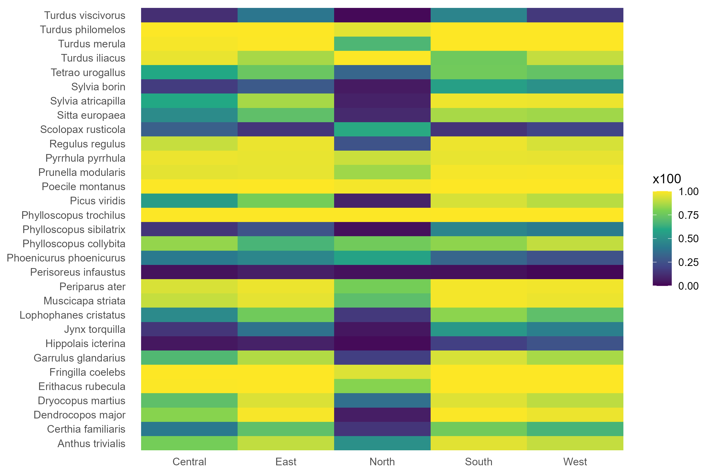
```

In mountain, four species (meadow pipit, European golden plover, northern wheatear and rock ptarmigan *Lagopus muta*; see @fig-MountainX100) had reference values near $1$ in all regions. Lapland longspur *Calcarius lapponicus* had values near $0$ in all regions except the North, and shore lark *Eremophila alpestris* and bluethroat *Luscinia svecica* had low values in most regions.

```{r fig-MountainX100}
#| fig-cap: 'Reference values ($X_{100}$) of each characteristic mountain species in each nature region. $X_{100}$ is the expert-assigned quantile of the species occupancy predicted within the region, and ranges from 0 to 1. Species are rows and nature regions are columns; yellow indicates values near 1 and dark purple values near 0.'
#| out-width: 100%
#| echo: false
#| warning: false
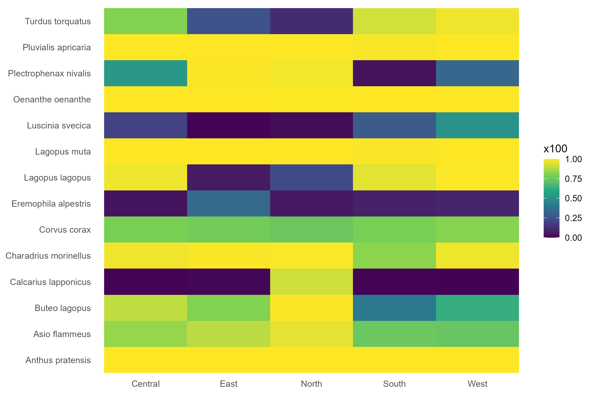
```

Reference values at or near $1$ mean that a species only adds to the indicator in the locations where its occupancy is clearly high. Species with very low reference values have the opposite effect: they reach a scaled value of $1$ at almost any location and therefore add little information about differences in condition.


Only species with an expert reference category contribute to the indicator. In the figures above, 31 of the 32 forest species and 14 of the 16 mountain species are shown (golden eagle *Aquila chrysaetos* is missing from both ecosystems, and common kestrel *Falco tinnunculus* from the mountain ecosystem).

### 10.2 Scaled indicator {#sec-indicatorValues}

#### 10.2.1 Regional values {#sec-regionalValues}

The indicator is the average, over species, of occupancy scaled against the reference value, so $1$ means that on average species occur at or above their reference levels and $0$ means a strong departure. Nationally, the indicator was $0.67$ for forest and $0.59$ for mountain (@tbl-representativeVals).

In forest, values were highest in the South ($0.74$) and similar in the West ($0.69$), East ($0.69$) and Central ($0.67$) regions. The North had the lowest value ($0.54$), clearly separated from the other regions. In mountain, regional differences were smaller. Values were highest in the North ($0.64$) and East ($0.64$), intermediate in Central ($0.57$), and lowest in the South ($0.54$) and West ($0.53$). Forest and mountain values should not be compared directly, because the two indicators use different species lists and different reference values.

The 95% bootstrap intervals in @tbl-representativeVals are very narrow (about $\pm 0.002$ to $\pm 0.004$). They only reflect resampling of prediction locations. They do not include the uncertainty in the occupancy predictions or the spatial dependence between nearby locations (see @sec-uncertainties), and should not be used to judge whether two regions differ. Differences of a few hundredths, such as West versus East in forest or North versus East in mountain, should be regarded as negligible.

```{r}
#| label: tbl-representativeVals
#| tbl-cap: "Regional and national estimates of the breeding bird indicator for the forest and mountain ecosystems. Values are the mean and the 2.5% (Lower) and 97.5% (Upper) quantiles of the bootstrap estimates. Regional estimates come from intercept-only beta regressions and the national estimate from a beta mixed model with nature region as a random effect. The indicator ranges from 0 to 1, where 1 means that, on average, species occupancy is at or above the reference values. The intervals reflect resampling of prediction locations only."
#| echo: false
#| message: false
#| warning: false

library(dplyr)
library(knitr)
library(kableExtra)

# Load representative_indicator_vals data
forest <- readr::read_csv("../data/forest/representative_indicator_vals.csv") |>
  dplyr::select(region, mean, lower, upper) |>
  dplyr::mutate(`Ecosystem type` = "Forest")

mountain <- readr::read_csv("../data/mountain/representative_indicator_vals.csv") |>
  dplyr::select(region, mean, lower, upper) |>
  dplyr::mutate(`Ecosystem type` = "Mountain")

indicator_vals <- dplyr::bind_rows(forest, mountain) |>
  dplyr::select(`Ecosystem type`, region, mean, lower, upper) |>
  dplyr::mutate(dplyr::across(c(mean, lower, upper), \(x) round(x, 3))) |>
  dplyr::rename(Region = region,
                Mean = mean,
                Lower = lower,
                Upper = upper)

knitr::kable(indicator_vals, digits = 3) |>
  kableExtra::kable_styling(
    bootstrap_options = c("striped", "condensed"),
    full_width = TRUE
  ) |>
  kableExtra::scroll_box(height = "300px")
```

#### 10.2.2 Sensitivity to the reference quantile {#sec-sensitivity}

The quantile linked to the expert category *samme* (same) and *høyere* (higher) is a subjective choice, so we tested quantiles from $0.5$ to $0.9$ for the expert category *samme* (the main results use $0.75$) keeping that of *høyere* fixed. Raising the quantile raises the reference values and lowers the indicator in all regions (@fig-forestSensitivity, @fig-mountainSensitivity). Nationally, the forest indicator decreased from about $0.72$ to $0.63$ and the mountain indicator from about $0.65$ to $0.55$. The decline was steepest in the forest North region (from about $0.62$ to $0.47$).

```{r fig-forestSensitivity}
#| fig-cap: "Sensitivity of the forest breeding bird indicator to the quantile linked to the expert category *samme*. The quantile was varied from 0.5 to 0.9, while the *høyere* quantile was kept at 0.95. The same bootstrap seed was used for every quantile, so differences reflect the quantile and not bootstrap noise."
#| fig-subcap:
#|   - "Indicator estimate and 95% bootstrap interval for each nature region and nationally, by *samme* quantile."
#|   - "Reference value ($x_{100}$) of each species in the *samme* category, by quantile. Species whose reference value is already close to 1 change little, whereas species with low occupancy over most of a region change most."
#| layout-ncol: 1
#| out-width: 100%
#| echo: false
#| warning: false

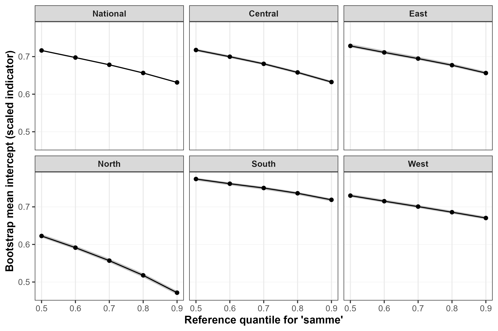
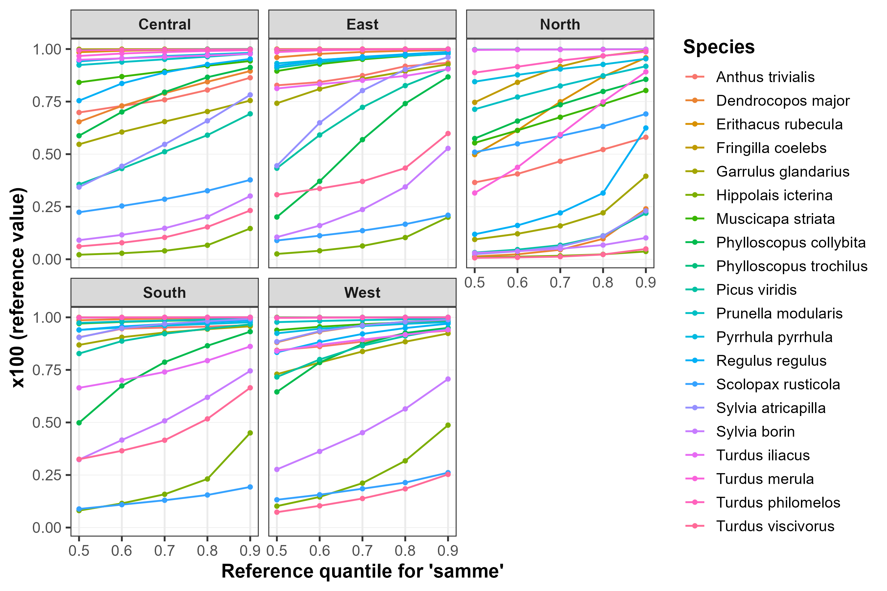
```

The ordering of regions was largely stable: the forest North region remained the lowest at all quantiles, and in mountain the North and East regions remained at the top, and the South and West regions at the bottom. Some regions that differ little in the main results, such as the mountain North and East, and the mountain South and West, became practically identical at a quantile of $0.9$. The absolute indicator values therefore depend on the reference choice, whereas the main regional contrasts do not. The sensitivity analysis used fewer bootstrap replicates and a smaller sample per region than the main analysis ($100$ replicates and $5\,000$ values), which does not affect the conclusion because the same bootstrap seed was used for every quantile.

```{r fig-mountainSensitivity}
#| fig-cap: "Sensitivity of the mountain breeding bird indicator to the quantile linked to the expert category *samme*. The quantile was varied from 0.5 to 0.9, while the *høyere* quantile was kept at 0.95. The same bootstrap seed was used for every quantile, so differences reflect the quantile and not bootstrap noise."
#| fig-subcap:
#|   - "Indicator estimate and 95% bootstrap interval for each nature region and nationally, by *samme* quantile."
#|   - "Reference value ($x_{100}$) of each species in the *samme* category, by quantile. Species whose reference value is already close to 1 change little, whereas species with low occupancy over most of a region change most."
#| layout-ncol: 1
#| out-width: 100%
#| echo: false
#| warning: false

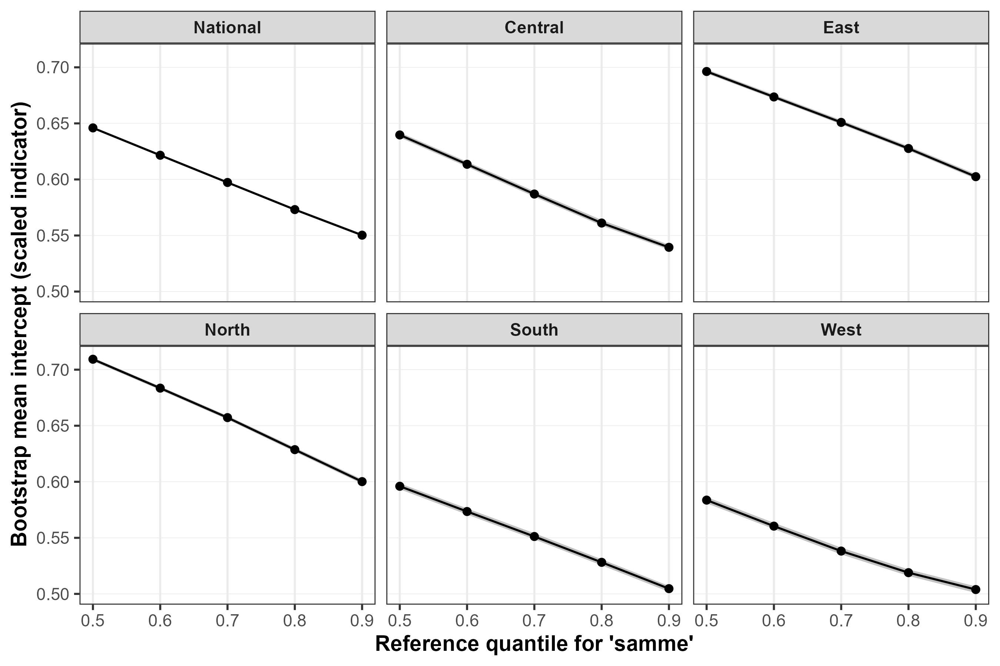
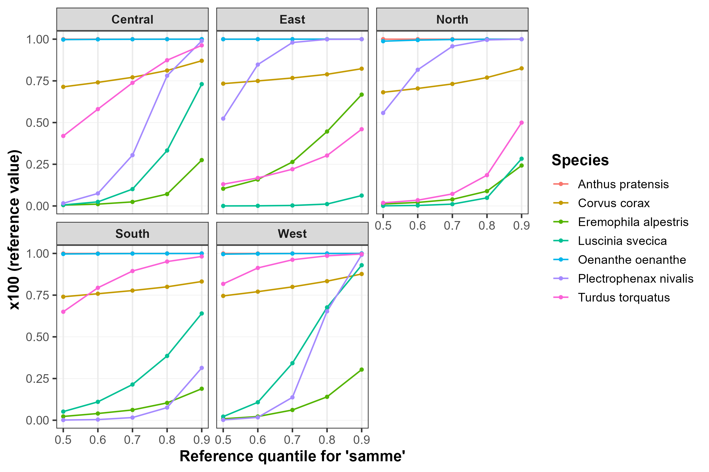
```


Species that already had reference values close to $1$ changed very little, whereas species with low occupancy in most of a region changed most (second panel of each figure).

#### 10.2.3 Relationship between the indicator and environmental variables {#sec-covariates}

@fig-forestScaledIndicatorVrsCovs and @fig-mountainScaledIndicatorVrsCovs show how the indicator varies with the environmental variables at the prediction locations. These plots are descriptive. The variables are the same ones that were used to predict occupancy, so the plots show how the model translates environment into the indicator, not independent evidence of what drives condition.

```{r fig-forestScaledIndicatorVrsCovs}
#| fig-cap: 'Predicted scaled indicator for forest ecosystems in relation to elevation, slope, dominant tree species, forest type and latitude. Each point is a prediction location. Blue lines show smoothed trends, with shaded bands indicating their uncertainty; boxplots summarise categorical variables.'
#| out-width: 100%
#| echo: false
#| warning: false
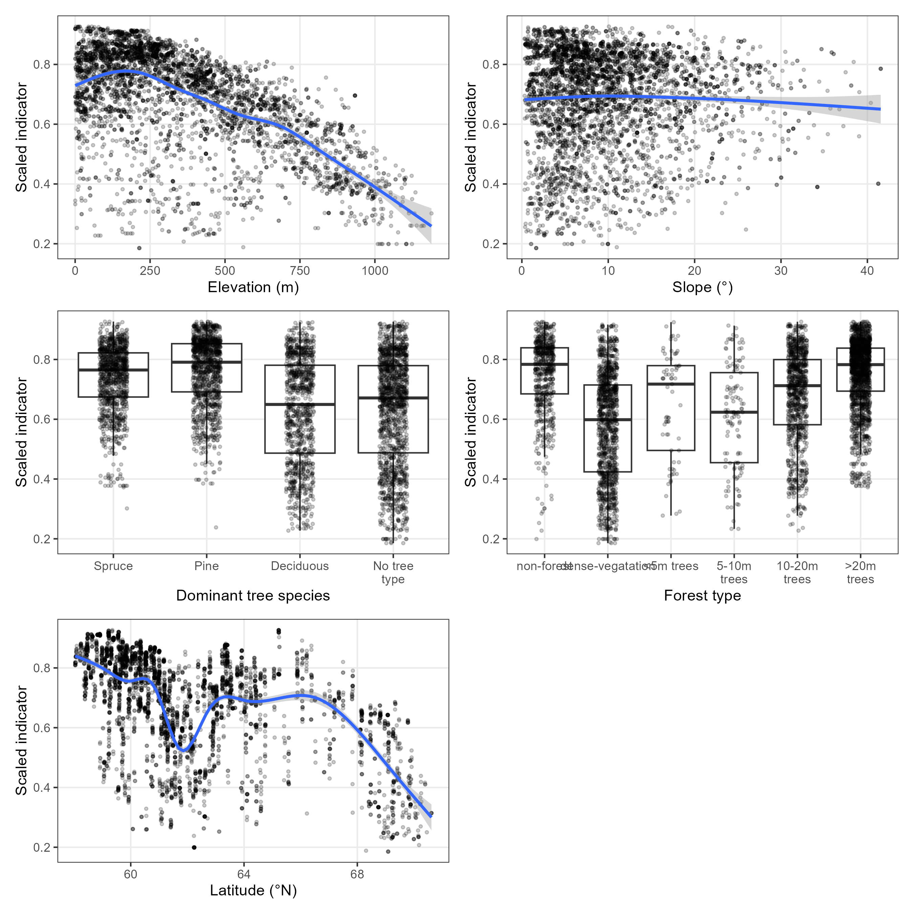
```

In forest, the indicator declined with increasing elevation (from about $0.75$–$0.80$ below $250$ m to about $0.3$ near $1\,000$ m or higher) and towards the north, with a pronounced dip around $62^{\circ}$N and a steep decline north of about $68^{\circ}$N. There was little association with slope. The indicator was higher in spruce- and pine-dominated forest than in deciduous or non-forest-typed locations, and higher in tall forest ($>20$ m) than in dense vegetation or low forest ($<5$ m and $5$–$10$ m). 

```{r fig-mountainScaledIndicatorVrsCovs}
#| fig-cap: 'Predicted scaled indicator for mountain ecosystems in relation to elevation, slope, latitude, distance to the nearest wind farm and distance to the tree line (negative values are below the tree line). Each point is a prediction location. Blue lines show smoothed trends, with shaded bands indicating their uncertainty.'
#| out-width: 100%
#| echo: false
#| warning: false
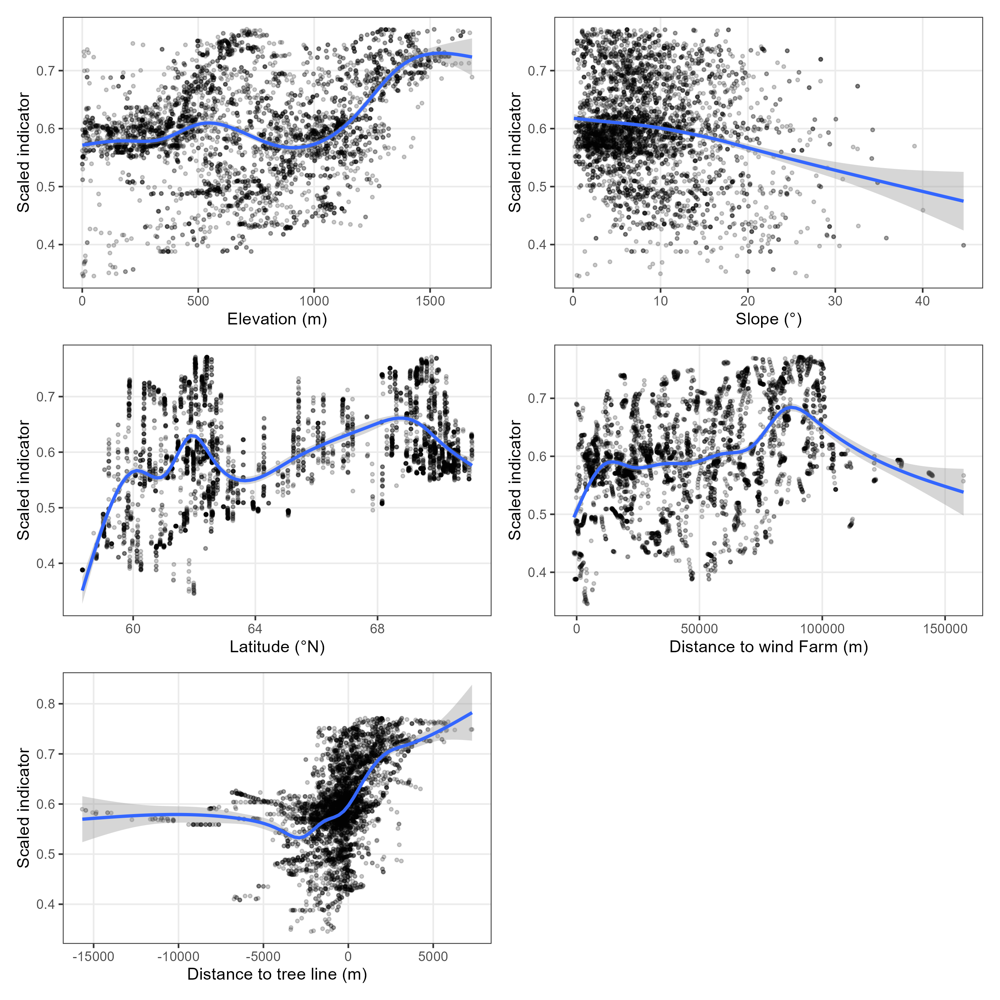
```

In mountain, the indicator was higher above about $1\,200$ m and above the tree line, and it declined modestly with increasing slope. The patterns with latitude and distance to the nearest wind farm were irregular. The distance-to-wind-farm pattern should not be interpreted as an effect of wind power, because wind farms are clustered geographically and distance to a wind farm is confounded with location and elevation.

The strong decline of the forest indicator with elevation and latitude likely reflects, at least in part, natural limits on the occurrence of forest bird species rather than reduced condition. The reference values are set within regions and do not fully remove these gradients (see @sec-uncertainties).


### 10.3 Effects of covariates on occupancy and detection {#sec-effects}

Species-specific coefficients show how each covariate relates to occupancy and detection in the multi-species spatial models. Coefficients are on the logit scale, and intervals that do not overlap zero indicate effects that are well supported by the data. Effects for rarer species have wide intervals, and should be considered uncertain.

#### 10.3.1 Forest ecosystem

For occupancy, elevation and latitude had negative effects for most forest species, and the community-level effects were clearly negative (@fig-forestOccEffs). At the community level, occupancy was also higher in forest taller than $10$ m, and lower in pine and deciduous stands (relative to spruce) and where no tree type was recorded. Species-specific patterns varied, and many intervals were wide, especially for the less frequently recorded species (for example golden eagle, wryneck *Jynx torquilla* and black grouse *Tetrao urogallus*).

```{r fig-forestOccEffs}
#| fig-cap: 'Species-specific effects of environmental and forest habitat covariates on occupancy in forest ecosystems from the multi-species spatial model. Points are posterior mean coefficient estimates (logit scale) and horizontal lines are the corresponding uncertainty intervals. Estimates are shown for elevation, slope, dominant tree species, forest type and latitude. The vertical dashed line marks a coefficient of zero; estimates to either side indicate negative and positive associations with occupancy, respectively.'
#| out-width: 100%
#| echo: false
#| warning: false
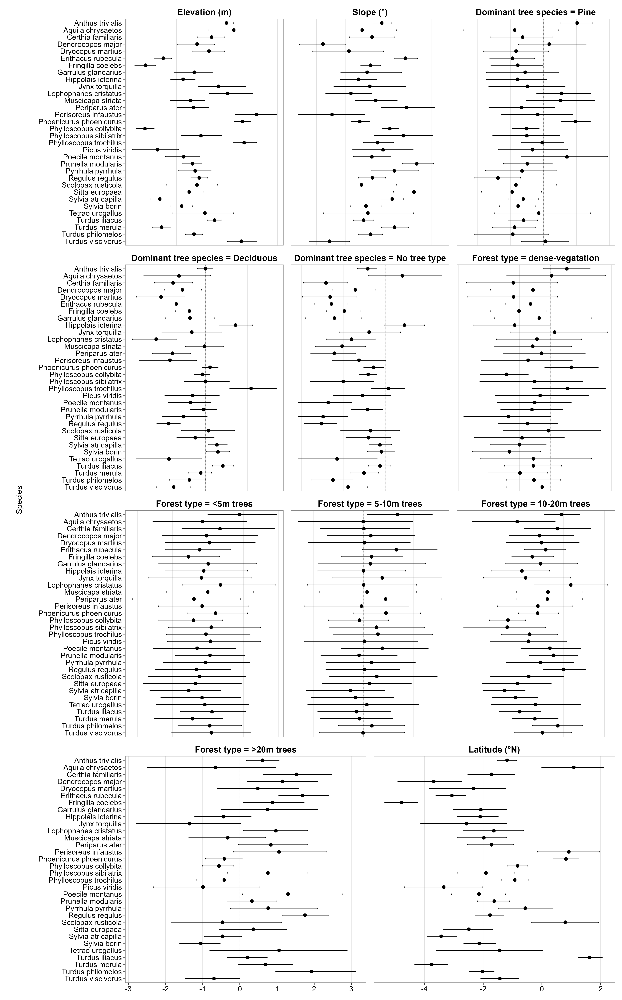
```

For detection, the effect of temperature was positive for many species (for example chaffinch, great spotted woodpecker, black woodpecker, blackcap and common blackbird) and negative for a few (willow warbler and marsh tit). Effects of precipitation were small and the intervals overlapped zero for most species (@fig-forestDetEffs).

```{r fig-forestDetEffs}
#| fig-cap: 'Species-specific effects of temperature and precipitation on detection probability in forest ecosystems from the multi-species spatial model. Points are posterior mean coefficient estimates (logit scale) and horizontal lines are the corresponding uncertainty intervals. The vertical dashed line marks a coefficient of zero.'
#| out-width: 100%
#| echo: false
#| warning: false
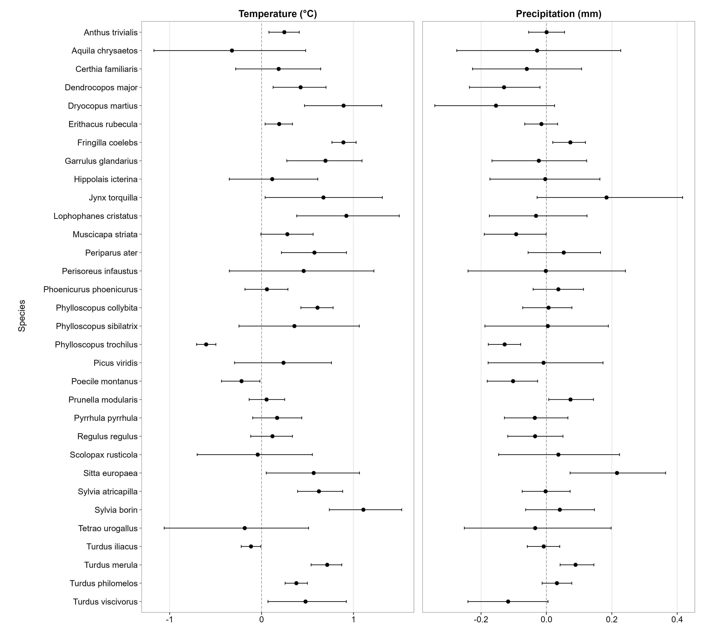
```

Estimated detection probabilities differed greatly among species (@fig-forestOccVrsDet). Several species had very low estimated detection per survey (about $0.003$–$0.03$, for example in golden eagle, wryneck, black grouse and green woodpecker), meaning that their occupancy estimates rest heavily on model assumptions and are weakly informed by data. For some very widespread species (such as willow warbler and chaffinch), occupancy was estimated close to $1$.

```{r fig-forestOccVrsDet}
#| fig-cap: 'Relationship between estimated detection probability and occupancy probability for each forest species at the prediction locations. Each point is a location and the blue line is a smoothed trend. Note that the vertical scale differs among species.'
#| out-width: 100%
#| echo: false
#| warning: false
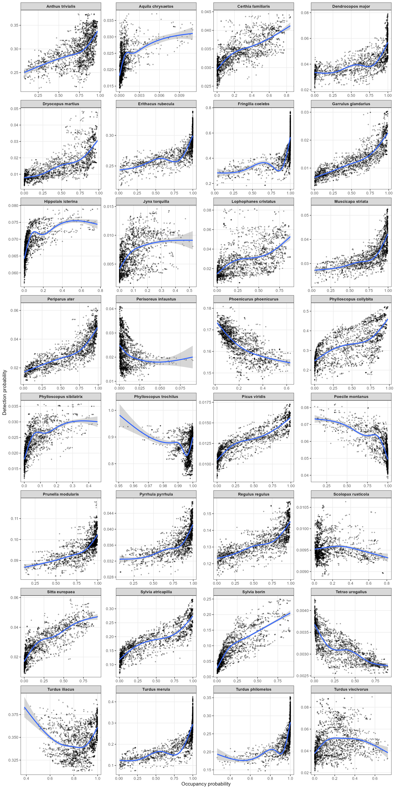
```

#### 10.3.2 Mountain ecosystem

For occupancy, elevation had a negative effect on most mountain species, with the strongest negative effects for willow ptarmigan, bluethroat and ring ouzel, whereas rock ptarmigan and snow bunting *Plectrophenax nivalis* showed positive or neutral effects (@fig-mountainOccEffs). Latitude had positive effects for most species. Effects of distance to the tree line and distance to wind farms differed in direction among species, and for several species the intervals were wide. The effect of distance to wind farms should be regarded as descriptive, because wind farms are not randomly located relative to habitat.

```{r fig-mountainOccEffs}
#| fig-cap: 'Species-specific effects of environmental covariates on occupancy in mountain ecosystems from the multi-species spatial model. Points are posterior mean coefficient estimates (logit scale) and horizontal lines are the corresponding uncertainty intervals. Estimates are shown for elevation, slope, latitude, distance to wind farm and distance to tree line. The vertical dashed line marks a coefficient of zero.'
#| out-width: 100%
#| echo: false
#| warning: false
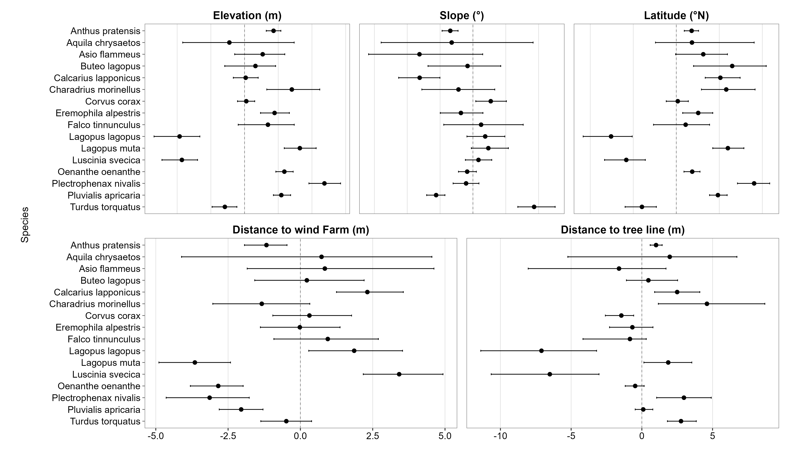
```

For detection, temperature had positive effects for some species (common raven, rough-legged buzzard, common kestrel) and negative effects for others (willow ptarmigan, bluethroat, northern wheatear and Eurasian dotterel). Precipitation effects were generally small or negative (@fig-mountainDetEffs). Detection probabilities were very low for most raptors and owls (about $0.001$–$0.01$ for golden eagle, short-eared owl, rough-legged buzzard and common kestrel), so occupancy for these species is weakly informed by the data (@fig-mountainOccVrsDet).


```{r fig-mountainDetEffs}
#| fig-cap: 'Species-specific effects of temperature and precipitation on detection probability in mountain ecosystems from the multi-species spatial model. Points are posterior mean coefficient estimates (logit scale) and horizontal lines are the corresponding uncertainty intervals. The vertical dashed line marks a coefficient of zero.'
#| out-width: 100%
#| echo: false
#| warning: false
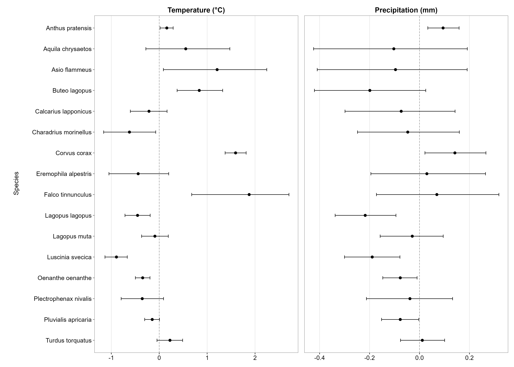
```

```{r fig-mountainOccVrsDet}
#| fig-cap: 'Relationship between estimated detection probability and occupancy probability for each mountain species at the prediction locations. Each point is a location and the blue line is a smoothed trend. Note that the vertical scale differs among species.'
#| out-width: 100%
#| echo: false
#| warning: false
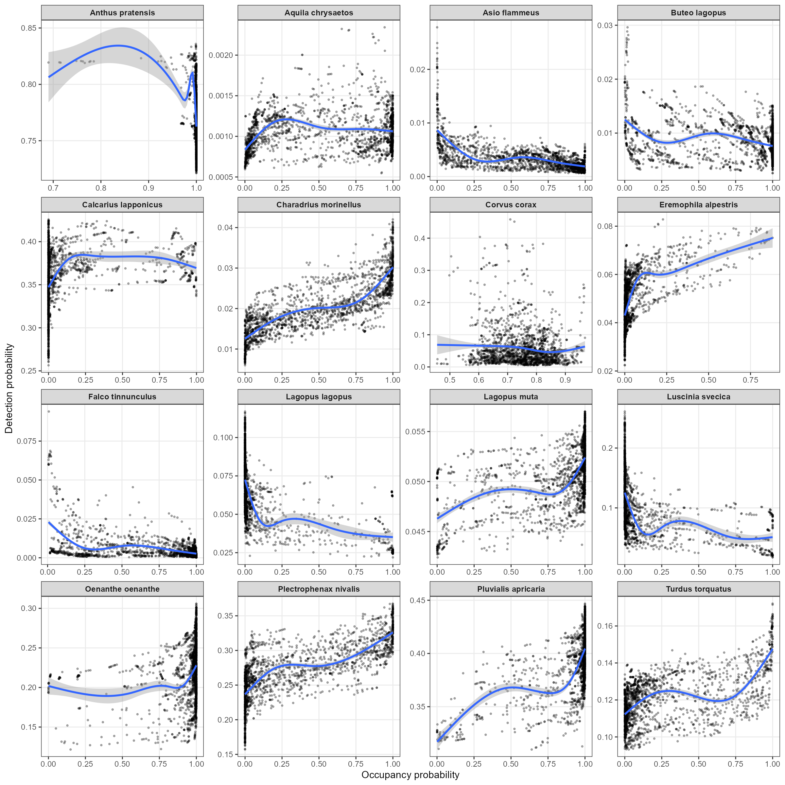
```

### 10.4 Model selection and fit {#sec-modelSelection}

<!--# TODO: add a table of WAIC values for the eight candidate models per ecosystem (or refer to best_models.csv). The statement below cannot be checked from the figures alone. -->

The multi-species spatial occupancy model was selected for both forest and mountain ecosystems (selection procedure in Section 9.1.2).

Model fit was checked with Bayesian p-values for each species, where values near $0.5$ indicate adequate fit and values close to $0$ or $1$ indicate that the model does not reproduce the data well (@fig-forestPPC, @fig-mountainPPC). Fit was adequate for most species but not all. In forest, seven of the 32 species had p-values below $0.05$ (chaffinch *Fringilla coelebs*, willow warbler *Phylloscopus trochilus*, tree pipit *Anthus trivialis*, European robin *Erithacus rubecula*, and three thrushes: *Turdus iliacus*, *T. merula*, *T. philomelos*). In mountain, five of the 16 species had p-values below $0.05$ (meadow pipit *Anthus pratensis*, European golden plover *Pluvialis apricaria*, ring ouzel *Turdus torquatus*, willow ptarmigan *Lagopus lagopus* and northern wheatear *Oenanthe oenanthe*). No species had p-values above $0.7$. Most of the poorly fitting species are common and widespread, and for several of them the model predicts occupancy close to $1$ across much of the ecosystem. Occupancy estimates for these species are therefore less reliable than for the rest of the community.

```{r fig-forestPPC}
#| fig-cap: 'Posterior predictive checks for the forest multi-species occupancy model. Each point is the Bayesian p-value for one species. The dashed line marks 0.5, which indicates adequate fit; values close to 0 indicate that the model does not reproduce the observed data for that species.'
#| out-width: 100%
#| echo: false
#| warning: false
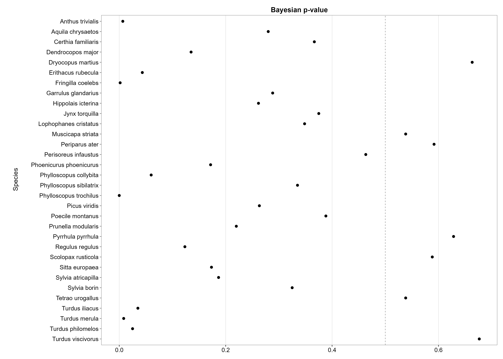
```

```{r fig-mountainPPC}
#| fig-cap: 'Posterior predictive checks for the mountain multi-species occupancy model. Each point is the Bayesian p-value for one species. The dashed line marks 0.5, which indicates adequate fit; values close to 0 indicate that the model does not reproduce the observed data for that species.'
#| out-width: 100%
#| echo: false
#| warning: false
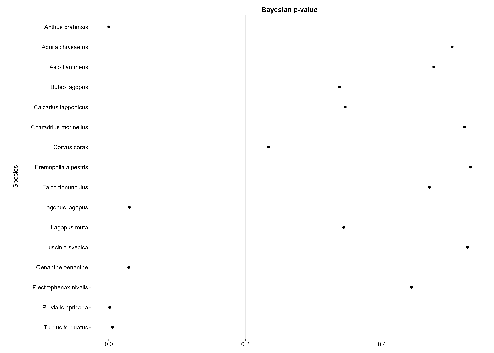
```


## 11. Export file

<!--# 

Optional: Display the code (don't execute it) or the workflow for exporting the indicator values to file. Ideally the indicator values are exported as a georeferenced shape or raster file with indicators values, reference values and errors. You can also chose to export the raw (un-normalised or unscaled variable) as a separate product. You should not save large sptaial output data on GitHub. You can use eval=FALSE to avoid code from being executed (example below - delete if not relevant) 

-->

```{r export}
#| eval: false
```


## 12. Author contributions

<!-- Fill in CReDIT and MeRIT statments to clarify the contributions from individual authors. For MeRIT, see https://www.nature.com/articles/s41467-023-37039-1. For CRedit, see https://credit.niso.org/. You can start with the template structur below, and just delete the rows you dont use.  -->

**CRediT statement**

* Conceptualization: [KPA, KRSS, DPJ, BKS]
* Methodology: [KPA, KSS, BKS]
* Data curation: [DPJ, KRSS]
* Formal analysis: [KPA, KRSS, BKS]
* Investigation: [KPA, KRSS]
* Software: [KPA, KRSS]
* Validation: [KPA]
* Visualization: [KPA]
* Resources: [Initials]
* Writing – original draft: [KPA]
* Writing – review & editing: [KPA, BKS]
* Project administration: [BKS]


**MeRIT attribution**

This part supplements the CRediT statement with more granularity for method section.

**Data processing**
Raw data were curated and cleaned by [DPJ]. Code for preprocessing was written by [DPJ, KPA].

**Statistical analysis**
All analyses were conducted by [KPA] using `spOccupancy`, with verification by [KRSS].

**Visualization**
Figures were produced by [KPA], with input from [BKS, KRSS].

**Reproducibility**
All code was reviewed and validated by [KPA, KRSS].


::: {.callout-tip collapse="true"}
## Session Info
<!-- You can leave this last part as it is, unless you have a good reason to alter it. -->

This information is mainly aimed at developers that need to recreate the R environment that produced the html.
Important note: this information is about the R session that was running when the html was rendered, and if some of the code chunks were not evaluated when the html was rendered, they may have been executed in a different environment.  

```{r sessionInfo}
#| echo: false
sessionInfo()
```

:::
