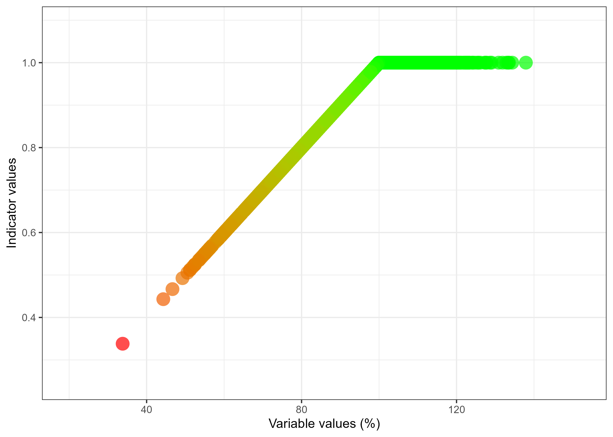

# Golden eagle
Anders Kolstad
2026-06-30

<!--# The following parts are autogenerated. Do not edit. -->

<div id="title-block-header" class="quarto-title-block default">
       <div class="quarto-title-meta">
         <div>
           <div class="quarto-title-meta-heading">Reviewed by</div>
           <div class="quarto-title-meta-contents">Matthew Grainger</div>
         </div>
       </div>
     </div>

<div>

</div>

> **Recommended citation**: Kolstad, A. 2026. Golden eagle \[Kongeørn\]
> (ID(s): NO_GOLD_001) v. 1.0.0. ecRxiv:
> https://github.com/NINAnor/ecRxiv/tree/main/indicators/NO_GOLD_001

> [!TIP]
>
> ### Metadata
>
> <div id="tbl-meta2">
>
> Table 1: Indicator metadata
>
> <div class="cell-output-display">
>
> | Variable | Value |
> |:---|:---|
> | Indicator ID | NO_GOLD_001 |
> | Indicator Name | Golden eagle \[Kongeørn\] |
> | Country | Norway |
> | Continent | Europe |
> | Ecosystem Condition Typology Class | B1 - Compositional state characteristics |
> | Realm | Terrestrial (T) |
> | Biome | T6 Polar-alpine (cryogenic) biome |
> | Ecosystem | NA |
> | Year added | 2026 |
> | Last update | 2026 |
> | Version | 1.0.0 |
> | Version comment | First version on ecRxiv, but this indicator is already published and described in the Norwegian Nature Index |
> | Normalised | TRUE |
> | Spatial aggregation pathway | \[Scale - Truncate\] - disaggregate - sp. aggregate (geographic region) - sp. aggregate (Norway) |
>
> </div>
>
> </div>

> [!TIP]
>
> ### Log
>
> <!--# Update this logg with short messages for each update -->
>
> - May 27, 2026 - submission
> - June 30, 2026 - Accepted

<hr />

<div id="fig-picture">


Figure 1: Golden eagle. Photo: © Giles Laurent, gileslaurent.com,
License CC BY-SA 4.0 <https://creativecommons.org/licenses/by-sa/4.0>,
via Wikimedia Commons

</div>

<hr />

<!--# Document you work below.  -->

## 1. Summary

<!--# 
With a maximum of 300 words, describe the indicator in general terms as you would to a non-expert. Think of this as a kind of common language summary. Follow the four numbers sub-headers below. under point 2, it is possible under  include a bullet point list of the specific steps in the workflow. 
 -->

1.  **Background and rationale**:
    <!-- What does the metric represent? Why is this relevant for describing ecosystem condition in this ecosystem?
    What are the main anthropogenic impact factors? --> Golden eagle is
    a common top predator in Norwegian high-altidude forests and
    mountains, although it also utilises a range of other habitats, from
    the coast to the high alpine areas. It feeds mainly on mid-range
    mammals and game birds. The golden eagle is protected from hunting
    in Norway, but may be negatively affected by other anthropogenic
    stressors, such as land use change, habitat degradation and climate
    change.

2.  **Methods**:
    <!-- What kind of data is used? How is the data customized (modified, estimated, integrated) to fit its purpose as an indicator? -->
    The size of the golden eagle population is estimated from expert
    opinion, based on information available from different sources,
    including the national golden eagle monotoring program. There is,
    however, considerable uncertatinties associated with both the
    reference condition/values and the current estimates.\
    We get the data from the Norwegian Nature Index database (Nater and
    Eriksen 2025).

3.  **Interpretation**:
    <!-- Add a very short description of how the indicator values should be interpreted. Here's an example for a bumblebee indicator: An indicator value of 1 signifies an intact bumblebee community. Values decreasing toward zero reflect negative ecological change, specifically the decline of species expected to be present. This metric does not account for potentially positive changes, such as increases in species' abundance or the arrival of new species. Tip: Add text on the line directly following the subheader, and don't introduce blank lines. This way the whole paragraph renders as a block quote. -->
    An indicator value of 1 means that golden eagle is as numerous, or
    more, than what we expect under the reference condition. Values
    decreasing toward zero indicates that the average population size is
    decreasing.

4.  **Results and development needs**:
    <!-- Briefly, what does the indicator say about the ecosystem condition. What is the current status of  the metric (can it be used or is it still in development), and what immediate tasks remain to improve the indicator or to make the indicator operational -->
    The indicator value for Norway as a whole in 2024 was 0.89 \[95% CI
    = 0.80-0.97\]. This is quite high, and shows that golden eagle is
    quite common in Norway today. The indicator value is similar in the
    south as in the north of the country. Development needs include
    better population estimates through intensified monitoring, and a
    revision of the X<sub>100</sub> values based on updated knowledge.

## 1.2 Native language summary - Norwegian

1.  **Bakgrunn og begrunnelse**: Kongeørn er en vanlig toppredator i
    norske fjellskoger og fjellområder, selv om den også benytter en
    rekke andre habitater, fra kysten til høyfjellet. Den lever
    hovedsakelig av mellomstore pattedyr og hønsefugler. Kongeørn er
    fredet mot jakt i Norge, men kan påvirkes negativt av
    arealbruksendringer, habitatforringelse og klimaendringer.

2.  **Metoder**: Størrelsen på kongeørnbestanden estimeres gjennom
    ekspertvurderinger, med utgangspunkt i informasjon fra ulike kilder,
    inkludert det nasjonale overvåkingsprogrammet for kongeørn. Det er
    imidlertid betydelig usikkerhet knyttet både til
    referansetilstanden/-verdiene og til dagens bestandsestimater.
    Dataene hentes fra databasen for Naturindeks for Norge (Nater and
    Eriksen 2025).

3.  **Tolkning**: En indikatorverdi på 1 betyr at kongeørnbestanden er
    like stor eller større enn det vi forventer under
    referansetilstanden. Verdier som nærmer seg null indikerer at den
    gjennomsnittlige bestandsstørrelsen er avtagende og går mot null.

4.  **Resultater og utviklingsbehov**: Indikatorverdien for hele Norge i
    2024 er 0,89 \[95 % KI = 0,80–0,97\]. Dette er en relativt høy verdi
    og viser at kongeørn fortsatt er ganske vanlig i Norge i dag.
    Indikatorverdien er omtrent lik i sør og nord i landet.
    Utviklingsbehov inkluderer bedre bestandsestimater gjennom mer
    intensiv overvåking, samt en revisjon av X<sub>100</sub>-verdiene
    basert på oppdatert kunnskap.

## 2. About the underlying data

<!--# Give a general introduction the datasets you have used, and provide more specific details in the sub-chapters.  -->

The data comes from the Norwegian Nature index (Nater and Eriksen 2025),
which did an evaluation of the golden eagle population based on expert
opinion, leaning on the national carnivore monitoring program
(www.rovdata.no).

### 2.1 Spatial and temporal resolution and extent

<!--# Describe the temporal and spatial resolution and extent of the data used -->

Indicator values are available for the different assessment years in
*Naturindeksen*: 1990, 2000, 2010, 2014, 2019 and 2024.

The indicator is calculated for southern and northern Norway. Here we
report the values for five geographic regions by simply reusing the
estimates from southern Norway and applying them to the other
overlapping reagins (“Central”, “East”, “South”, “West”). We also
aggregate to a national estimate.

### 2.2 Sampling design

<!-- How was the data sampled? Describe potential sampling biases -->

The data is based on expert opinion. No sampilng was involved.

### 2.3 Original units

<!--# What are the original units for the most relevant  variables in the data-->

The original units of the raw data is percentage, representing the
current population as a percentage of the population in the reference
condition.

### 2.4 Instructions for citing, using and accessing data

<!--# Is the data openly available? If not, how can one access it? What are the key references to the datasets?   -->

Indicator values from the Norwegian Nature Index can be found in (Nater
et al. 2025). Indicator values, variable values and reference values can
be downloaded from the Nature Index database using the API, as I have
done below. The data is licenced under [CC-BY
4.0](https://creativecommons.org/licenses/by/4.0/).

<!-- ### 2.5 Additional comments about the dataset -->

<!--# Optional. Text here -->

## 3. Indicator properties

### 3.1 Ecosystem Condition Typology Class (ECT)

<!--# Describe the rationale for assigning the indicator to the ECT class. See https://oneecosystem.pensoft.net/article/58218/
This doesnt need to be very long. Maybe just a single sentence. -->

B1 - Compositional state characteristics

<!-- 
### 3.1.1 Other condition typologies -->

<!--# Optional: Add text about other standards or typologies, such as alternative national condition typologies, and how the indicator relates to these -->

### 3.2 Ecosystem condition characteristic

<!--# 
&#10;Describe the ecosystem condition characteristic represented in the indicator. See 10.3897/oneeco.6.e58218 for information on what these characteristics might be.
For example, and indicator called 'Trenching in mires' could be made to represent an ecosystem characteristic 'Intact hydrology'. The term 'characteristic' is used similar to the term 'criteria' in Multiple Criteria Decision Making.  
&#10;-->

The ecosystem characteristic represented in this indicator is an
ecosystem where species abundances and composition is similar to that in
the reference condition.

### 3.3 Collinearities with other indicators

<!--# Describe known collinearities with other metrics (indicators or variables) that could become problematic if they were also included in the same Ecosystem Condition Assessment as the indicator described here. -->

None that are very strong.

### 3.4 Impact factors

<!--# Describe the main natural and anthropogenic factors that affecst the metric -->

Golden eagle is mainly affected by land use change, habitat degradation
and climate change.

### 3.5 Spatial aggregation

<!-- Describe in word the same aggregation pathway presented in the top yaml (the metadata). If you have scaled against the reference value, it is especially important to know if you did any avergaing or summations etc. beforehand. An example text for a rather simple case could be: "The variable is scaled at the initial polygon level and the point estimate is a area-weighted arithmetic mean of all polygins. There is no transformation, and truncation is not needed as the indicator becomes naturally bound between 0 and 1".  -->

The data is available as the scale of two regions in Norway (north and
south). At this point I normalise (scale and truncate) the variable.
Then I reuse the indicator values for Southern Norway to apply also to
the four souther regions central, east, south and west. I then aggregate
these, together with region north, to produce a national indicator
estimate.

## 4. Reference condition and levels

### 4.1 Reference condition

<!--# Define the reference condition (or refer to where it is defined). Note the distinction between reference condition and reference levels 10.3897/oneeco.5.e58216  -->

The reference condition is a moutain ecosystem with minimal human impact
and a climate similar to the period 1961-1990 (Nybø and Evju (red)
2017).

### 4.2 Reference levels

<!--# 
&#10;If relevant (i.e. if you have normalised a variable), describe the reference levels used to normalise the variable. 
&#10;Use the terminology where X~0~ refers to the reference level (the variable value) denoting the worst possible condition; X~100~denotes the optimum or best possible condition; and X~*n*~, where in is between 0 and 100, denotes any other anchoring points linking the variable scale to the indicator scale (e.g. the threshold value between good and bad condition X~60^). 
&#10;Why was the current option chosen and how were the reference levels quantified? If the reference values are calculated as part of the analyses further down, please repeat the main information here.
&#10; -->

X<sub>100</sub> is uniformly defined as 100%. This essentially means
that the variable is already scaled.

X<sub>0</sub> is defined as a complete absence of golden eagle.

<!-- X~60~ is not specified and defaults to 60% of the X~100~ value.  -->

#### 4.2.1 Spatial resolution and validity

<!--# 
&#10;Describe the spatial resolution of the reference levels. E.g. is it defined as a fixed value for all areas, or does it vary. Also, at what spatial scale are the reference levels valid? For example, if the reference levels have a regional resolution (varies between regions), it might mean that it is only valid and correct to use for normalising local variable values that are first aggregated to regional scale. However, sometimes the reference levels are insensitive to this and can be used to scale variables at the local (e.g. plot) scale. 
&#10; -->

The reference values are the same everywhere.

## 5. Uncertainties

### 5.1 General uncertainties

<!--# Describe the main reasons why you might not trust 100% the final value to represent the given ecosystem characteristic for the give ecosystem type. What aspects of this condition metric are most sensitive to subjective decitions? Is the spatial sampling sufficient? Does the choice of modeling framework affect the values? Is the metric relevant do describe ecosystem condition for the give ecosystem type?  -->

There is considerable uncertainties associated with the
X<sub>100</sub>value, as well as the current population estimates, as
estimated based on expert opinion. There is no structured documentation
for how these values have been estimated.

### 5.2 Reported uncertainties

<!-- Describe the nature of the errors you (hopefully) provide alongside the point estimate for the condition metric. It is especially important to clarify if the errors are inferential (referring to the uncertainty of the point estimate) or descriptive (referreing to the data itself). Here' an example text: "What we report as uncertainties in @tbl-finalTable are inferential and refer to the uncertainty around the point estimates. It does not directly describe variation in the data itself. 
However, the variation in the mean is defined by the spatial variation only, and quartiles are obtained by bootstrapping the set of localities within a region, and calculating the indicator for each of 9999 such samples".   -->

The reported uncertainties reflect the uncertainties around the true
parameter means, i.e. they are inferrential uncertainties for the true
value of the indicator for the given area and time combination.

## 6. References

<!--# You can add references manually or use a citation manager and add intext citations as with crossreferencing and hyperlinks. See https://quarto.org/docs/authoring/footnotes-and-citations.html -->

<div id="refs" class="references csl-bib-body hanging-indent"
data-entry-spacing="0">

<div id="ref-nater_naturindeks_2025" class="csl-entry">

Nater, C. R., and L. F. Eriksen. 2025. *Naturindeks for Norge 2025.
Tilstand og utvikling for biologisk mangfold.* {NINA} {Temahefte} 97.
Trondheim: Norsk Institutt for Naturforskning.

</div>

<div id="ref-nater_ni2025_2025" class="csl-entry">

Nater, C. R., T. Zeiner-Henriksen, and S. Nybø. 2025. NI2025: Indicator
Data. doi:[10.21345/y790-v762](https://doi.org/10.21345/y790-v762).

</div>

<div id="ref-nybo_fagsystem_2017" class="csl-entry">

Nybø, S., and M. Evju (red). 2017. *[Fagsystem for fastsetting av god
økologisk tilstand - forslag fra et
ekspertråd](https://www.regjeringen.no/no/dokumenter/fagsystem-for-fastsetting-av-god-okologisk-tilstand/id2558481/)*.

</div>

</div>

## 7. Import and prepare datasets

<!--# All the data import and preparation should be done in this chapter, before the analysis chapter. As a minimum, add code for importing data, and describe or show the data structure. You may also explain certain variables, what they represent, and their distributions -->

### 7.1 Naturindeks

<!--# Import and prepare the first dataset for analysis. Change the header from Dataset A to the name of the actual dataset. -->

We download the dataset from the Naturindeks database using the API. The
function gives read-only access without requiring a username and
password.

``` r
# I use a dev version of NIcalc where the username and passwork for the guest user is hrd coded into the function. This will probably be merged into the real NIcalc (from NINAnor/NIcalc) soon.
# renv::install("ChloeRN/NIcalc@include_ReadOnly_access")
# library(NIcalc)

# Import data set
goldImport <- NIcalc::importDatasetApi(
  eco = NULL,
  indic = c("Kongeørn"),
  year = c("2010", "2014", "2019", "2024")
)
saveRDS(goldImport, here::here("data/goldImport.rds"))
```

## 8. Spatial units

<!--# Describe the spatial units that you rely on in your analyses. Highlight the spatial units (the resolution) that the indicator values should be interpreted at. Potential spatial delineation data (maksing layers etc.) should be introduced under chapert 7. We recommend using the SEEA EA terminology of Basic Spatial Units (BSU), Ecosystem Asses (EA) and Ecosystem Accounting Area (EAA). -->

According to the Naturindeks terminology, the 430 municipalities are
called `BSunits`. I use these later just to sum up the total alpine area
for some regions.

Norway is split into a south and a north region, and therse are referred
to as `ICunits`.

The five geographic regions in Norway (east, south, west, central,
north) are called `parts` and `NIunits`.

We can think of the two ICunits as ecosystem assets, and mainland Norway
as the Ecosystem accounting Area.

## 9. Analyses

Here I use a generic approach to handling data from the Naturindeks
where I get both the variable values and the reference values,
separately, from the NI database, and perform the normalisation and
spatial aggregation ourselves.

The variable values have uncertainties in the form of probability
function. The uncertainties are from a statistical model, and so we
think of them as inferential uncertainties.

Here I use an NIcalc function to just prepare and structure the data a
little differently.

``` r
# Assemble
assemble <- NIcalc::assembleNiObject(
  inputData = goldImport,
  predefNIunits = c(allArea = T, parts = T, counties = F),
  indexType = "thematic"
)
```

Then I get the reference values. Because the unit for the variable as it
is recorded in Naturindeksen, is % (of the populations size under the
reference condition), the x<sub>100</sub> is a natural 100% everywhere,
but for consistency, the reference levels are in the same spatial
resolution as the variable, i.e. the two ICunit regions. X<sub>0</sub>
is a natural zero. In the naturindeks, the X<sub>100</sub> is defined
with an uncertainty range which we will ignore here.

``` r
x100 <- goldImport$referenceValues$referenceValues |>
  select(ICunitId, ICunitName, x100 = expectedValue)
gt::gt(x100)
```

<div id="tpqavusiww" style="padding-left:0px;padding-right:0px;padding-top:10px;padding-bottom:10px;overflow-x:auto;overflow-y:auto;width:auto;height:auto;">
<style>#tpqavusiww table {
  font-family: system-ui, 'Segoe UI', Roboto, Helvetica, Arial, sans-serif, 'Apple Color Emoji', 'Segoe UI Emoji', 'Segoe UI Symbol', 'Noto Color Emoji';
  -webkit-font-smoothing: antialiased;
  -moz-osx-font-smoothing: grayscale;
}
&#10;#tpqavusiww thead, #tpqavusiww tbody, #tpqavusiww tfoot, #tpqavusiww tr, #tpqavusiww td, #tpqavusiww th {
  border-style: none;
}
&#10;#tpqavusiww p {
  margin: 0;
  padding: 0;
}
&#10;#tpqavusiww .gt_table {
  display: table;
  border-collapse: collapse;
  line-height: normal;
  margin-left: auto;
  margin-right: auto;
  color: #333333;
  font-size: 16px;
  font-weight: normal;
  font-style: normal;
  background-color: #FFFFFF;
  width: auto;
  border-top-style: solid;
  border-top-width: 2px;
  border-top-color: #A8A8A8;
  border-right-style: none;
  border-right-width: 2px;
  border-right-color: #D3D3D3;
  border-bottom-style: solid;
  border-bottom-width: 2px;
  border-bottom-color: #A8A8A8;
  border-left-style: none;
  border-left-width: 2px;
  border-left-color: #D3D3D3;
}
&#10;#tpqavusiww .gt_caption {
  padding-top: 4px;
  padding-bottom: 4px;
}
&#10;#tpqavusiww .gt_title {
  color: #333333;
  font-size: 125%;
  font-weight: initial;
  padding-top: 4px;
  padding-bottom: 4px;
  padding-left: 5px;
  padding-right: 5px;
  border-bottom-color: #FFFFFF;
  border-bottom-width: 0;
}
&#10;#tpqavusiww .gt_subtitle {
  color: #333333;
  font-size: 85%;
  font-weight: initial;
  padding-top: 3px;
  padding-bottom: 5px;
  padding-left: 5px;
  padding-right: 5px;
  border-top-color: #FFFFFF;
  border-top-width: 0;
}
&#10;#tpqavusiww .gt_heading {
  background-color: #FFFFFF;
  text-align: center;
  border-bottom-color: #FFFFFF;
  border-left-style: none;
  border-left-width: 1px;
  border-left-color: #D3D3D3;
  border-right-style: none;
  border-right-width: 1px;
  border-right-color: #D3D3D3;
}
&#10;#tpqavusiww .gt_bottom_border {
  border-bottom-style: solid;
  border-bottom-width: 2px;
  border-bottom-color: #D3D3D3;
}
&#10;#tpqavusiww .gt_col_headings {
  border-top-style: solid;
  border-top-width: 2px;
  border-top-color: #D3D3D3;
  border-bottom-style: solid;
  border-bottom-width: 2px;
  border-bottom-color: #D3D3D3;
  border-left-style: none;
  border-left-width: 1px;
  border-left-color: #D3D3D3;
  border-right-style: none;
  border-right-width: 1px;
  border-right-color: #D3D3D3;
}
&#10;#tpqavusiww .gt_col_heading {
  color: #333333;
  background-color: #FFFFFF;
  font-size: 100%;
  font-weight: normal;
  text-transform: inherit;
  border-left-style: none;
  border-left-width: 1px;
  border-left-color: #D3D3D3;
  border-right-style: none;
  border-right-width: 1px;
  border-right-color: #D3D3D3;
  vertical-align: bottom;
  padding-top: 5px;
  padding-bottom: 6px;
  padding-left: 5px;
  padding-right: 5px;
  overflow-x: hidden;
}
&#10;#tpqavusiww .gt_column_spanner_outer {
  color: #333333;
  background-color: #FFFFFF;
  font-size: 100%;
  font-weight: normal;
  text-transform: inherit;
  padding-top: 0;
  padding-bottom: 0;
  padding-left: 4px;
  padding-right: 4px;
}
&#10;#tpqavusiww .gt_column_spanner_outer:first-child {
  padding-left: 0;
}
&#10;#tpqavusiww .gt_column_spanner_outer:last-child {
  padding-right: 0;
}
&#10;#tpqavusiww .gt_column_spanner {
  border-bottom-style: solid;
  border-bottom-width: 2px;
  border-bottom-color: #D3D3D3;
  vertical-align: bottom;
  padding-top: 5px;
  padding-bottom: 5px;
  overflow-x: hidden;
  display: inline-block;
  width: 100%;
}
&#10;#tpqavusiww .gt_spanner_row {
  border-bottom-style: hidden;
}
&#10;#tpqavusiww .gt_group_heading {
  padding-top: 8px;
  padding-bottom: 8px;
  padding-left: 5px;
  padding-right: 5px;
  color: #333333;
  background-color: #FFFFFF;
  font-size: 100%;
  font-weight: initial;
  text-transform: inherit;
  border-top-style: solid;
  border-top-width: 2px;
  border-top-color: #D3D3D3;
  border-bottom-style: solid;
  border-bottom-width: 2px;
  border-bottom-color: #D3D3D3;
  border-left-style: none;
  border-left-width: 1px;
  border-left-color: #D3D3D3;
  border-right-style: none;
  border-right-width: 1px;
  border-right-color: #D3D3D3;
  vertical-align: middle;
  text-align: left;
}
&#10;#tpqavusiww .gt_empty_group_heading {
  padding: 0.5px;
  color: #333333;
  background-color: #FFFFFF;
  font-size: 100%;
  font-weight: initial;
  border-top-style: solid;
  border-top-width: 2px;
  border-top-color: #D3D3D3;
  border-bottom-style: solid;
  border-bottom-width: 2px;
  border-bottom-color: #D3D3D3;
  vertical-align: middle;
}
&#10;#tpqavusiww .gt_from_md > :first-child {
  margin-top: 0;
}
&#10;#tpqavusiww .gt_from_md > :last-child {
  margin-bottom: 0;
}
&#10;#tpqavusiww .gt_row {
  padding-top: 8px;
  padding-bottom: 8px;
  padding-left: 5px;
  padding-right: 5px;
  margin: 10px;
  border-top-style: solid;
  border-top-width: 1px;
  border-top-color: #D3D3D3;
  border-left-style: none;
  border-left-width: 1px;
  border-left-color: #D3D3D3;
  border-right-style: none;
  border-right-width: 1px;
  border-right-color: #D3D3D3;
  vertical-align: middle;
  overflow-x: hidden;
}
&#10;#tpqavusiww .gt_stub {
  color: #333333;
  background-color: #FFFFFF;
  font-size: 100%;
  font-weight: initial;
  text-transform: inherit;
  border-right-style: solid;
  border-right-width: 2px;
  border-right-color: #D3D3D3;
  padding-left: 5px;
  padding-right: 5px;
}
&#10;#tpqavusiww .gt_stub_row_group {
  color: #333333;
  background-color: #FFFFFF;
  font-size: 100%;
  font-weight: initial;
  text-transform: inherit;
  border-right-style: solid;
  border-right-width: 2px;
  border-right-color: #D3D3D3;
  padding-left: 5px;
  padding-right: 5px;
  vertical-align: top;
}
&#10;#tpqavusiww .gt_row_group_first td {
  border-top-width: 2px;
}
&#10;#tpqavusiww .gt_row_group_first th {
  border-top-width: 2px;
}
&#10;#tpqavusiww .gt_summary_row {
  color: #333333;
  background-color: #FFFFFF;
  text-transform: inherit;
  padding-top: 8px;
  padding-bottom: 8px;
  padding-left: 5px;
  padding-right: 5px;
}
&#10;#tpqavusiww .gt_first_summary_row {
  border-top-style: solid;
  border-top-color: #D3D3D3;
}
&#10;#tpqavusiww .gt_first_summary_row.thick {
  border-top-width: 2px;
}
&#10;#tpqavusiww .gt_last_summary_row {
  padding-top: 8px;
  padding-bottom: 8px;
  padding-left: 5px;
  padding-right: 5px;
  border-bottom-style: solid;
  border-bottom-width: 2px;
  border-bottom-color: #D3D3D3;
}
&#10;#tpqavusiww .gt_grand_summary_row {
  color: #333333;
  background-color: #FFFFFF;
  text-transform: inherit;
  padding-top: 8px;
  padding-bottom: 8px;
  padding-left: 5px;
  padding-right: 5px;
}
&#10;#tpqavusiww .gt_first_grand_summary_row {
  padding-top: 8px;
  padding-bottom: 8px;
  padding-left: 5px;
  padding-right: 5px;
  border-top-style: double;
  border-top-width: 6px;
  border-top-color: #D3D3D3;
}
&#10;#tpqavusiww .gt_last_grand_summary_row_top {
  padding-top: 8px;
  padding-bottom: 8px;
  padding-left: 5px;
  padding-right: 5px;
  border-bottom-style: double;
  border-bottom-width: 6px;
  border-bottom-color: #D3D3D3;
}
&#10;#tpqavusiww .gt_striped {
  background-color: rgba(128, 128, 128, 0.05);
}
&#10;#tpqavusiww .gt_table_body {
  border-top-style: solid;
  border-top-width: 2px;
  border-top-color: #D3D3D3;
  border-bottom-style: solid;
  border-bottom-width: 2px;
  border-bottom-color: #D3D3D3;
}
&#10;#tpqavusiww .gt_footnotes {
  color: #333333;
  background-color: #FFFFFF;
  border-bottom-style: none;
  border-bottom-width: 2px;
  border-bottom-color: #D3D3D3;
  border-left-style: none;
  border-left-width: 2px;
  border-left-color: #D3D3D3;
  border-right-style: none;
  border-right-width: 2px;
  border-right-color: #D3D3D3;
}
&#10;#tpqavusiww .gt_footnote {
  margin: 0px;
  font-size: 90%;
  padding-top: 4px;
  padding-bottom: 4px;
  padding-left: 5px;
  padding-right: 5px;
}
&#10;#tpqavusiww .gt_sourcenotes {
  color: #333333;
  background-color: #FFFFFF;
  border-bottom-style: none;
  border-bottom-width: 2px;
  border-bottom-color: #D3D3D3;
  border-left-style: none;
  border-left-width: 2px;
  border-left-color: #D3D3D3;
  border-right-style: none;
  border-right-width: 2px;
  border-right-color: #D3D3D3;
}
&#10;#tpqavusiww .gt_sourcenote {
  font-size: 90%;
  padding-top: 4px;
  padding-bottom: 4px;
  padding-left: 5px;
  padding-right: 5px;
}
&#10;#tpqavusiww .gt_left {
  text-align: left;
}
&#10;#tpqavusiww .gt_center {
  text-align: center;
}
&#10;#tpqavusiww .gt_right {
  text-align: right;
  font-variant-numeric: tabular-nums;
}
&#10;#tpqavusiww .gt_font_normal {
  font-weight: normal;
}
&#10;#tpqavusiww .gt_font_bold {
  font-weight: bold;
}
&#10;#tpqavusiww .gt_font_italic {
  font-style: italic;
}
&#10;#tpqavusiww .gt_super {
  font-size: 65%;
}
&#10;#tpqavusiww .gt_footnote_marks {
  font-size: 75%;
  vertical-align: 0.4em;
  position: initial;
}
&#10;#tpqavusiww .gt_asterisk {
  font-size: 100%;
  vertical-align: 0;
}
&#10;#tpqavusiww .gt_indent_1 {
  text-indent: 5px;
}
&#10;#tpqavusiww .gt_indent_2 {
  text-indent: 10px;
}
&#10;#tpqavusiww .gt_indent_3 {
  text-indent: 15px;
}
&#10;#tpqavusiww .gt_indent_4 {
  text-indent: 20px;
}
&#10;#tpqavusiww .gt_indent_5 {
  text-indent: 25px;
}
&#10;#tpqavusiww .katex-display {
  display: inline-flex !important;
  margin-bottom: 0.75em !important;
}
&#10;#tpqavusiww div.Reactable > div.rt-table > div.rt-thead > div.rt-tr.rt-tr-group-header > div.rt-th-group:after {
  height: 0px !important;
}
</style>

| ICunitId | ICunitName | x100 |
|----------|------------|------|
| 4063     | Sør-Norge  | 100  |
| 4064     | Nord-Norge | 100  |

</div>

The variable values are stored as a parameterised probability function,
and I need to draw *n* samples from this function. The probability
function differs between indicators in the Naturindeks. It could also
differ within an indicator. Here I create a vector defining which
probability function to use. I use ´tradObs´ where there is a regular
probability distribution family, and `customObs` where customDist!= NA.
When `distributionFamilyName == NA`, `customDistribution != NA`.

``` r
myYears <- as.character(c(2010, 2014, 2019, 2024))
obstype <- NULL

for (i in 1:length(myYears)) {
  obs <- assemble$indicatorValues[[i]]$distributionFamilyName

  obs[!is.na(obs)] <- "tradObs"
  obs[is.na(obs)] <- "customObs"

  obstype[[i]] <- obs
}
```

Now I am ready to sample the probability distributions. I set *n* to be
1000.

``` r
dat <- tibble(ICunitId = NULL, value = NULL, year = NULL)

for (i in 1:length(myYears)) {
  #print(i)
  myMat <- NIcalc::sampleObsMat(
    ICunitId = assemble$indicatorValues[[i]]$ICunitId,
    value = assemble$indicatorValues[[i]]$expectedValue,
    distrib = assemble$indicatorValues[[i]]$distributionFamilyName,
    mu = assemble$indicatorValues[[i]]$distParameter1,
    sig = assemble$indicatorValues[[i]]$distParameter2,
    customDistribution = assemble$indicatorValues[[i]]$customDistribution,
    obsType = obstype[[i]],
    nsim = 1000
  )
  ICunitIds <- row.names(myMat)
  
  myMat <-  myMat |>
    as_tibble() |>
    add_column(ICunitId = ICunitIds, .before = 1) |>
    pivot_longer(cols = -any_of("ICunitId")) |>
    select(-name) |>
    add_column(year = myYears[i])
  
  dat <- dat |> 
    bind_rows(myMat)
}
head(dat)
```

    # A tibble: 6 × 3
      ICunitId value year 
      <chr>    <dbl> <chr>
    1 4063      87.9 2010 
    2 4063      77.8 2010 
    3 4063     100.  2010 
    4 4063      91.9 2010 
    5 4063      86.5 2010 
    6 4063      95.7 2010 

This is the point in the spatial aggregation where we should normalise
against the reference values. So let’s add inn the X<sub>100</sub>
values.

``` r
dat <- dat |>
  left_join(x100 |> mutate(ICunitId = as.character(ICunitId)), by = join_by(ICunitId))
```

Then we can normalise also the scatter plot with variables against
indicator values (<a href="#fig-norm" class="quarto-xref">Figure 2</a>).

``` r
ind <- ec_normalise(
  variable = dat$value,
  x100 = dat$x100
)

dat <- dat |> add_column(indicator = ind)
```

``` r
temp <- ec_norm_plot(dat$value, dat$indicator) +
  labs(x = "Variable values (%)")
ggsave(here::here("img/norm_plot_eng.png"), scale =1.5, plot =temp)
```

    Saving 10.5 x 7.5 in image

``` r
knitr::include_graphics(here::here("img/norm_plot_eng.png"))
```

<div id="fig-norm">



Figure 2: Normalisation (scaling and truncation) of variable values into
indicator values. The X100 value differs between 15 counties in Norway.

</div>

I also export a figure for the Norwegian fact sheet:

``` r
temp <- ec_norm_plot(dat$value, dat$indicator, lan = "norsk") +
  labs(x = "% av opprinnelig bestandsstørrelse", y = "Indikatorverdi", y = "Indikatorverdi")
ggsave(here::here("img/norm_plot.png"), scale =1, plot =temp)
```

Then we estimate values for each geographic region (NIunits; N, M, E, S,
W). In *Naturindeks* this is done behind the scenes, and I’m not sure
how. The data for region N is the same as ICunit ‘Nord-Norge’. All the
other regions are combined into ‘Sør_Norge’. I will duplicate the data
for these four regions, just so that the output format is consistent
with other Norwegian indicators,

Then I will get the alpine area for each ICunit and aggregate the
indicator values to a get national estimate.

``` r
out <- dat |>
  select(year, ICunitName, indicator) %>=%
  mutate(part = case_when(
    ICunitName == "Sør-Norge" ~ "S",
    ICunitName == "Nord-Norge" ~"N",
    .unmatched = "error"
  ))
```

    ── select(dat, year, ICunitName, indicator)  [rows:     8 000  cols:    3] ─────

    ℹ mutate(part =                     rows:     8 000 +0        cols:    4 +1    [   0.0 ms]

      case_when(ICunitName ==

      "Sør-Norge" ~ "S", ICunitName ==

      "Nord-Norge" ~ "N", .unmatched =

      "error"))

      added: part

``` r
new_rows <- out |>
  filter(part == "S") |>
  mutate(temp = part) |>
  select(-part) |>
  tidyr::expand_grid(part = c("C", "E", "W")) |>
  select(-temp)

out <- out |>
  bind_rows(new_rows)

out |> count(part)
```

    # A tibble: 5 × 2
      part      n
      <chr> <int>
    1 C      4000
    2 E      4000
    3 N      4000
    4 S      4000
    5 W      4000

### Spatial aggregation

Then we can aggregate from regions (NIunits) to all of Norway `ecTools`.
This uses a Monte Carlo propagation of the uncertainties. For this we
need the summed mountain area per geographic region.

``` r
# The link between BSunits and NIunits can be found here:
bs_ni <- as.data.frame(assemble$NIunits) |>
  rownames_to_column(var = "BSunits")

# and we also get the alpine area
bs_fjell <- as.data.frame(assemble$BSunits) |>
  select(BSunits = name, Fjell) |>
  mutate(BSunits = as.character(BSunits))
# and add that as well
bs_ni_fjell <- bs_ni |>
  left_join(bs_fjell, by = join_by(BSunits)) 

# and we create a column for the regions, and sum up
bs_ni_fjell2 <- bs_ni_fjell |>
  select(-wholeArea) |>
  mutate(across(c(E, S, W, C, N), ~ na_if(., 0))) |>
  pivot_longer(cols = c(E, S, W, C, N), values_drop_na = T, values_to = "count", names_to = "part") |>
  select(-count) |>
  group_by(part) |>
  summarise(Fjell = sum(Fjell))

# and add the new columns to the main dataset
out2 <- out |>
  left_join(
    bs_ni_fjell2,
    by = join_by(part),
    unmatched = "error",
    relationship = "many-to-one"
  ) |>
  add_column(end_units = "Norway")

head(out2)
```

    # A tibble: 6 × 6
      year  ICunitName indicator part  Fjell end_units
      <chr> <chr>          <dbl> <chr> <dbl> <chr>    
    1 2010  Sør-Norge      0.879 S     6571. Norway   
    2 2010  Sør-Norge      0.778 S     6571. Norway   
    3 2010  Sør-Norge      1     S     6571. Norway   
    4 2010  Sør-Norge      0.919 S     6571. Norway   
    5 2010  Sør-Norge      0.865 S     6571. Norway   
    6 2010  Sør-Norge      0.957 S     6571. Norway   

``` r
mc_propagated_gold <- ecTools::ec_upscale(
  data = out2,
  variable = indicator,
  weight = Fjell,
  start_units = part,
  end_units = end_units,
  year = year,
  end_units_name = "part",
  n = 1000
)

saveRDS(mc_propagated_gold, here::here("data/mc_propagated_gold.rds"))
```

Then we append this to the main dataset

``` r
mc_propagated_gold_2 <- out2 |>
  select(year, part, sampled_mean = indicator) |>
  bind_rows(mc_propagated_gold)

mc_propagated_gold_2 |> count(year, part)
```

    # A tibble: 24 × 3
       year  part       n
       <chr> <chr>  <int>
     1 2010  C       1000
     2 2010  E       1000
     3 2010  N       1000
     4 2010  Norway  1000
     5 2010  S       1000
     6 2010  W       1000
     7 2014  C       1000
     8 2014  E       1000
     9 2014  N       1000
    10 2014  Norway  1000
    # ℹ 14 more rows

## 10. Results

Then we create some summary statistics
(<a href="#tbl-results" class="quarto-xref">Table 2</a>) and plot them
(<a href="#fig-timeSeries" class="quarto-xref">Figure 3</a>).

``` r
summary_out <- mc_propagated_gold_2 |>
  group_by(part, year) |>
  summarise(
    median = round(median(sampled_mean), 2),
    p_025 = round(quantile(sampled_mean, probs = 0.025), 2),
    p_25 = round(quantile(sampled_mean, probs = 0.25), 2),
    p_75 = round(quantile(sampled_mean, probs = 0.75), 2),
    p_975 = round(quantile(sampled_mean, probs = 0.975), 2),
  ) |>
  add_column(
    ECT = "B1",
    Indicator = "Golden eagle",
    Ecosystem = "Mountains",
    ID = "NO_GOLD_001"
  )
```

``` r
part_labels <- c(
  N = "North",
  C = "Central",
  W = "West",
  S = "South",
  E = "East",
  Norway = "Norway",
  All = "Norway"
)

region_levels <- c("Norway", "Central", "East", "North", "South", "West")

region_cols <- setNames(
  MetBrewer::met.brewer("Archambault", n = length(region_levels)),
  region_levels
)

plot_data <- summary_out |>
  mutate(
    year = factor(year, levels = myYears),
    series_type = if_else(part == "Norway", "National", "Region"),
    part2 = recode(part, !!!part_labels)
  )
```

``` r
ggplot(plot_data, aes(x = year, y = median, colour = part2, group = part2)) +
  geom_line(
    aes(linewidth = series_type),
    position = position_dodge(width = 0.18)
  ) +
  scale_linewidth_manual(
    values = c(National = 2, Region = 0.55),
    guide = "none"
  ) +
  geom_pointrange(
    aes(ymin = p_025, ymax = p_975, shape = series_type),
    size = 0.8,
    linewidth = 0.45,
    position = position_dodge(width = 0.18)
  ) +
  scale_colour_manual(values = region_cols, name = NULL) +
  scale_shape_manual(
    values = c(National = 19, Region = 17),
    name = NULL
  ) +
  scale_y_continuous(limits = c(0, 1), breaks = seq(0, 1, 0.2)) +
  theme_bw(base_size = 12) +
  theme(
    legend.position = "bottom",
    legend.box = "vertical",
    panel.grid.minor = element_blank(),
    panel.grid.major.x = element_blank()
  ) +
  guides(
    colour = guide_legend(
      nrow = 2,
      override.aes = list(size = 0.7, linewidth = 0.45)
    ),
    shape = guide_legend(override.aes = list(size = 0.8, linewidth = 0.45))
  ) +
  labs(y = "Indicator value", x = "")
```

<div id="fig-timeSeries">


Figure 3: Indicator values for NO_GOLD_001 (golden eagle) plotted over
time and for five different regions, as well as the combined national
estimated. The error bars are 95% confidence intervals. Regions E, S, W
and C are identical.

</div>

``` r
summary_out |>
  unite(col = "CI_95", c(p_025, p_975), sep = " - ") |>
  unite(col = "IQR", c(p_25, p_75), sep = " - ") |>
  select(
    ECT,
    Indicator,
    ID,
    "Accounting area" = part,
    Ecosystem,
    "Closing year" = year,
    "Indicator value" = median,
    "95% CI" = CI_95,
    "50% CI" = IQR
  ) |>
  knitr::kable()
```

<div id="tbl-results">

Table 2: Indicator values and uncertainty estimates for NO_GOLD_001.
Regions E, S, W and C are identical.

<div class="cell-output-display">

| ECT | Indicator | ID | Accounting area | Ecosystem | Closing year | Indicator value | 95% CI | 50% CI |
|:---|:---|:---|:---|:---|:---|---:|:---|:---|
| B1 | Golden eagle | NO_GOLD_001 | C | Mountains | 2010 | 0.90 | 0.63 - 1 | 0.8 - 0.99 |
| B1 | Golden eagle | NO_GOLD_001 | C | Mountains | 2014 | 0.90 | 0.64 - 1 | 0.8 - 0.99 |
| B1 | Golden eagle | NO_GOLD_001 | C | Mountains | 2019 | 0.91 | 0.65 - 1 | 0.81 - 0.99 |
| B1 | Golden eagle | NO_GOLD_001 | C | Mountains | 2024 | 0.89 | 0.64 - 1 | 0.79 - 0.98 |
| B1 | Golden eagle | NO_GOLD_001 | E | Mountains | 2010 | 0.90 | 0.63 - 1 | 0.8 - 0.99 |
| B1 | Golden eagle | NO_GOLD_001 | E | Mountains | 2014 | 0.90 | 0.64 - 1 | 0.8 - 0.99 |
| B1 | Golden eagle | NO_GOLD_001 | E | Mountains | 2019 | 0.91 | 0.65 - 1 | 0.81 - 0.99 |
| B1 | Golden eagle | NO_GOLD_001 | E | Mountains | 2024 | 0.89 | 0.64 - 1 | 0.79 - 0.98 |
| B1 | Golden eagle | NO_GOLD_001 | N | Mountains | 2010 | 0.89 | 0.75 - 1 | 0.85 - 0.95 |
| B1 | Golden eagle | NO_GOLD_001 | N | Mountains | 2014 | 0.90 | 0.77 - 1 | 0.85 - 0.95 |
| B1 | Golden eagle | NO_GOLD_001 | N | Mountains | 2019 | 0.90 | 0.75 - 1 | 0.85 - 0.95 |
| B1 | Golden eagle | NO_GOLD_001 | N | Mountains | 2024 | 0.90 | 0.76 - 1 | 0.85 - 0.95 |
| B1 | Golden eagle | NO_GOLD_001 | Norway | Mountains | 2010 | 0.89 | 0.8 - 0.97 | 0.86 - 0.92 |
| B1 | Golden eagle | NO_GOLD_001 | Norway | Mountains | 2014 | 0.89 | 0.8 - 0.97 | 0.86 - 0.92 |
| B1 | Golden eagle | NO_GOLD_001 | Norway | Mountains | 2019 | 0.89 | 0.8 - 0.97 | 0.86 - 0.92 |
| B1 | Golden eagle | NO_GOLD_001 | Norway | Mountains | 2024 | 0.89 | 0.8 - 0.97 | 0.86 - 0.92 |
| B1 | Golden eagle | NO_GOLD_001 | S | Mountains | 2010 | 0.90 | 0.63 - 1 | 0.8 - 0.99 |
| B1 | Golden eagle | NO_GOLD_001 | S | Mountains | 2014 | 0.90 | 0.64 - 1 | 0.8 - 0.99 |
| B1 | Golden eagle | NO_GOLD_001 | S | Mountains | 2019 | 0.91 | 0.65 - 1 | 0.81 - 0.99 |
| B1 | Golden eagle | NO_GOLD_001 | S | Mountains | 2024 | 0.89 | 0.64 - 1 | 0.79 - 0.98 |
| B1 | Golden eagle | NO_GOLD_001 | W | Mountains | 2010 | 0.90 | 0.63 - 1 | 0.8 - 0.99 |
| B1 | Golden eagle | NO_GOLD_001 | W | Mountains | 2014 | 0.90 | 0.64 - 1 | 0.8 - 0.99 |
| B1 | Golden eagle | NO_GOLD_001 | W | Mountains | 2019 | 0.91 | 0.65 - 1 | 0.81 - 0.99 |
| B1 | Golden eagle | NO_GOLD_001 | W | Mountains | 2024 | 0.89 | 0.64 - 1 | 0.79 - 0.98 |

</div>

</div>

## 11. Export file

The indicator values are exported and can be found under
`data/results_NO_GOLD_001_v1.0.0.csv`.

``` r
write.csv(mc_propagated_gold_2, here::here("data/results_NO_GOLD_001_v1.0.0.csv"), row.names = F)
```

## 12. Author contributions

Not relevant, as this is the work of a single author. I would, however,
like to acknowledge the work of those that created the indicator on
*Naturindeks* (Nater and Eriksen 2025).

> [!TIP]
>
> ### Session Info
>
> This workflow uses `renv`. Run `renv::restore()` to recreate the
> working environment.
