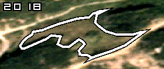
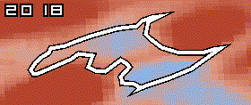
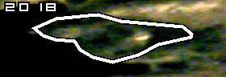
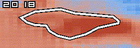

```{r setup}
#| include: false

library(dplyr)
library(tidyr)
library(readr)
library(ggplot2)
library(gt)
library(scales)

source(here::here("R", "theme.R"))

knitr::opts_chunk$set(dev = "ragg_png", dpi = 150, fig.width = 7.5, fig.height = 4.2)

REPO <- here::here()
out_path <- function(...) file.path(REPO, "outputs", ...)

fmt  <- function(x, d = 0) formatC(x, format = "f", digits = d, big.mark = ",")
fmt_no <- function(x, d = 0) formatC(x, format = "f", digits = d, big.mark = " ", decimal.mark = ",")  # Norwegian
pct  <- function(x, d = 1) paste0(formatC(100 * x, format = "f", digits = d), " %")

gt_style <- function(g) {
  g |>
    gt::tab_options(table.font.size = 13, data_row.padding = gt::px(4),
                    table.width = gt::pct(100)) |>
    gt::tab_style(gt::cell_text(weight = "bold"), gt::cells_column_labels())
}

# Columns should arrive already formatted as text. `group` is a grouping
# column (shown as row groups); `bold_rows` is a logical vector; `extra` is
# applied to the gt object.
show_table <- function(df, group = NULL, bold_rows = NULL, extra = identity) {
  num_like <- vapply(df, function(x) all(grepl("^[-0-9., %()]*$", x[!is.na(x)])), logical(1))
  g <- gt::gt(df, groupname_col = group) |>
    gt::cols_align("right", columns = dplyr::all_of(names(df)[num_like & !(names(df) %in% group)])) |>
    gt_style()
  if (!is.null(bold_rows)) g <- gt::tab_style(g, gt::cell_text(weight = "bold"), gt::cells_body(rows = bold_rows))
  extra(g)
}

TRIAGE_ORDER <- c("Strong restoration", "Moderate restoration", "No strong signal",
                  "Moderate succession", "Strong succession")

# Current (2024) county numbering: the first two digits of the kommune number.
FYLKE_BY_PREFIX <- c(
  "11" = "Rogaland", "15" = "Møre og Romsdal", "18" = "Nordland", "31" = "Østfold",
  "42" = "Agder", "46" = "Vestland", "50" = "Trøndelag", "55" = "Troms"
)
```

```{r load-data}
#| include: false

# ---- site-level results (one row per MI polygon) ----------------------------
sites <- read_csv(out_path("unified_site_summary", "MI_unified_site_summary.csv"),
                  show_col_types = FALSE)

traj <- read_csv(out_path("temporal_trajectories", "07_site_level_results_ALL.csv"),
                 show_col_types = FALSE)

# Headline clearance population: restorative-trajectory sites with at least
# one SJ3/SJ4 -> SJ1/SJ2 pixel transition (Methodology Section 8).
clear_raw <- read_csv(out_path("scrub_clearance", "SJ34_to_SJ12_restorative",
                               "15_restorative_sites_SJ34_to_SJ12.csv"),
                      show_col_types = FALSE)

# Scrub removal = SJ3-source, non-spruce pixels; tree removal = SJ4-source or
# spruce pixels. Burn-coincident: scrub inside any mapped burn, trees inside a
# probable-wildfire burn (python/mi_aesj_annual_products.py, pixel by pixel).
clear <- clear_raw

# Burns: one row per burnt site-year, from FIRMS-triggered Sentinel-2 dNBR burn
# mapping (python/mi_dnbr_burn.py). Provisional fire type from the FIRMS dates:
# any detection in June-August = probable wildfire, otherwise lyngbrenning
# season (probable prescribed burn).
BURN_DIR <- file.path(REPO, "python", "mi_dnbr_burn_results")
FIRE_TYPE_LAB <- c(prescribed_burn = "Lyngbrenning season (probable prescribed burn)",
                   wildfire        = "June-August (probable wildfire)")
fires <- read_csv(file.path(BURN_DIR, "MI_burns.csv"), show_col_types = FALSE) |>
  mutate(fire_type = factor(FIRE_TYPE_LAB[probable_fire_type], levels = FIRE_TYPE_LAB))
fire_events <- read_csv(file.path(BURN_DIR, "MI_firms_events.csv"), show_col_types = FALSE)
fire_dets   <- read_csv(file.path(BURN_DIR, "MI_firms_detections.csv"), show_col_types = FALSE)

# AE-SJ of burnt pixels and of the same site's never-burnt pixels, by year
# relative to the burn (python/mi_dnbr_burn.py, stage 2).
burn_traj <- read_csv(file.path(BURN_DIR, "MI_burn_aesj_trajectories.csv"), show_col_types = FALSE)


# Site-level fire type: a site with any summer burn counts as a wildfire site.
# The clearance outputs are not split by burn year, so area on sites with both
# a spring and a summer burn cannot be divided between them.
site_fire_type <- fires |>
  group_by(fid) |>
  summarise(site_fire_type = if (any(probable_fire_type == "wildfire")) "wildfire" else "prescribed_burn",
            both_types = n_distinct(probable_fire_type) > 1, .groups = "drop")

# Annual polygon statistics from the national scoring run.
annual <- purrr::map_dfr(2018:2025, function(y) {
  read_csv(file.path(REPO, "python", "mi_aesj_annual_results",
                     sprintf("MI_aesj_annual_%d.csv", y)),
           col_select = c(fid, year, status, aesj_median_AE_SJ),
           show_col_types = FALSE)
}) |>
  filter(status == "ok")

confusion <- read_csv(out_path("sj_score_validation",
                               "02_sj_score_validation_confusion_matrix.csv"),
                      show_col_types = FALSE)

grazing_ci   <- read_csv(out_path("temporal_trajectories", "grazing",
                                  "24_grazing_slope_median_bootstrap_ci.csv"),
                         show_col_types = FALSE)
grazing_test <- read_csv(out_path("temporal_trajectories", "grazing",
                                  "24_grazing_slope_test_result.csv"),
                         show_col_types = FALSE)
grazing_strata <- read_csv(out_path("temporal_trajectories", "grazing",
                                    "23_no_grazing_vs_grazing_by_tilstand.csv"),
                           show_col_types = FALSE)

dev <- read_csv(file.path(REPO, "inputs", "MI_DW_persistent_development_annual.csv"),
                col_select = c(fid, starts_with("dev_ha_")), show_col_types = FALSE) |>
  mutate(across(starts_with("dev_ha_"), ~ coalesce(as.numeric(.x), 0)))

# MI attributes and geometry (site name, kommune, field survey).
mi <- sf::st_read(
  file.path(REPO, "inputs", "MI_kystlynghei.shp"),
  query = 'SELECT fid, "områdenav", kommunenum, kommuner, year, "7RA-SJ", "7JB-BT", faktaark FROM MI_kystlynghei',
  quiet = TRUE
)
mi_attr <- mi |>
  sf::st_drop_geometry() |>
  transmute(
    fid,
    name        = `områdenav`,
    kommune     = sub(" \\(.*$", "", kommuner),
    # first kommune only where a polygon spans several ("4206,4207")
    fylke       = unname(FYLKE_BY_PREFIX[substr(formatC(sub("[^0-9].*$", "", trimws(as.character(kommunenum))),
                                                        width = 4, flag = "0"), 1, 2)]),
    survey_year = as.integer(year),
    field_sj    = suppressWarnings(as.integer(X7RA.SJ)),
    bt          = suppressWarnings(as.integer(X7JB.BT)),
    faktaark
  )

# MI attributes take precedence: drop any column the site summary also carries
# (e.g. bt), so the join does not produce bt.x / bt.y.
sites <- sites |>
  select(-any_of(setdiff(names(mi_attr), "fid"))) |>
  left_join(mi_attr, by = "fid")

# Weather before each probable wildfire (python/diagnostics/wildfire_weather.py;
# ERA5 via Open-Meteo, 30 days before the first FIRMS detection vs 1991-2020)
wx <- read_csv(file.path(BURN_DIR, "wildfire_weather.csv"), show_col_types = FALSE) |>
  mutate(fid = as.integer(sub(";.*$", "", as.character(fids)))) |>
  left_join(mi_attr |> select(fid, kommune, fylke), by = "fid") |>
  mutate(place = paste0(kommune, ", ", fylke)) |>
  arrange(first_date)
wx_sotra <- wx |> filter(event_id == "2021_019")
wx_wet   <- wx |> filter(precip_pct_of_normal > 150)
```

```{r key-numbers}
#| include: false

key <- list()
key$n_sites      <- nrow(sites)
key$n_classified <- sum(!is.na(sites$triage_class))
key$n_excluded   <- sum(is.na(sites$triage_class))
tri <- table(factor(sites$triage_class, levels = TRIAGE_ORDER))
key$tri          <- tri
key$n_restor     <- sum(tri[c("Strong restoration", "Moderate restoration")])
key$n_succ       <- sum(tri[c("Strong succession", "Moderate succession")])
key$n_nosignal   <- tri[["No strong signal"]]
key$ratio        <- key$n_succ / key$n_restor
key$median_change <- median(sites$sj_change, na.rm = TRUE)

# Trend confidence from the 90 % interval on sj_change, for the trend classes
# (R/modules/temporal_trajectories.R, header items 1 and 6).
CONF_ORDER <- c("High", "Medium", "Low")
classed <- sites |> filter(!is.na(triage_class))
conf_n <- function(classes, level) sum(classed$triage_class %in% classes & classed$trend_confidence %in% level)
SUCC_CLASSES   <- c("Strong succession", "Moderate succession")
RESTOR_CLASSES <- c("Strong restoration", "Moderate restoration")
key$succ_high     <- conf_n(SUCC_CLASSES, "High")
key$succ_medium   <- conf_n(SUCC_CLASSES, "Medium")
key$succ_low      <- conf_n(SUCC_CLASSES, "Low")
key$restor_high   <- conf_n(RESTOR_CLASSES, "High")
key$restor_medium <- conf_n(RESTOR_CLASSES, "Medium")
key$restor_low    <- conf_n(RESTOR_CLASSES, "Low")
ye <- read_csv(out_path("temporal_trajectories", "02b_regional_year_effects.csv"), show_col_types = FALSE)
ye_big <- ye |> filter(n_sites >= 500)   # counties with enough sites to quote
key$ye_max     <- max(abs(ye_big$year_effect))
key$ye_max_lab <- with(ye_big[which.max(abs(ye_big$year_effect)), ], paste0(ye_region, " ", year))
key$change_se_med <- median(classed$sj_change_se, na.rm = TRUE)
key$halfwidth_med <- median(classed$sj_change_hi - classed$sj_change, na.rm = TRUE)
key$model_se_med  <- median(classed$model_se_mean, na.rm = TRUE)
key$model_se_p10  <- quantile(classed$model_se_mean, 0.1, na.rm = TRUE, names = FALSE)
key$model_se_p90  <- quantile(classed$model_se_mean, 0.9, na.rm = TRUE, names = FALSE)
cleared20 <- coalesce(classed$prop_sj34, 0) > 0.2
key$cleared20_n   <- sum(cleared20)
key$change_se_cleared20 <- median(classed$sj_change_se[cleared20], na.rm = TRUE)
key$change_se_other     <- median(classed$sj_change_se[coalesce(classed$n_sj34_12, 0) == 0 & !classed$burn_confirmed], na.rm = TRUE)
key$moderate_thr  <- read_csv(out_path("temporal_trajectories", "02_triage_threshold_derivation.csv"),
                              show_col_types = FALSE)$threshold_AE_SJ_units[1]
key$prio_overgr_high <- sum(sites$priority %in% "Good/moderate condition, overgrowing" &
                              sites$priority_confidence %in% "High")
key$prio_overgr_dir  <- sum(sites$priority %in% "Good/moderate condition, overgrowing" &
                              sites$priority_confidence %in% c("High", "Medium"))

cls <- sites |> filter(!is.na(triage_class), !is.na(tilstand))
is_succ   <- grepl("succession", cls$triage_class)
is_restor <- grepl("restoration", cls$triage_class)
poor      <- cls$tilstand %in% c("Dårlig", "Svært redusert")
key$succ_poor   <- mean(is_succ[poor])
key$succ_good   <- mean(is_succ[cls$tilstand == "God"])
key$restor_good <- mean(is_restor[cls$tilstand == "God"])
key$restor_poor <- mean(is_restor[poor])

# Composition shift (mean pixel shares) for restoring / succeeding sites
comp_shift <- traj |>
  filter(grepl("succession|restoration", triage_class)) |>
  mutate(group = if_else(grepl("restoration", triage_class), "restor", "succ")) |>
  group_by(group) |>
  summarise(across(c(p1_base, p1_final, p4_base, p4_final),
                   ~ mean(.x, na.rm = TRUE)),
            p34_start = mean(p3_base + p4_base, na.rm = TRUE), .groups = "drop")
key$restor_sj1_base  <- comp_shift$p1_base[comp_shift$group == "restor"]
key$restor_sj1_final <- comp_shift$p1_final[comp_shift$group == "restor"]
key$succ_sj34_base   <- comp_shift$p34_start[comp_shift$group == "succ"]
key$succ_sj4_base    <- comp_shift$p4_base[comp_shift$group == "succ"]
key$succ_sj4_final   <- comp_shift$p4_final[comp_shift$group == "succ"]

nordland <- sites |> filter(fylke == "Nordland", !is.na(triage_class))
key$nordland_restor <- mean(grepl("restoration", nordland$triage_class))
key$nordland_succ   <- mean(grepl("succession", nordland$triage_class))

ref <- read_csv(out_path("model", "FINAL_AE_SJ_covadj_class_reference_positions.csv"),
                show_col_types = FALSE)
med <- setNames(ref$median_AE_SJ, ref$sj)
key$thr_mod    <- 0.5 * (med[["1"]] - med[["2"]])
key$thr_strong <- 0.5 * (med[["3"]] - med[["4"]])

# National year effect: median of all sites' year-to-year change.
year_shift <- annual |>
  arrange(fid, year) |>
  group_by(fid) |>
  mutate(step = aesj_median_AE_SJ - lag(aesj_median_AE_SJ)) |>
  ungroup() |>
  filter(!is.na(step)) |>
  group_by(year) |>
  summarise(median_step = median(step), .groups = "drop")
key$max_year_shift <- max(abs(year_shift$median_step))

# Fire: detection
key$fire_sites      <- n_distinct(fires$fid)
key$fire_siteyears  <- nrow(fires)
key$fire_ha         <- sum(fires$burn_area_ha)
key$fire_multi      <- sum(table(fires$fid) > 1)
key$fire_med_ha     <- median(fires$burn_area_ha)
key$fire_lt1        <- sum(fires$burn_area_ha < 1)
key$fire_in_poly    <- sum(fires$n_firms_in_polygon > 0)
key$firms_dets      <- nrow(fire_dets)
key$firms_events    <- nrow(fire_events)
key$firms_events_ok <- sum(fire_events$status == "ok")
key$firms_events_burn <- sum(fire_events$burn_area_ha > 0, na.rm = TRUE)
key$firms_events_mi <- n_distinct(unlist(strsplit(fires$event_ids, ";")))
key$firms_only_noaa20 <- sum(fires$sensors == "NOAA-20")
key$firms_no_noaa20 <- sum(!grepl("NOAA-20", fires$sensors))
fire_year_ha <- fires |> group_by(year) |> summarise(ha = sum(burn_area_ha), .groups = "drop")
key$fire_top_year   <- fire_year_ha$year[which.max(fire_year_ha$ha)]
key$fire_top_share  <- max(fire_year_ha$ha) / key$fire_ha
fire_by_type <- fires |>
  group_by(probable_fire_type) |>
  summarise(sites = n_distinct(fid), siteyears = n(), ha = sum(burn_area_ha),
            share_med = median(burn_percent), size_med = median(burn_area_ha), .groups = "drop")
ft <- function(type, col, d = fire_by_type) {
  v <- d[[col]][d$probable_fire_type == type]; if (length(v)) v else 0
}
key$rx_sites <- ft("prescribed_burn", "sites"); key$wf_sites <- ft("wildfire", "sites")
key$rx_siteyears <- ft("prescribed_burn", "siteyears"); key$wf_siteyears <- ft("wildfire", "siteyears")
key$rx_ha <- ft("prescribed_burn", "ha"); key$wf_ha <- ft("wildfire", "ha")
key$rx_share_med <- ft("prescribed_burn", "share_med"); key$wf_share_med <- ft("wildfire", "share_med")
key$rx_size_med <- ft("prescribed_burn", "size_med"); key$wf_size_med <- ft("wildfire", "size_med")
key$fire_both_sites <- sum(site_fire_type$both_types)
key$wf_years <- paste(sort(unique(fires$year[fires$probable_fire_type == "wildfire"])), collapse = ", ")
key$wf_298_ha <- sum(fires$burn_area_ha[fires$fid == 298 & fires$year == 2021])
key$ex_2679_ha <- sum(fires$burn_area_ha[fires$fid == 2679 & fires$year == 2019])

# Fire: response of the succession score. For each burn, the mean AE-SJ of the
# burnt pixels is compared with the mean of the same site's never-burnt pixels;
# the burnt - reference difference is adjusted by its value in the year before
# the burn, so the effect is the change caused by the burn (same design as the
# naturtiltak analysis, Methodology Section 11.4). Each burn counts once; the burn
# year itself mixes conditions before and after the fire and is left out.
MIN_EFFECT_PX <- 20
burn_eff <- burn_traj |>
  select(fid, burn_year, years_since_burn, group, mean_AE_SJ, n_px, prop_SJ1, prop_SJ2, prop_SJ3, prop_SJ4) |>
  pivot_wider(names_from = group, values_from = c(mean_AE_SJ, n_px, prop_SJ1, prop_SJ2, prop_SJ3, prop_SJ4)) |>
  filter(n_px_burnt >= MIN_EFFECT_PX, n_px_reference >= MIN_EFFECT_PX) |>
  mutate(diff = mean_AE_SJ_burnt - mean_AE_SJ_reference) |>
  group_by(fid, burn_year) |>
  mutate(base = diff[match(-1, years_since_burn)], adj = diff - base) |>
  ungroup() |>
  filter(!is.na(base), years_since_burn != 0) |>
  left_join(fires |> select(fid, burn_year = year, probable_fire_type, fire_type), by = c("fid", "burn_year"))
eff_summary <- burn_eff |>
  filter(between(years_since_burn, -3, 4)) |>
  group_by(fire_type, probable_fire_type, years_since_burn) |>
  summarise(n = n(), effect = mean(adj), se = sd(adj) / sqrt(n()),
            burnt = mean(mean_AE_SJ_burnt), reference = mean(mean_AE_SJ_reference), .groups = "drop") |>
  mutate(lo = effect - qt(0.975, pmax(n - 1, 1)) * se, hi = effect + qt(0.975, pmax(n - 1, 1)) * se)
fe <- function(type, yrs, col = "effect") {
  v <- eff_summary[[col]][eff_summary$probable_fire_type == type & eff_summary$years_since_burn == yrs]
  if (length(v)) v else NA_real_
}
key$eff_n_rx <- fe("prescribed_burn", 1, "n")
key$eff_n_wf <- fe("wildfire", 1, "n")
key$eff_rx1 <- fe("prescribed_burn", 1); key$eff_rx1_lo <- fe("prescribed_burn", 1, "lo"); key$eff_rx1_hi <- fe("prescribed_burn", 1, "hi")
key$eff_wf1 <- fe("wildfire", 1); key$eff_wf1_lo <- fe("wildfire", 1, "lo"); key$eff_wf1_hi <- fe("wildfire", 1, "hi")
key$eff_rx2 <- fe("prescribed_burn", 2); key$eff_wf2 <- fe("wildfire", 2)
key$eff_rx3 <- fe("prescribed_burn", 3); key$eff_wf3 <- fe("wildfire", 3)
key$eff_rx4 <- fe("prescribed_burn", 4); key$eff_wf4 <- fe("wildfire", 4)
key$eff_rx_pre <- fe("prescribed_burn", -2); key$eff_wf_pre <- fe("wildfire", -2)
key$eff_rx_pos1 <- with(filter(burn_eff, probable_fire_type == "prescribed_burn", years_since_burn == 1), mean(adj > 0))
key$eff_wf_pos1 <- with(filter(burn_eff, probable_fire_type == "wildfire", years_since_burn == 1), mean(adj > 0))
# Condition of the burnt pixels before (year -1) and after (year +1) the burn,
# area-weighted across burns
comp_type <- burn_eff |>
  filter(years_since_burn %in% c(-1, 1)) |>
  group_by(probable_fire_type, years_since_burn) |>
  summarise(sj12 = weighted.mean(prop_SJ1_burnt + prop_SJ2_burnt, n_px_burnt),
            sj1 = weighted.mean(prop_SJ1_burnt, n_px_burnt),
            sj34 = weighted.mean(prop_SJ3_burnt + prop_SJ4_burnt, n_px_burnt),
            score = weighted.mean(mean_AE_SJ_burnt, n_px_burnt), .groups = "drop")
fc <- function(type, yrs, col) {
  v <- comp_type[[col]][comp_type$probable_fire_type == type & comp_type$years_since_burn == yrs]
  if (length(v)) v else NA_real_
}
key$rx_pre_sj12 <- fc("prescribed_burn", -1, "sj12"); key$wf_pre_sj12 <- fc("wildfire", -1, "sj12")
key$rx_pre_sj34 <- fc("prescribed_burn", -1, "sj34"); key$wf_pre_sj34 <- fc("wildfire", -1, "sj34")
key$rx_post_sj1 <- fc("prescribed_burn", 1, "sj1");  key$wf_post_sj1 <- fc("wildfire", 1, "sj1")
key$rx_pre_sj1  <- fc("prescribed_burn", -1, "sj1"); key$wf_pre_sj1  <- fc("wildfire", -1, "sj1")
key$rx_pre_score <- fc("prescribed_burn", -1, "score"); key$wf_pre_score <- fc("wildfire", -1, "score")

# Fire: validation against registered burning (Methodology Section 11.4)
# Registered burns (naturtiltak burns-verified pool, duplicates merged): FIRMS in any year up to and
# including the registered year, and dNBR at the FIRMS date (scar inside or
# within 250 m of the roughly drawn polygon); python/validation_registered_burns.py
valf <- jsonlite::read_json(file.path(REPO, "python", "validation_registered_burns", "validation_final.json"),
                            simplifyVector = TRUE)
vsp  <- jsonlite::read_json(file.path(REPO, "python", "validation_registered_burns", "spatial_representativeness.json"),
                            simplifyVector = TRUE)
key$val_features   <- valf$features
key$val_feat_firms <- valf$features_firms
key$val_fires      <- valf$all$fires
key$val_fires_hit  <- valf$all$fires_hit
key$val_feat_hit   <- valf$all$features_hit
key$val_u_fires    <- valf$usable_imagery$fires
key$val_u_hit      <- valf$usable_imagery$fires_hit
key$val_u_feat     <- valf$usable_imagery$features
key$val_u_feat_hit <- valf$usable_imagery$features_hit
key$val_ctl_in     <- valf$all$controls_hit_inside_pct / 100
key$val_ctl_250    <- valf$all$controls_hit_pct / 100
key$val_feat_lt5   <- valf$by_polygon_size$features[valf$by_polygon_size$size == "< 5 ha"]
key$val_firms_lt5  <- valf$by_polygon_size$firms[valf$by_polygon_size$size == "< 5 ha"]
key$val_feat_gt100 <- valf$by_polygon_size$features[valf$by_polygon_size$size == "> 100 ha"]
key$val_firms_gt100 <- valf$by_polygon_size$firms[valf$by_polygon_size$size == "> 100 ha"]
sp_pre <- vsp$share_with_detection[vsp$share_with_detection$period == "2018 to Y", ]
key$sp_reg  <- sp_pre$registered
key$sp_bg_lo <- min(unlist(sp_pre[c("displaced_5km", "displaced_10km", "displaced_20km")]))
key$sp_bg_hi <- max(unlist(sp_pre[c("displaced_5km", "displaced_10km", "displaced_20km")]))

# Clearance (headline population)
key$clear_sites   <- nrow(clear)
key$clear_ha      <- sum(clear$area_SJ34_to_SJ12_ha)
key$clear_mech_ha <- sum(clear$area_SJ34_to_SJ12_clearance_ha)
key$clear_fire_ha <- sum(clear$area_SJ34_to_SJ12_burnt_ha)
clear_ft <- clear |> left_join(site_fire_type, by = "fid")
key$clear_fire_rx_ha    <- sum(clear_ft$area_SJ34_to_SJ12_burnt_ha[clear_ft$site_fire_type %in% "prescribed_burn"])
key$clear_fire_wf_ha    <- sum(clear_ft$area_SJ34_to_SJ12_burnt_ha[clear_ft$site_fire_type %in% "wildfire"])
key$clear_fire_rx_sites <- sum(clear_ft$area_SJ34_to_SJ12_burnt_ha > 0 & clear_ft$site_fire_type %in% "prescribed_burn")
key$clear_fire_wf_sites <- sum(clear_ft$area_SJ34_to_SJ12_burnt_ha > 0 & clear_ft$site_fire_type %in% "wildfire")
key$clear_fire_wf_both  <- all(clear_ft$both_types[clear_ft$area_SJ34_to_SJ12_burnt_ha > 0 & clear_ft$site_fire_type %in% "wildfire"])
key$clear_sj3_ha  <- sum(clear$area_scrub_to_SJ12_ha)   # scrub: SJ3-source, not spruce
key$clear_sj4_ha  <- sum(clear$area_tree_to_SJ12_ha)    # trees: SJ4-source or spruce
key$clear_tree_fire_ha  <- sum(clear$area_tree_to_SJ12_burnt_ha)
key$spruce_fire_ha <- sum(clear$area_SJ34_to_SJ12_picea_burnt_ha)
key$clear_median  <- median(clear$area_SJ34_to_SJ12_ha)
key$clear_ge01    <- sum(clear$area_SJ34_to_SJ12_ha >= 0.1 - 1e-9)
key$clear_top10   <- sum(sort(clear$area_SJ34_to_SJ12_ha, decreasing = TRUE)[1:10]) / key$clear_ha
pathways <- read_csv(out_path("scrub_clearance", "SJ34_to_SJ12_restorative",
                              "20_SJ34_to_SJ12_transition_pathways.csv"), show_col_types = FALSE)
key$sj3_to_sj2_share <- pathways$area_ha[pathways$transition == "SJ3 -> SJ2"] / sum(pathways$area_ha)
key$to_sj1_share     <- sum(pathways$area_ha[grepl("-> SJ1", pathways$transition)]) / sum(pathways$area_ha)
key$fire_sj34_all_ha <- sum(sites$ha_sj34_burnt, na.rm = TRUE)
sites_ft <- sites |> select(fid, ha_sj34_burnt) |> left_join(site_fire_type, by = "fid")
key$fire_sj34_rx_ha <- sum(sites_ft$ha_sj34_burnt[sites_ft$site_fire_type %in% "prescribed_burn"], na.rm = TRUE)
key$fire_sj34_wf_ha <- sum(sites_ft$ha_sj34_burnt[sites_ft$site_fire_type %in% "wildfire"], na.rm = TRUE)
key$spruce_sites  <- sum(clear$n_SJ34_to_SJ12_picea > 0)
key$spruce_ha     <- sum(clear$area_SJ34_to_SJ12_picea_ha)
key$sites_with_spruce <- sum(sites$picea_pct > 0, na.rm = TRUE)

# Development
key$dev_sites <- sum(dev$dev_ha_total > 0)
key$dev_ha    <- sum(dev$dev_ha_total)
dev_fylke <- dev |>
  left_join(sites |> select(fid, fylke), by = "fid") |>
  group_by(fylke) |>
  summarise(ha = sum(dev_ha_total), .groups = "drop") |>
  arrange(desc(ha))
key$dev_top3      <- paste(dev_fylke$fylke[1:3], collapse = ", ")
key$dev_top3_share <- sum(dev_fylke$ha[1:3]) / key$dev_ha
key$dev_18_20 <- sum(dev$dev_ha_2018 + dev$dev_ha_2019 + dev$dev_ha_2020) / 3
key$dev_21_25 <- sum(dev$dev_ha_2021 + dev$dev_ha_2022 + dev$dev_ha_2023 + dev$dev_ha_2024 + dev$dev_ha_2025) / 5

# Field agreement
cm <- confusion |>
  mutate(f = as.integer(sub("SJ", "", field_sj_lab)), m = as.integer(sub("SJ", "", modal_sj_lab)))
n_cm <- sum(cm$n)
po   <- sum(cm$n[cm$f == cm$m]) / n_cm
rs   <- cm |> group_by(f) |> summarise(r = sum(n)); cs <- cm |> group_by(m) |> summarise(c = sum(n))
pe   <- sum(rs$r * cs$c) / n_cm^2
w    <- function(a, b) 1 - abs(a - b) / 3
pow  <- sum(w(cm$f, cm$m) * cm$n) / n_cm
pew  <- sum(outer(rs$r, cs$c) * outer(1:4, 1:4, w)) / n_cm^2
key$val_n      <- n_cm
key$val_agree  <- po
key$val_kappa  <- (po - pe) / (1 - pe)
key$val_wkappa <- (pow - pew) / (1 - pew)
key$val_within1 <- sum(cm$n[abs(cm$f - cm$m) <= 1]) / n_cm
key$val_gross  <- sum(cm$n[abs(cm$f - cm$m) == 3])

# Grazing
key$graze_shift <- grazing_test$hodges_lehmann_shift
key$graze_p     <- grazing_test$p_value
# Confounding check: total change, BT1 vs BT2-3, within the 'Moderat' condition
# class only (computed live; same code as the analysis-code panel)
graze_mod <- traj |> filter(direction_eligible, bt %in% 1:3, tilstand == "Moderat")
key$graze_moderat_p <- wilcox.test(sj_change ~ I(bt > 1), data = graze_mod)$p.value
```

```{r map-data}
#| include: false

# One point per site (for maps), plus everything shown in the site popups.
sf::sf_use_s2(FALSE)
mi_valid <- sf::st_make_valid(mi |> select(fid))
pts <- sf::st_point_on_surface(mi_valid)
xy_utm <- sf::st_coordinates(pts)
xy_ll  <- sf::st_coordinates(sf::st_transform(pts, 4326))

fire_site <- fires |>
  group_by(fid) |>
  summarise(fire_years = paste(sort(unique(year)), collapse = ", "),
            fire_ha = sum(burn_area_ha),
            fire_detail = paste0(year, " (", ifelse(probable_fire_type == "wildfire", "summer", "spring"), ")",
                                 collapse = ", "), .groups = "drop") |>
  left_join(site_fire_type |> select(fid, site_fire_type), by = "fid")

map_dat <- tibble(fid = pts$fid, E = round(xy_utm[, 1]), N = round(xy_utm[, 2]),
                  lng = round(xy_ll[, 1], 5), lat = round(xy_ll[, 2], 5)) |>
  left_join(sites |> select(fid, name, kommune, fylke, survey_year, field_sj, bt, tilstand,
                            triage_class, sj_base, sj_final, sj_change, picea_pct,
                            ha_sj34_12, faktaark, priority, open_final,
                            trend_confidence, sj_change_lo, sj_change_hi), by = "fid") |>
  left_join(fire_site, by = "fid") |>
  left_join(clear |> transmute(fid, clear_ha = area_SJ34_to_SJ12_ha,
                               clear_fire_ha = area_SJ34_to_SJ12_burnt_ha,
                               clear_sj3_ha = area_scrub_to_SJ12_ha,   # scrub (not spruce)
                               clear_sj4_ha = area_tree_to_SJ12_ha,    # trees incl. spruce
                               spruce_ha = area_SJ34_to_SJ12_picea_ha), by = "fid") |>
  left_join(dev |> transmute(fid, dev_ha = dev_ha_total), by = "fid") |>
  mutate(
    triage = coalesce(triage_class, "Excluded"),
    clear_kind = case_when(
      clear_sj3_ha > 0 & clear_sj4_ha > 0 ~ "Scrub and trees",
      clear_sj4_ha > 0 ~ "Trees",
      clear_sj3_ha > 0 ~ "Scrub",
      TRUE ~ NA_character_)
  )

# Shared colours for maps (web and print)
TRAJ_MAP_COLS <- c(TRIAGE_COLOURS, "Excluded" = "#B9BCAE")
TRAJ_MAP_COLS["Moderate succession"]  <- "#D9875F"   # a step stronger than the bar-chart tone, for small points
TRAJ_MAP_COLS["Moderate restoration"] <- "#7FAE7C"
BURN_COL   <- "#E8590C"
WILDFIRE_COL <- "#9E1B1B"
FIRE_TYPE_COLS <- setNames(c(BURN_COL, WILDFIRE_COL), FIRE_TYPE_LAB)
CLEAR_COLS <- c("Scrub" = "#7FAE7C", "Trees" = "#33573A", "Scrub and trees" = "#C9A227")
SPRUCE_COL <- "#2E5E4E"
DEV_COL    <- "#7A5289"
PRIORITY_COLS <- c("Poor condition, open heath remaining" = "#C2185B",
                   "Good/moderate condition, overgrowing" = "#F2A900")
# Marker opacity by trend confidence (trajectory and priority layers);
# excluded sites have no confidence and keep the full opacity.
CONF_OPACITY <- c(High = 0.95, Medium = 0.5, Low = 0.15)
conf_opacity <- function(conf) unname(coalesce(CONF_OPACITY[conf], 0.9))
```

> **Recommended citation**: Gray, A. M., Singh, G. and Mienna, I. M. 2026. Coastal heathland succession (ID: NO_KYST_001) v. 0.1.0. ecRxiv: <https://github.com/NINAnor/ecRxiv/tree/main/indicators/NO_KYST_001>

::: {.callout-tip collapse="true"}
## Log

- 19 Oct. 2026 - Original PR (v0.1.0)
:::

# Sammendrag {.unnumbered}

Kystlynghei er en kulturbetinget naturtype som er avhengig av beiting og lyngbrenning. Når skjøtselen opphører, gror lyngheia igjen med kratt og skog [@velle2014]. Denne rapporten bruker årlige satellittdata (AlphaEarth Foundations) og en modell kalibrert mot 201 215 feltvurderte punkter til å følge suksesjonstrinnet (SJ1-SJ4) i alle `r fmt_no(key$n_sites)` kartlagte kystlyngheilokaliteter hvert år fra 2018 til 2025.

- **Utvikling 2018-2025:** `r fmt_no(key$n_succ)` lokaliteter viser en tydelig utvikling mot gjengroing, mens `r fmt_no(key$n_restor)` viser en utvikling mot mer åpen lynghei. Gjengroende lokaliteter er dermed om lag `r fmt_no(key$ratio, 1)` ganger så mange som restaurerte. `r fmt_no(key$n_nosignal)` lokaliteter viser ingen tydelig endring.
- **Økende forskjeller:** Lokaliteter i dårlig eller svært redusert tilstand gror oftest videre igjen (`r fmt_no(100 * key$succ_poor, 0)` %), mens andelen som restaureres er høyest blant lokaliteter som allerede er i god tilstand (`r fmt_no(100 * key$restor_good, 0)` %, mot `r fmt_no(100 * key$restor_poor, 0)` % blant lokaliteter i dårlig tilstand).
- **Brann:** Satellittdata (NASA FIRMS og Sentinel-2) viser `r fmt_no(key$fire_siteyears)` branner på `r fmt_no(key$fire_sites)` lokaliteter i perioden 2018-2025, med et samlet brent areal på `r fmt_no(key$fire_ha)` ha. Ut fra tidspunktet for brannen, som en foreløpig indikasjon, skjedde `r fmt_no(key$rx_siteyears)` branner (`r fmt_no(key$rx_ha)` ha) i lyngbrenningssesongen og er trolig skjøtselsbrenning, mens `r fmt_no(key$wf_siteyears)` (`r fmt_no(key$wf_ha)` ha) skjedde i juni-august og trolig er ukontrollerte branner. Brent lynghei ble mer åpen (mer SJ1-preget) enn ubrent lynghei på samme lokalitet, med `r fmt_no(key$eff_rx1, 2)` enheter året etter skjøtselsbrenning, økende til `r fmt_no(key$eff_rx4, 2)` etter fire år. Små branner fanges sjelden opp, så tallene er minimumsestimater.
- **Rydding av kratt og trær:** `r fmt_no(key$clear_sites)` lokaliteter med restaurerende utvikling har piksler som har gått fra gjengrodd (SJ3/SJ4) til åpen tilstand (SJ1/SJ2), til sammen `r fmt_no(key$clear_ha, 0)` ha. Bare `r fmt_no(key$clear_fire_ha, 0)` ha av dette faller sammen med en kartlagt brann. `r fmt_no(key$spruce_ha, 1)` ha gran er fjernet på `r fmt_no(key$spruce_sites)` lokaliteter, nesten utelukkende ved rydding.
- **Beiting:** Lokaliteter med beitespor gror langsommere igjen enn lokaliteter uten, men forskjellen er liten og delvis sammenfallende med tilstandsvurderingen.
- **Nedbygging:** `r fmt_no(key$dev_ha, 1)` ha kystlynghei på `r fmt_no(key$dev_sites)` lokaliteter er varig omgjort til bebygd areal.

Modellen gjengir rekkefølgen av suksesjonstrinnene godt, men skiller dårligere mellom nabotrinn. Årlige endringer på landsbasis er av samme størrelsesorden som terskelen for moderat endring, slik at trender for enkeltlokaliteter bør tolkes med forsiktighet og kontrolleres i felt.

# Summary {.unnumbered}

Coastal heathland (*kystlynghei*) is a semi-natural habitat maintained by grazing and burning. Without management it becomes overgrown with scrub and then woodland [@velle2014]. This report uses annual satellite embeddings (AlphaEarth Foundations) and a model calibrated against 201,215 field-assessed samples to track the successional stage (SJ1-SJ4) of all `r fmt(key$n_sites)` mapped kystlynghei sites every year from 2018 to 2025.

- **Trajectories 2018-2025:** `r fmt(key$n_succ)` sites show a clear trajectory towards overgrowth (succession), compared with `r fmt(key$n_restor)` moving towards more open heath (restoration). `r fmt(key$n_nosignal)` sites show no clear change. Of these, `r fmt(key$succ_high)` succession and `r fmt(key$restor_high)` restoration sites have high confidence of at least a moderate change.
- **Widening gap:** sites already in poor condition (*dårlig*, *svært redusert*) are the most likely to keep overgrowing (`r fmt(100 * key$succ_poor, 0)` %), while sites with a restoration signal are more likely to already be in good condition (`r fmt(100 * key$restor_good, 0)` %, against `r fmt(100 * key$restor_poor, 0)` % of poor-condition sites).
- **Burns:** satellite data (NASA FIRMS and Sentinel-2) show `r fmt(key$fire_siteyears)` burns on `r fmt(key$fire_sites)` sites between 2018 and 2025, with a total burnt area of `r fmt(key$fire_ha)` ha. Using the date of the fire as a provisional guide, `r fmt(key$rx_siteyears)` burns (`r fmt(key$rx_ha)` ha) fell in the lyngbrenning season and are probably prescribed, and `r fmt(key$wf_siteyears)` (`r fmt(key$wf_ha)` ha) fell in June-August and are probably wildfires. Burnt heath became more open (more SJ1-like) than unburnt heath on the same site, by `r fmt(key$eff_rx1, 2)` score units in the year after a prescribed burn, increasing to `r fmt(key$eff_rx4, 2)` after four years. Small burns are rarely detected, so these figures are minimum estimates.
- **Scrub and tree clearance:** `r fmt(key$clear_sites)` sites on a restoring trajectory contain pixels that moved from overgrown (SJ3/SJ4) to open (SJ1/SJ2) condition, totalling `r fmt(key$clear_ha, 0)` ha. We estimate that `r fmt(key$spruce_ha, 1)` ha of invasive spruce was removed across `r fmt(key$spruce_sites)` sites.
- **Grazing:** sites with signs of grazing are overgrowing more slowly than ungrazed sites, but the difference is small and partly confounded with the condition assessment.
- **Development:** `r fmt(key$dev_ha, 1)` ha of heathland on `r fmt(key$dev_sites)` sites has been permanently converted to built land.


# Introduction

Coastal heathland is one of Norway's most threatened nature types. It depends on continued grazing and periodic burning; when these stop, the heath passes through a predictable succession from open heather to scrub and then to woodland [@velle2014]. Miljødirektoratet's nature-type mapping [@mi_instruks] (hereafter MI) records the successional stage of each mapped site on the four-step *7RA-SJ* scale (SJ1 intact, SJ2 fallow phase, SJ3 early regrowth, SJ4 late regrowth), but each site is visited only once and cannot be revisited annually.

This report presents the results of a satellite-based assessment that extends the SJ assessment to every mapped site in every year from 2018 to 2025. It addresses five questions:

1. How has the successional stage of mapped kystlynghei sites changed between 2018 and 2025?
2. Is grazing associated with slower overgrowth?
3. Can we detect management through prescribed burning, and how is the heath affected?
4. Where have scrub and trees, including planted spruce, been removed?
5. How much heathland has been lost to built development?

This is the first annual assessment from remote-sensing monitoring of management effects in coastal heathland. It supports the action plan for coastal heathland 2023-2037 [@kystlynghei_handlingsplan], which names burning, grazing and clearance as the main management measures. Results are reported at site level and nationally.

Every site can be explored in the interactive web map (@sec-webmap).

# Data and methods

The methods are summarised here only as far as is needed to read the results. Full descriptions, equations and validation are given in the companion methodology document [@methods2026], cited below as "Methodology Section *n*".

**Sites and field data.** All `r fmt(key$n_sites)` kystlynghei polygons in the MI dataset, with their field-assessed successional stage (7RA-SJ), grazing class (BT) and condition (*tilstand*) (Methodology Section 2).

**Succession score (AE-SJ).** Each 10 × 10 m pixel's annual AlphaEarth embedding [@alphaearth2025] is converted into a continuous score calibrated so that the typical SJ4 (overgrown) sample scores 0 and the typical SJ1 (open) sample scores 1. Pixels are assigned to an SJ-like class using boundaries midway between the class medians (Methodology Sections 3-4).

**Trajectories.** For each site, a robust (Theil-Sen) trend [@sen1968] is fitted to the annual median score for 2018-2025. Sites are classed as *moderate* or *strong* restoration or succession when the change over the period exceeds `r fmt(key$thr_mod, 3)` or `r fmt(key$thr_strong, 3)` score units respectively. These thresholds equal half the distance between the SJ1 and SJ2 medians and half the distance between the SJ3 and SJ4 medians. Sites with heavy grazing (BT5-BT6), built development, fewer than six years of data or implausible jumps are excluded (Methodology Section 5). Before the trend is fitted, the annual scores are corrected for regional year effects: in each county and year, the typical deviation of all sites from their own trend lines, which reflects weather, snow and the timing of the growing season shared across the region. Each trend is given a confidence level from its 90 % confidence interval (@sec-uncertainty).

**Burns.** Burns are found in two steps (Methodology Section 7). NASA FIRMS active-fire detections [@firms_nasa] from four satellite products (VIIRS on NOAA-20, Suomi NPP and NOAA-21 [@schroeder2014], and MODIS [@giglio2016]) are first used to screen the MI sites for burn events, including the timing of the burn. Sentinel-2 imagery [@sentinel2_esa] is then used to identify the burn scar. For each fire detected, the normalised burn ratio (NBR) [@key2006] in the weeks after the detection is compared, pixel by pixel, with the same season of the previous year, a burn scar being defined as a patch of pixels of at least 0.25 ha whose NBR dropped clearly (dNBR) between the detection and the previous year. Burns are provisionally separated by the date of the FIRMS detection: a burn with any detection in June, July or August is treated as a probable wildfire, and all other burns, which fall in the lyngbrenning season in late winter and spring, as probable prescribed burns.

**Scrub and tree clearance.** Pixels that were SJ3- or SJ4-like in 2018-2019 and SJ1- or SJ2-like in 2024-2025 indicate removal of scrub or trees. Tree removal is the SJ4-like pixels together with all pixels classified as *Picea* on the Forest Paths tree genus map [@forestpaths], scrub removal is the remaining SJ3-like pixels. Spruce removal is reported separately as part of tree removal. Scrub pixels inside a mapped burn are reported as *coinciding with a burn*. Tree pixels are treated as clearance, because prescribed burning is applied to open heath and does not remove trees, except inside the burns of probable wildfires, where they are also reported as coinciding with the burn. The method cannot tell whether such pixels were burnt or cleared, because felling produces the same signal as burning (see @sec-disc-burns).

**Grazing and development.** The trend is compared between sites with no sign of grazing (BT1) and sites with grazing (BT2-BT3) (Methodology Section 6). Loss to development is taken from persistent transitions to built land in Dynamic World land cover classifications [@brown2022] (Methodology Section 9).

# Results

## Overview

```{r tbl-headline}
#| label: tbl-headline
#| tbl-cap: "Headline results, all mapped kystlynghei sites, 2018-2025. Trajectory confidence is from the 90 % interval on each site's trend (@sec-uncertainty): high = at least a moderate trend in the direction of the class, medium = the direction only."

headline <- tibble::tribble(
  ~Theme, ~Result, ~Value,
  "Sites", "Mapped kystlynghei sites", fmt(key$n_sites),
  "Sites", "Sites with a trajectory classification", fmt(key$n_classified),
  "Trajectories", "Succession (moderate + strong)", fmt(key$n_succ),
  "Trajectories", "- high confidence", fmt(key$succ_high),
  "Trajectories", "- medium confidence", fmt(key$succ_medium),
  "Trajectories", "- low confidence", fmt(key$succ_low),
  "Trajectories", "Restoration (moderate + strong)", fmt(key$n_restor),
  "Trajectories", "- high confidence", fmt(key$restor_high),
  "Trajectories", "- medium confidence", fmt(key$restor_medium),
  "Trajectories", "- low confidence", fmt(key$restor_low),
  "Trajectories", "No strong signal", fmt(key$n_nosignal),
  "Burns 2018-2025", "Sites with a mapped burn", fmt(key$fire_sites),
  "Burns 2018-2025", "Burnt area (ha)", fmt(key$fire_ha),
  "Burns 2018-2025", "- lyngbrenning season, probable prescribed (ha, sites)", paste0(fmt(key$rx_ha), " (", key$rx_sites, ")"),
  "Burns 2018-2025", "- June-August, probable wildfire (ha, sites)", paste0(fmt(key$wf_ha), " (", key$wf_sites, ")"),
  "Clearance", "Restoring sites with scrub or tree removal", fmt(key$clear_sites),
  "Clearance", "Area converted from SJ3/SJ4 to SJ1/SJ2 (ha)", fmt(key$clear_ha, 1),
  "Clearance", "- of which coinciding with a mapped burn (ha)", fmt(key$clear_fire_ha, 1),
  "Clearance", "  - on sites with spring burns only (ha)", fmt(key$clear_fire_rx_ha, 1),
  "Clearance", "  - on sites with a summer fire (ha)", fmt(key$clear_fire_wf_ha, 1),
  "Clearance", "Spruce removed (ha, sites)", paste0(fmt(key$spruce_ha, 1), " (", key$spruce_sites, ")"),
  "Development", "Area converted to built land (ha, sites)", paste0(fmt(key$dev_ha, 1), " (", key$dev_sites, ")")
)
headline |>
  show_table(group = "Theme")
```

## Model performance

The model was validated by cross-validation on the calibration samples and by comparison with the field assessment of each site in its survey year (Methodology Section 11). The main figures are summarised here.

- **Order of the stages:** in every cross-validation fold, the SJ1-SJ4 medians kept their correct order. Endpoint classes (SJ1 vs SJ4) were separated with an AUC of 0.98-0.99, and the rank correlation with the field class was 0.58-0.66 on held-out data.
- **Site-level agreement:** for `r fmt(key$val_n)` sites, the most common pixel class in the survey year matched the field class exactly in `r pct(key$val_agree)` of cases (Cohen's κ = `r fmt(key$val_kappa, 2)`; linearly weighted κ = `r fmt(key$val_wkappa, 2)`). Agreement to within one class was `r pct(key$val_within1)`.
- **Gross disagreements:** only `r key$val_gross` sites were placed at the opposite end of the scale (SJ1 vs SJ4). Inspection of aerial photographs showed that some of these are field records that do not match the vegetation, instead aligning with the AE-SJ score, while others are very small forested polygons that the 10 m data cannot resolve (Methodology Section 11.2).

```{r tbl-confusion}
#| label: tbl-confusion
#| tbl-cap: "Field-assessed class (rows) against the most common satellite pixel class in the same site and survey year (columns)."

confusion |>
  pivot_wider(names_from = modal_sj_lab, values_from = n, values_fill = 0) |>
  mutate(Total = SJ1 + SJ2 + SJ3 + SJ4,
         Recall = pct(c(SJ1[1], SJ2[2], SJ3[3], SJ4[4]) / Total),
         across(c(SJ1, SJ2, SJ3, SJ4, Total), fmt)) |>
  rename(`Field class` = field_sj_lab, `Sat. SJ1` = SJ1, `Sat. SJ2` = SJ2,
         `Sat. SJ3` = SJ3, `Sat. SJ4` = SJ4) |>
  show_table(extra = function(g) {
    gt::tab_style(g, gt::cell_text(weight = "bold"),
                  list(gt::cells_body(`Sat. SJ1`, 1), gt::cells_body(`Sat. SJ2`, 2),
                       gt::cells_body(`Sat. SJ3`, 3), gt::cells_body(`Sat. SJ4`, 4)))
  })
```

The model is therefore well suited to tracking movement along the successional gradient. It is less suited to deciding the exact class of a single site, particularly between SJ2 and SJ3.

### Model uncertainty {#sec-uncertainty}

Two kinds of uncertainty affect the results, and they matter for different questions.

**Uncertainty in a site's score.** Pixels of the same field class spread across a range of AE-SJ scores, more widely for SJ3 and SJ4 than for SJ1 (Methodology Table 1). Assigning each pixel the spread of its class gives a standard error of a site's mean score in a given year. The median is `r fmt(key$model_se_med, 3)` score units (10-90 % of sites: `r fmt(key$model_se_p10, 3)`-`r fmt(key$model_se_p90, 3)`), larger for small sites and for sites dominated by SJ3- and SJ4-like pixels. Because errors in neighbouring pixels are correlated, this is a lower bound (Methodology Section 12). This uncertainty concerns where a site lies on the gradient, which is why the class of a single site is less certain than its direction of change. Much of it is a bias that stays the same from year to year: a site whose vegetation makes it look more overgrown than the field class suggests looks so in every year. It therefore largely cancels out when the trend is computed.

**Uncertainty in a site's trend.** The annual scores of a site scatter around its trend. Part of this scatter is shared by all sites in a region: weather, snow and the timing of the growing season shift the scores of a whole county up or down in some years (up to `r fmt(key$ye_max, 3)` score units, in `r key$ye_max_lab`). These regional year effects were estimated as the median deviation of a county's sites from their own trend lines in each year, and removed before the trends were fitted. Because they are measured around each site's own trend, real regional trends are kept. What remains is the scatter of each site around its trend. Eight values give only a rough estimate of a single site's scatter, so it was combined with the typical scatter of similar sites, in the same county and field SJ score, by empirical Bayes [@smyth2004]. Each site's change over 2018-2025 then has a standard error (median `r fmt(key$change_se_med, 3)` score units) and a 90 % confidence interval (median half-width `r fmt(key$halfwidth_med, 3)`), which is of the same size as the moderate triage threshold (`r fmt(key$moderate_thr, 3)`). Each site with a succession or restoration trend was therefore given a confidence level:

- **High:** the interval lies wholly beyond the moderate threshold in the direction of the class, so the site has at least a moderate trend in that direction.
- **Medium:** the interval excludes zero, so the direction is clear but the size of the change is not.
- **Low:** the interval includes zero.

Of the `r fmt(key$n_succ)` succession sites, `r fmt(key$succ_high)` have high and `r fmt(key$succ_medium)` medium confidence; of the `r fmt(key$n_restor)` restoration sites, `r fmt(key$restor_high)` have high and `r fmt(key$restor_medium)` medium confidence (@tbl-headline, @fig-triage). The balance towards succession holds among the sites we are most confident about (`r fmt(key$succ_high / key$restor_high, 1)` succession sites for every restoration site, against `r fmt(key$ratio, 1)` for all classified sites). *No strong signal* sites have no confidence level: with eight annual values, the interval is too wide to show that a site has changed by less than the moderate threshold, so these sites have no detectable trend rather than a confirmed stable state.

A low confidence does not mean that a site is unchanged, only that its change over the period cannot be separated from the year-to-year variation. Management changes a site in a step rather than gradually, but this widens the intervals little: sites where more than a fifth of the area was cleared (`r fmt(key$cleared20_n)` sites) have a median standard error of `r fmt(key$change_se_cleared20, 3)`, against `r fmt(key$change_se_other, 3)` for sites without detected clearance or burning. For managed sites, the clearance and burn results (@sec-clearance, @sec-fire) remain the more direct evidence of change. The confidence level, the interval and both standard errors are included in the site shapefiles, and the confidence is shown in the web map (@sec-webmap).

## Successional trajectories 2018-2025 {#sec-trajectories}

Of the `r fmt(key$n_classified)` sites with a trajectory classification, `r fmt(key$n_succ)` (`r pct(key$n_succ / key$n_classified)`) moved towards overgrowth and `r fmt(key$n_restor)` (`r pct(key$n_restor / key$n_classified)`) towards more open heath (@fig-triage). Strong changes were rare in both directions: `r fmt(key$tri[["Strong succession"]])` strong succession and `r fmt(key$tri[["Strong restoration"]])` strong restoration sites. The median site changed by `r fmt(key$median_change, 3)` score units over the period, so the typical site is drifting slightly towards overgrowth.

```{r fig-triage}
#| label: fig-triage
#| fig-cap: "Number of sites in each trajectory class, 2018-2025. Excluded sites (heavy grazing, development, insufficient data) are not shown. Shading shows the confidence in each site's trend (@sec-uncertainty): solid = high, mid-tone = medium, pale = low. *No strong signal* sites have no confidence level."
#| fig-height: 3.8

CONF_ALPHA <- c(High = 1, Medium = 0.55, Low = 0.22)
triage_conf <- classed |>
  count(class = factor(triage_class, levels = TRIAGE_ORDER),
        conf = factor(trend_confidence, levels = rev(CONF_ORDER)))
ggplot(triage_conf, aes(class, n, fill = class, alpha = conf)) +
  geom_col(width = 0.7, colour = "white", linewidth = 0.5) +
  geom_text(data = tibble(class = factor(names(key$tri), levels = TRIAGE_ORDER), n = as.numeric(key$tri)),
            aes(class, n, label = fmt(n)), inherit.aes = FALSE,
            vjust = -0.4, size = 3.4, family = FONT_SANS, colour = SKOG_THEME$ink2) +
  scale_fill_manual(values = TRIAGE_COLOURS, guide = "none") +
  scale_alpha_manual(values = CONF_ALPHA, breaks = CONF_ORDER, name = "Trend confidence", na.value = 1,
                     guide = guide_legend(override.aes = list(fill = SKOG_THEME$ink2))) +
  scale_y_continuous(labels = label_comma(), expand = expansion(mult = c(0, 0.12))) +
  labs(x = NULL, y = "Number of sites", title = "Trajectory class of kystlynghei sites, 2018-2025") +
  theme_report() +
  theme(legend.position = "top", legend.justification = "left")
```

Confidence in the trends varies (@sec-uncertainty). `r fmt(key$succ_high)` succession sites and `r fmt(key$restor_high)` restoration sites have high confidence of at least a moderate trend, and a further `r fmt(key$succ_medium)` and `r fmt(key$restor_medium)` have a clear direction but an uncertain size of change.

**Regional pattern.** The balance between succession and restoration differs strongly between counties (@fig-triage-fylke). Succession dominates in western Norway, most of all in Møre og Romsdal, Vestland, Agder and Rogaland. Nordland is the clear exception: `r pct(key$nordland_restor, 0)` of its sites are classed as restoring and only `r pct(key$nordland_succ, 0)` as succeeding. This contrast is large enough to warrant checking before it is interpreted as a management success. A regional difference in the satellite data, for example later snow melt or a shorter growing season in the north, could produce a similar pattern. Manual checks of a sample of the restoring Nordland sites is recommended.

```{r fig-triage-fylke}
#| label: fig-triage-fylke
#| fig-cap: "Share of sites in each trajectory class by county. Numbers give the sites with a trajectory classification."
#| fig-height: 4.2

fylke_dat <- sites |>
  filter(!is.na(triage_class), !is.na(fylke)) |>
  count(fylke, triage_class) |>
  group_by(fylke) |>
  mutate(share = n / sum(n), total = sum(n),
         succ = sum(share[triage_class %in% c("Moderate succession", "Strong succession")])) |>
  ungroup() |>
  mutate(triage_class = factor(triage_class, levels = rev(TRIAGE_ORDER)),
         fylke_lab = paste0(fylke, " (", fmt(total), ")"),
         fylke_lab = reorder(fylke_lab, succ))

ggplot(fylke_dat, aes(share, fylke_lab, fill = triage_class)) +
  geom_col(width = 0.75) +
  scale_fill_manual(values = TRIAGE_COLOURS, breaks = TRIAGE_ORDER, name = NULL) +
  scale_x_continuous(labels = percent_axis, expand = c(0, 0)) +
  labs(x = "Share of sites", y = NULL, title = "Trajectory classes by county") +
  theme_report() +
  theme(legend.position = "bottom", panel.grid.major.y = element_blank()) +
  guides(fill = guide_legend(nrow = 2))
```

**Relation to the field condition assessment.** The trajectories reinforce the existing differences between sites (@tbl-tilstand). Among sites assessed as being in poor condition (*dårlig*, *svært redusert*), `r pct(key$succ_poor, 0)` are overgrowing further and only `r pct(key$restor_poor, 0)` are restoring. Among sites in good condition, `r pct(key$restor_good, 0)` are restoring and only `r pct(key$succ_good, 0)` are overgrowing. In proportion to their number, restoration effort (or the grazing that maintains it) is reaching sites already in good condition far more often than sites in poor condition, which continue to deteriorate.

```{r tbl-tilstand}
#| label: tbl-tilstand
#| tbl-cap: "Trajectory class by field condition assessment (tilstand). Percentages are row shares."

sites |>
  filter(!is.na(triage_class), !is.na(tilstand)) |>
  mutate(group = case_when(
    grepl("succession", triage_class) ~ "Succession",
    grepl("restoration", triage_class) ~ "Restoration",
    TRUE ~ "No strong signal")) |>
  count(tilstand, group) |>
  group_by(tilstand) |>
  mutate(cell = paste0(fmt(n), " (", fmt(100 * n / sum(n), 0), " %)"), Sites = fmt(sum(n))) |>
  ungroup() |>
  select(-n) |>
  pivot_wider(names_from = group, values_from = cell) |>
  mutate(tilstand = factor(tilstand, levels = TILSTAND_LEVELS)) |>
  arrange(tilstand) |>
  select(Tilstand = tilstand, Sites, Succession, `No strong signal`, Restoration) |>
  mutate(Tilstand = as.character(Tilstand)) |>
  show_table()
```

**What the change looks like.** @fig-annual shows the median score of each trajectory class year by year. Over the period, strongly succeeding sites moved close to a third of the way from intact to fully overgrown heath, ending near the typical SJ4 site. Strongly restoring sites moved a similar distance in the other direction, from SJ3-like to SJ2-like condition.

The pixel composition shows what kind of sites these are (@fig-composition):

- **Succeeding sites** were already mostly overgrown at the start: `r pct(key$succ_sj34_base, 0)` of their area was SJ3- or SJ4-like in 2018-2019. Their main change was further densification, with the SJ4-like share rising from `r pct(key$succ_sj4_base, 0)` to `r pct(key$succ_sj4_final, 0)`.
- **Restoring sites** started out more open, and their SJ1-like share rose from `r pct(key$restor_sj1_base, 0)` to `r pct(key$restor_sj1_final, 0)`. Overgrowth is mostly a matter of overgrown heath becoming woodland, not of intact heath beginning to overgrow.

```{r fig-annual}
#| label: fig-annual
#| fig-cap: "Median of the annual site-median AE-SJ score for each trajectory class (coloured lines). Dotted horizontal lines mark the SJ1-SJ4 reference medians."
#| fig-height: 4.4

annual_cls <- annual |>
  inner_join(sites |> filter(!is.na(triage_class)) |> select(fid, triage_class), by = "fid") |>
  group_by(triage_class, year) |>
  summarise(med = median(aesj_median_AE_SJ), .groups = "drop") |>
  mutate(triage_class = factor(triage_class, levels = TRIAGE_ORDER))
annual_all <- annual |> group_by(year) |> summarise(med = median(aesj_median_AE_SJ))
ref_lines <- tibble(sj = paste0("SJ", 1:4), y = as.numeric(med[c("1", "2", "3", "4")]))

ggplot(annual_cls, aes(year, med, colour = triage_class)) +
  geom_segment(data = ref_lines, aes(x = 2018, xend = 2025.2, y = y, yend = y), inherit.aes = FALSE,
               linetype = "dotted", colour = SKOG_THEME$ink3) +
  geom_text(data = ref_lines, aes(x = 2025.3, y = y, label = sj), inherit.aes = FALSE,
            size = 3, colour = SKOG_THEME$ink3, family = FONT_SANS, hjust = 0) +
  geom_line(data = annual_all, aes(year, med), inherit.aes = FALSE,
            linetype = "dashed", colour = SKOG_THEME$ink2, linewidth = 0.6) +
  geom_line(linewidth = 1) +
  geom_point(size = 1.6) +
  scale_colour_manual(values = c(TRIAGE_COLOURS[c("Strong restoration", "Moderate restoration")],
                                 "No strong signal" = SKOG_THEME$neutral2,
                                 TRIAGE_COLOURS[c("Moderate succession", "Strong succession")]),
                      breaks = TRIAGE_ORDER, name = NULL) +
  scale_x_continuous(breaks = 2018:2025, limits = c(2018, 2025.7)) +
  labs(x = NULL, y = "Median AE-SJ score", title = "Annual score by trajectory class") +
  theme_report() +
  theme(legend.position = "right")
```

```{r fig-composition}
#| label: fig-composition
#| fig-cap: "Average pixel composition of restoring and succeeding sites at the start (2018-2019) and end (2024-2025) of the period."
#| fig-height: 3.8

comp <- traj |>
  filter(triage_class %in% TRIAGE_ORDER, triage_class != "No strong signal") |>
  mutate(group = if_else(grepl("restoration", triage_class), "Restoring sites", "Succeeding sites")) |>
  group_by(group) |>
  summarise(across(c(p1_base, p2_base, p3_base, p4_base, p1_final, p2_final, p3_final, p4_final),
                   ~ mean(.x, na.rm = TRUE)), .groups = "drop") |>
  pivot_longer(-group, names_to = c("sj", "period"), names_pattern = "p(\\d)_(base|final)") |>
  mutate(sj = factor(paste0("SJ", sj, "-like"), levels = rev(SJ_ZONE_LEVELS)),
         period = factor(if_else(period == "base", "2018-2019", "2024-2025")))

ggplot(comp, aes(period, value, fill = sj)) +
  geom_col(width = 0.65) +
  geom_text(aes(label = ifelse(value > 0.05, paste0(round(100 * value), "%"), ""),
                colour = sj %in% c("SJ1-like", "SJ4-like")),
            position = position_stack(vjust = 0.5), size = 3, family = FONT_SANS, show.legend = FALSE) +
  scale_colour_manual(values = c(`TRUE` = "white", `FALSE` = SKOG_THEME$ink), guide = "none") +
  facet_wrap(~group) +
  scale_fill_manual(values = SJ_ZONE_COLOURS, breaks = SJ_ZONE_LEVELS, name = NULL) +
  scale_y_continuous(labels = percent_axis, expand = c(0, 0)) +
  labs(x = NULL, y = "Share of site pixels", title = "Pixel composition at the start and end of the period") +
  theme_report() +
  theme(legend.position = "right")
```

**Examples.** @fig-traj-examples shows one succeeding and one restoring site year by year. In the succeeding site, the open (blue) part of the polygon is taken over by overgrown (red) pixels between 2018 and 2025. In the restoring site, the polygon goes from overgrown to more open, and the true-colour image becomes lighter as scrub is removed.

::: {.content-visible when-format="html"}
::: {#fig-traj-examples layout-ncol=2}

{#fig-traj-succ-rgb width="100%"}

{#fig-traj-succ-aesj width="100%"}

{#fig-traj-rest-rgb width="100%"}

{#fig-traj-rest-aesj width="100%"}

Annual timelapse, 2018-2025, of a site classed as succeeding (top) and one classed as restoring (bottom). Left: true-colour satellite image. Right: AE-SJ score, from red (low score, overgrown, SJ4-like) to blue (high score, open, SJ1-like). The white line is the MI site boundary.
:::
:::

::: {.content-visible when-format="docx"}
{#fig-traj-examples width="100%"}
:::

::: {.callout-note collapse="true" icon="false"}
## Analysis code: trajectory classification

Inputs: annual site statistics [`python/mi_aesj_annual_results/MI_aesj_annual_<year>.csv`](../python/mi_aesj_annual_results/) and class reference medians [`outputs/model/FINAL_AE_SJ_covadj_class_reference_positions.csv`](../outputs/model/FINAL_AE_SJ_covadj_class_reference_positions.csv). Site-level results: [`outputs/temporal_trajectories/07_site_level_results_ALL.csv`](../outputs/temporal_trajectories/07_site_level_results_ALL.csv). Full module: [`R/modules/temporal_trajectories.R`](../R/modules/temporal_trajectories.R). The code below, run from the repository root, reproduces the published trajectory classes exactly.

```{r}
#| eval: false
#| echo: true
#| code-fold: false
library(dplyr); library(readr); library(purrr)

# Annual median AE-SJ score per site (national scoring run)
annual <- map_dfr(2018:2025, \(y) read_csv(
  sprintf("python/mi_aesj_annual_results/MI_aesj_annual_%d.csv", y),
  col_select = c(fid, year, status, aesj_median_AE_SJ))) |>
  filter(status == "ok")

# Theil-Sen slope: the median of all pairwise slopes
theil_sen <- function(y, x, min_n = 6) {
  keep <- is.finite(y) & is.finite(x); y <- y[keep]; x <- x[keep]
  if (length(y) < min_n) return(NA_real_)
  ij <- combn(seq_along(y), 2)
  median((y[ij[2, ]] - y[ij[1, ]]) / (x[ij[2, ]] - x[ij[1, ]]))
}

# Thresholds anchored in the field classes
ref <- read_csv("outputs/model/FINAL_AE_SJ_covadj_class_reference_positions.csv")
med <- setNames(ref$median_AE_SJ, ref$sj)
thr_moderate <- 0.5 * (med[["1"]] - med[["2"]])   # half the SJ1-SJ2 gap (0.073)
thr_strong   <- 0.5 * (med[["3"]] - med[["4"]])   # half the SJ3-SJ4 gap (0.267)

trends <- annual |>
  group_by(fid) |>
  summarise(n_years = n(), slope = theil_sen(aesj_median_AE_SJ, year),
            span = max(year) - min(year), .groups = "drop") |>
  mutate(
    sj_change = slope * span,   # trend-equivalent change over the period
    tier = case_when(n_years < 6 | !is.finite(sj_change) ~ NA_character_,
                     abs(sj_change) >= thr_strong   ~ "Strong",
                     abs(sj_change) >= thr_moderate ~ "Moderate",
                     TRUE ~ "No strong signal"),
    triage_class = case_when(is.na(tier) ~ NA_character_,
                             tier == "No strong signal" ~ tier,
                             sj_change > 0 ~ paste(tier, "restoration"),
                             TRUE ~ paste(tier, "succession"))
  )
# The module additionally excludes BT5/BT6 sites, sites with persistent built
# development and sites with a year-to-year step > 0.5 before reporting.
count(trends, triage_class)
```

:::

## Grazing

Among sites assessed as SJ1-SJ3 in good or moderate condition, sites without signs of grazing (BT1) drifted towards overgrowth, while sites with grazing (BT2-BT3) were on average stable or slightly restoring (@fig-grazing). The difference is statistically clear (Wilcoxon test [@wilcoxon1945; @mann1947], p = `r formatC(key$graze_p, format = "e", digits = 1)`), but small: `r fmt(abs(key$graze_shift), 4)` score units per year (Hodges-Lehmann estimate [@hodges1963]). That amounts to about `r fmt(abs(key$graze_shift) * 7, 3)` units over the period, which is below the threshold for a moderate change.

The result must also be interpreted with care. Grazing contributes to the field condition assessment, so grazed sites are more often assessed as being in good condition. Within the *moderat* condition class alone, the difference between grazed and ungrazed sites is no longer statistically significant (p = `r fmt(key$graze_moderat_p, 2)`). The data are consistent with grazing slowing overgrowth, but they do not separate the effect of grazing from that of the initial condition of the site.

```{r fig-grazing}
#| label: fig-grazing
#| fig-cap: "Median annual change in AE-SJ score for sites without (BT1) and with (BT2-BT3) signs of grazing, with 95 % bootstrap confidence intervals. Negative values indicate overgrowth."
#| fig-height: 2.8
#| fig-width: 7

g <- grazing_ci
names(g) <- tolower(names(g))
grp_col <- intersect(c("grazing_narrow", "group"), names(g))[1]
lo_col  <- intersect(c("ci_low", "ci_lo", "lower", "conf_low", "q025"), names(g))[1]
hi_col  <- intersect(c("ci_high", "ci_hi", "upper", "conf_high", "q975"), names(g))[1]
md_col  <- intersect(c("median_slope", "median", "estimate"), names(g))[1]

ggplot(g, aes(x = .data[[md_col]], y = .data[[grp_col]])) +
  geom_vline(xintercept = 0, colour = SKOG_THEME$ink3) +
  geom_errorbarh(aes(xmin = .data[[lo_col]], xmax = .data[[hi_col]]), height = 0.15,
                 colour = SKOG_THEME$ink2) +
  geom_point(size = 3, colour = SKOG_THEME$accent) +
  labs(x = "Median annual change in AE-SJ score", y = NULL,
       title = "Overgrowth rate with and without grazing") +
  theme_report() +
  theme(panel.grid.major.x = element_line(colour = SKOG_THEME$rule, linewidth = 0.35))
```

::: {.callout-note collapse="true" icon="false"}
## Analysis code: grazing comparison

Inputs: [`outputs/temporal_trajectories/07_site_level_results_ALL.csv`](../outputs/temporal_trajectories/07_site_level_results_ALL.csv) and the MI polygons (`inputs/MI_kystlynghei.shp`, field successional stage). Full module: [`R/modules/grazing.R`](../R/modules/grazing.R). The code below reproduces the reported test exactly.

```{r}
#| eval: false
#| echo: true
#| code-fold: false
library(dplyr); library(readr); library(sf)

field <- st_read("inputs/MI_kystlynghei.shp",
                 query = 'SELECT fid, "7RA-SJ" FROM MI_kystlynghei', quiet = TRUE) |>
  st_drop_geometry() |>
  transmute(fid, field_sj = suppressWarnings(as.integer(X7RA.SJ)))

# Population: sites with a trajectory, field-assessed SJ1-SJ3, condition God/Moderat
graze <- read_csv("outputs/temporal_trajectories/07_site_level_results_ALL.csv") |>
  filter(direction_eligible, bt %in% 1:3, tilstand %in% c("God", "Moderat")) |>
  left_join(field, by = "fid") |>
  filter(field_sj %in% 1:3) |>
  mutate(grazing = factor(if_else(bt == 1, "No grazing (BT1)", "Grazing present (BT2-3)"),
                          levels = c("No grazing (BT1)", "Grazing present (BT2-3)")))

# Annual Theil-Sen slope compared between groups: Wilcoxon rank-sum test with
# the Hodges-Lehmann shift and its 95 % confidence interval
wilcox.test(sj_slope ~ grazing, data = graze, conf.int = TRUE)

# Median annual slope per group with a bootstrap 95 % confidence interval
boot_ci <- function(x, n = 2000) quantile(replicate(n, median(sample(x, replace = TRUE))), c(0.025, 0.975))
graze |>
  group_by(grazing) |>
  reframe(n = n(), median_slope = median(sj_slope),
          bound = c("2.5 %", "97.5 %"), ci = boot_ci(sj_slope))

# Confounding check reported in the text: total change over the period, compared
# within the 'Moderat' condition class only (all field SJ classes)
moderat <- read_csv("outputs/temporal_trajectories/07_site_level_results_ALL.csv") |>
  filter(direction_eligible, bt %in% 1:3, tilstand == "Moderat") |>
  mutate(grazing = factor(if_else(bt == 1, "No grazing (BT1)", "Grazing present (BT2-3)"),
                          levels = c("No grazing (BT1)", "Grazing present (BT2-3)")))
wilcox.test(sj_change ~ grazing, data = moderat, conf.int = TRUE)
```

:::

## Burns {#sec-fire}

FIRMS recorded `r fmt(key$firms_events)` fires close to, or within, mapped kystlynghei sites between 2018 and 2025. Mapping burn scars across the fire affected areas found `r fmt(key$fire_siteyears)` burns on `r fmt(key$fire_sites)` MI sites, with a total burnt area of `r fmt(key$fire_ha)` ha (@fig-fire-year, @tbl-fires-largest). `r fmt(key$fire_multi)` sites burnt more than once. Most burns are small: the median burnt area on a site is `r fmt(key$fire_med_ha, 1)` ha, and `r fmt(key$fire_lt1)` burns are smaller than 1 ha. Burning varies strongly between years; `r key$fire_top_year` has the largest burnt area, with `r pct(key$fire_top_share, 0)` of the total.

```{r fig-fire-year}
#| label: fig-fire-year
#| fig-cap: "Mapped burns on kystlynghei sites by year and provisional type: number of burns (left) and burnt area (right). Burns with a FIRMS detection in June-August are probable wildfires; all others fell in the lyngbrenning season and are probable prescribed burns."
#| fig-height: 3.4

fires |>
  group_by(year, fire_type) |>
  summarise(Burns = n(), `Area (ha)` = sum(burn_area_ha), .groups = "drop") |>
  complete(year = 2018:2025, fire_type, fill = list(Burns = 0, `Area (ha)` = 0)) |>
  pivot_longer(c(Burns, `Area (ha)`), names_to = "metric") |>
  mutate(metric = factor(metric, levels = c("Burns", "Area (ha)"))) |>
  ggplot(aes(factor(year), value, fill = fire_type)) +
  geom_col(width = 0.7) +
  facet_wrap(~metric, scales = "free_y") +
  scale_fill_manual(values = FIRE_TYPE_COLS, name = NULL) +
  scale_y_continuous(labels = label_comma(), expand = expansion(mult = c(0, 0.08))) +
  labs(x = NULL, y = NULL, title = "Mapped burns on kystlynghei sites") +
  theme_report() +
  theme(legend.position = "bottom")
```

```{r tbl-fires-largest}
#| label: tbl-fires-largest
#| tbl-cap: "The ten largest burns on kystlynghei sites, with the date of the first FIRMS detection, the satellites that detected the fire and the provisional type."

fires |>
  arrange(desc(burn_area_ha)) |>
  slice_head(n = 10) |>
  left_join(sites |> select(fid, name, kommune), by = "fid") |>
  transmute(Site = paste0(name, ", ", kommune, " (", fid, ")"),
            `First FIRMS detection` = format(as.Date(firms_first_date), "%d.%m.%Y"),
            Satellites = gsub(";", ", ", sensors),
            `Burnt area (ha)` = fmt(burn_area_ha, 1),
            `Share of site` = paste0(fmt(burn_percent, 0), " %"),
            Type = if_else(probable_fire_type == "wildfire", "Probable wildfire", "Probable prescribed")) |>
  show_table()
```

@fig-burn-example shows a typical burn. FIRMS detected a fire at this site on 13 April 2019, in the lyngbrenning season. A month later, Sentinel-2 shows a dark burn scar of `r fmt(key$ex_2679_ha, 1)` ha in the eastern part of the site, where the NBR dropped sharply from the year before. Six years later the scar has grown back to the colour of the surrounding heath. Note the burn scar in the centre of the site in the first panel (left), this does not become incorperated into the mapped burn area for 2019 (centre), but indicates active prescribed burning at this site. 

```{r fig-burn-example}
#| label: fig-burn-example
#| fig-cap: "A prescribed burn at site 2679, mapped with Sentinel-2. Left: the spring before the burn. Middle: a month after the FIRMS detection (13 April 2019), with the mapped burn outlined in red-orange. Right: the same season in 2025. White line: the MI polygon."

knitr::include_graphics(here::here("report", "fig_burn_example_2679_2019_recovery.png"))
```

**Prescribed burns and wildfires.** As a provisional separation, burns are classed by the date of their FIRMS detections. `r fmt(key$rx_siteyears)` burns on `r fmt(key$rx_sites)` sites (`r fmt(key$rx_ha)` ha) were detected only outside June-August, in the lyngbrenning season, and are probably prescribed burns. `r fmt(key$wf_siteyears)` burns on `r fmt(key$wf_sites)` sites (`r fmt(key$wf_ha)` ha) had a detection in June-August and are probably wildfires (years: `r key$wf_years`). The 2021 wildfire on Sotra (site 298) alone makes up `r fmt(key$wf_298_ha)` ha. `r fmt(key$fire_both_sites)` sites had both a spring burn and a summer fire in different years. The rule cannot recognise wildfires in spring, such as fires that escape during a dry April (for example row 2 of @tbl-fires-largest incorrectly indicates the fire at Lindesnes was a prescribed burn when it was in fact a wildfire), so some burns classed here as prescribed may have been uncontrolled (@sec-disc-burns). We will work to refine this classification in future updates of the report.

### Effect of burning on succession {#sec-fire-effect}

For each burn, the mean score of the burnt pixels was compared with that of the pixels in the same site that never burnt, from three years before to four years after the burn. The difference in the year before the burn was subtracted, so the effect measures the change caused by the burn. Burns in 2025 are not yet included, because there is no year after them.

```{r fig-burn-effect}
#| label: fig-burn-effect
#| fig-cap: "Change in the succession score of burnt pixels relative to never-burnt pixels in the same site, by year relative to the burn, for probable prescribed burns (left) and probable wildfires (right). The difference in the year before the burn is set to zero. Lines show the mean across burns and ribbons the 95 % confidence interval; the numbers along the top are the burns in each year. Positive values indicate the burnt heath became more open (SJ1-like) than the unburnt heath. The burn year is left out, because the annual embedding mixes conditions before and after the fire."
#| fig-height: 3.8

eff_plot <- eff_summary |> filter(n >= 3) |>
  mutate(panel = factor(if_else(probable_fire_type == "wildfire", "Probable wildfire (June-August)",
                                "Probable prescribed burn (lyngbrenning season)"),
                        levels = c("Probable prescribed burn (lyngbrenning season)", "Probable wildfire (June-August)")))
y_n <- max(eff_plot$hi) + 0.03
ggplot(eff_plot, aes(years_since_burn, effect, colour = fire_type, fill = fire_type)) +
  geom_hline(yintercept = 0, colour = SKOG_THEME$ink2, linewidth = 0.3) +
  geom_vline(xintercept = 0, colour = SKOG_THEME$ink2, linewidth = 0.3, linetype = "dotted") +
  geom_ribbon(aes(ymin = lo, ymax = hi, group = interaction(fire_type, years_since_burn > 0)),
              alpha = 0.18, colour = NA) +
  geom_line(aes(group = interaction(fire_type, years_since_burn > 0)), linewidth = 0.9) +
  geom_point(size = 2) +
  geom_text(aes(y = y_n, label = n), colour = SKOG_THEME$ink2, size = 2.7, show.legend = FALSE) +
  facet_wrap(~panel) +
  scale_colour_manual(values = FIRE_TYPE_COLS, guide = "none", aesthetics = c("colour", "fill")) +
  scale_x_continuous(breaks = -3:4, labels = function(x) ifelse(x > 0, paste0("+", x), x)) +
  labs(x = "Years relative to the burn", y = "Change in AE-SJ (burnt - unburnt)",
       title = "Burnt heath becomes more open than unburnt heath") +
  theme_report()
```

In the first year after a burn, burnt heath moved towards SJ1 relative to unburnt heath in the same site by `r fmt(key$eff_rx1, 3)` score units after prescribed burns (95 % CI `r fmt(key$eff_rx1_lo, 3)` to `r fmt(key$eff_rx1_hi, 3)`; `r fmt(key$eff_n_rx)` burns) and by `r fmt(key$eff_wf1, 3)` after summer fires (`r fmt(key$eff_wf1_lo, 3)` to `r fmt(key$eff_wf1_hi, 3)`; `r fmt(key$eff_n_wf)` burns) (@fig-burn-effect, @tbl-fire-type). The shift was positive for `r pct(key$eff_rx_pos1, 0)` of prescribed burns and `r pct(key$eff_wf_pos1, 0)` of summer fires. It kept growing in the following years, to `r fmt(key$eff_rx3, 3)` and `r fmt(key$eff_rx4, 3)` three and four years after prescribed burns, and to about `r fmt(key$eff_wf2, 2)` from the second year after summer fires. Before burning, the difference between burnt and unburnt pixels was stable, so the shift is not a continuation of an earlier trend. The response builds up as the burnt heath regrows as young heather: by the third to fourth year it approaches the 0.10 found in the first year after registered *naturtiltak* burns (Methodology Section 11.4), roughly one class step at the open end of the gradient. The first-year response is smaller on MI sites than in the registered burns, possibly because the annual embedding of the first year still includes the bare, recently burnt ground.

Both burn types affected mostly open heath. Before the burn, `r pct(key$rx_pre_sj12, 0)` of the area burnt in prescribed burns and `r pct(key$wf_pre_sj12, 0)` of the area burnt in summer fires was SJ1- or SJ2-like, and `r pct(key$rx_pre_sj34, 0)` and `r pct(key$wf_pre_sj34, 0)` was SJ3- or SJ4-like. A year after the burn, `r pct(key$rx_post_sj1, 0)` and `r pct(key$wf_post_sj1, 0)` of the burnt area was SJ1-like, against `r pct(key$rx_pre_sj1, 0)` and `r pct(key$wf_pre_sj1, 0)` before. Burning therefore mainly renews heath that is still open, moving it from the fallow stage (SJ2) back to intact heath (SJ1); it rarely reopens overgrown heath. This is consistent with the small area of SJ3-like heath that turned open within a burn (@sec-clearance). The wildfire figures rest on `r fmt(key$eff_n_wf)` burns, dominated by a large fire on Sotra island in 2021, and should be read as indicative.

```{r tbl-fire-type}
#| label: tbl-fire-type
#| tbl-cap: "Burns 2018-2025 by provisional type. Burnt area and share of site are medians across burns. The condition before and after the burn is the share of the burnt area in each SJ-like class in the year before and the year after the burn, weighted by area. The effect is the mean change in AE-SJ of burnt relative to never-burnt pixels in the same site (year before the burn = 0), with its 95 % confidence interval; burns in 2025 are not included."

fires |>
  group_by(probable_fire_type) |>
  summarise(Burns = fmt(n()), Sites = fmt(n_distinct(fid)), `Area (ha)` = fmt(sum(burn_area_ha)),
            `Median burnt area (ha)` = fmt(median(burn_area_ha), 1),
            `Share of site burnt` = paste0(fmt(median(burn_percent), 0), " %"), .groups = "drop") |>
  left_join(comp_type |> filter(years_since_burn == -1) |>
              transmute(probable_fire_type, `SJ1/SJ2-like before` = pct(sj12, 0)), by = "probable_fire_type") |>
  left_join(comp_type |> filter(years_since_burn == 1) |>
              transmute(probable_fire_type, `SJ1-like after` = pct(sj1, 0)), by = "probable_fire_type") |>
  left_join(eff_summary |> filter(years_since_burn == 1) |>
              transmute(probable_fire_type,
                        `Effect, year +1` = paste0(fmt(effect, 3), " (", fmt(lo, 3), " to ", fmt(hi, 3), ")")),
            by = "probable_fire_type") |>
  mutate(Type = if_else(probable_fire_type == "wildfire", "June-August (probable wildfire)",
                        "Lyngbrenning season (probable prescribed)"), .before = 1) |>
  select(-probable_fire_type) |>
  arrange(desc(Type)) |>
  show_table()
```

Three points matter when using these figures:

- **The number of burns is a minimum.** A burn is mapped only where FIRMS detected the fire. Of `r fmt(key$val_features)` sites where burning was registered in *naturtiltak* in 2021-2025, FIRMS detected a fire at only `r fmt(key$val_feat_firms)` (`r pct(key$val_feat_firms / key$val_features, 0)`) in any year up to the registered year, which is usually the reporting date at the end of a grant period: `r fmt(key$val_firms_lt5)` of `r fmt(key$val_feat_lt5)` sites smaller than 5 ha, against `r fmt(key$val_firms_gt100)` of `r fmt(key$val_feat_gt100)` larger than 100 ha (Methodology Section 11.4). Where FIRMS did detect the fire, Sentinel-2 showed the burn scar at or next to the registered area for `r fmt(key$val_fires_hit)` of `r fmt(key$val_fires)` fires, and for `r fmt(key$val_u_hit)` of `r fmt(key$val_u_fires)` fires with usable cloud-free imagery. Most small prescribed burns are therefore missing, and the true extent of prescribed burning is considerably larger.
- **The burnt area is conservative.** It counts only pixels with a clear drop in NBR, in patches of at least 0.25 ha. The edges of burns and lightly burnt heath on bare rock often fall below this threshold, and pixels without clear Sentinel-2 images before and after the fire are left out.
- **Burn and clearance are not always separable.** Felling trees causes the same NBR drop as fire. Within prescribed burns, tree (SJ4-like and spruce) pixels are therefore counted as clearance; only within probable wildfires are they counted as coinciding with the burn (@sec-clearance).

::: {.callout-note collapse="true" icon="false"}
## Analysis code: burn detection

Inputs: the FIRMS detections in [`inputs/active_fires/active_fires_2018_2025.gpkg`](../inputs/active_fires/) and Sentinel-2 L2A from Microsoft Planetary Computer. Burns are mapped by [`python/mi_dnbr_burn.py`](../python/mi_dnbr_burn.py), which writes [`python/mi_dnbr_burn_results/MI_burns.csv`](../python/mi_dnbr_burn_results/MI_burns.csv) (one row per burnt site-year) and the AE-SJ trajectories of burnt and unburnt pixels. Loading the detections and the distance rule are in [`python/active_fires.py`](../python/active_fires.py). The R code below reproduces the burn statistics and the effect on succession.

```{r}
#| eval: false
#| echo: true
#| code-fold: false
library(dplyr); library(readr); library(tidyr)

fires <- read_csv("python/mi_dnbr_burn_results/MI_burns.csv")
fires |>
  group_by(probable_fire_type) |>
  summarise(burns = n(), sites = n_distinct(fid), area_ha = sum(burn_area_ha))

# Effect: burnt minus never-burnt pixels in the same site, relative to the year
# before the burn; each burn counts once; burn year left out
traj <- read_csv("python/mi_dnbr_burn_results/MI_burn_aesj_trajectories.csv")
traj |>
  select(fid, burn_year, years_since_burn, group, mean_AE_SJ, n_px) |>
  pivot_wider(names_from = group, values_from = c(mean_AE_SJ, n_px)) |>
  filter(n_px_burnt >= 20, n_px_reference >= 20) |>
  mutate(diff = mean_AE_SJ_burnt - mean_AE_SJ_reference) |>
  group_by(fid, burn_year) |>
  mutate(effect = diff - diff[match(-1, years_since_burn)]) |>
  ungroup() |>
  filter(!is.na(effect), years_since_burn != 0) |>
  left_join(select(fires, fid, burn_year = year, probable_fire_type), by = c("fid", "burn_year")) |>
  group_by(probable_fire_type, years_since_burn) |>
  summarise(n = n(), effect = mean(effect), .groups = "drop")
```

The burn test runs per fire in Python. Its core:

```python
# Per pixel, per fire (excerpt from python/mi_dnbr_burn.py, map_burn())
dnbr  = pre_nbr - post_nbr        # median NBR, same season of the previous year minus 1-60 days after FIRMS
dndvi = pre_ndvi - post_ndvi
dnbr_corr  = dnbr  - unburnt_offset(dnbr,  pre_ndvi, heath)    # removes green-up and year differences
dndvi_corr = dndvi - unburnt_offset(dndvi, pre_ndvi, heath)
cand = (valid & ~bright & (dnbr_corr >= 0.075) & (dndvi_corr >= 0.0)
        & (pre_ndvi >= 0.15) & (post_nbr <= 0.30))
labels, _ = burn_patches(cand, cand & (dnbr_corr >= 0.20))    # >= 4 core pixels; patches >= 0.25 ha
# a patch is a burn when it lies within reach of the fire's FIRMS detections
# (750 m VIIRS, 1,000 m MODIS); a site is burnt with >= 0.1 ha of burn inside it
```

:::

## Scrub and tree clearance, including spruce {#sec-clearance}

`r fmt(key$clear_sites)` sites on a restoring trajectory contain pixels that moved from overgrown (SJ3/SJ4-like) to open (SJ1/SJ2-like) condition, totalling `r fmt(key$clear_ha, 1)` ha (@tbl-clearance). Most of this (`r fmt(key$clear_sj3_ha, 1)` ha) was removal of scrub from SJ3-like heath; tree removal, from SJ4-like stands or spruce, made up `r fmt(key$clear_sj4_ha, 1)` ha, of which `r fmt(key$spruce_ha, 1)` ha was spruce. Only `r fmt(key$clear_fire_ha, 1)` ha coincides with a mapped burn: scrub inside any burn, and trees only inside probable wildfires (`r fmt(key$clear_tree_fire_ha, 1)` ha). Of the burn-coincident area, `r fmt(key$clear_fire_rx_ha, 1)` ha lies on `r fmt(key$clear_fire_rx_sites)` sites burnt only in the lyngbrenning season and `r fmt(key$clear_fire_wf_ha, 1)` ha on `r fmt(key$clear_fire_wf_sites)` sites with a summer fire`r if (key$clear_fire_wf_both) ". The sites with a summer fire were also burnt in spring in another year, so their area cannot be assigned to one fire type" else ""`.

```{r tbl-clearance}
#| label: tbl-clearance
#| tbl-cap: "Scrub and tree clearance on restoring sites, 2018-2019 to 2024-2025, by field condition (tilstand)."

clear_summary <- function(d) {
  summarise(d, Sites = n(),
            `Scrub removal (ha)` = sum(area_scrub_to_SJ12_ha),      # SJ3-like, not spruce
            `Tree removal, incl. spruce (ha)` = sum(area_tree_to_SJ12_ha),   # SJ4-like or spruce
            `of which spruce (ha)` = sum(area_SJ34_to_SJ12_picea_ha),
            `Coinciding with a burn (ha)` = sum(area_SJ34_to_SJ12_burnt_ha),
            .groups = "drop")
}
bind_rows(
  clear |>
    mutate(Tilstand = as.character(factor(tilstand, levels = TILSTAND_LEVELS))) |>
    group_by(Tilstand) |>
    clear_summary() |>
    arrange(match(Tilstand, TILSTAND_LEVELS)),
  clear |> clear_summary() |> mutate(Tilstand = "Total")
) |>
  relocate(Tilstand) |>
  mutate(Sites = fmt(Sites), across(-c(Tilstand, Sites), ~ fmt(.x, 1))) |>
  (\(d) show_table(d, bold_rows = d$Tilstand == "Total"))()
```

Four features of this result matter for how it is used:

- **Some of the cleared area may be prescribed burning.** Only burns mapped after a FIRMS detection are separated from clearance, and FIRMS detects few small lyngbrenning fires: it detected a fire at only `r pct(key$val_feat_firms / key$val_features, 0)` of the sites with registered burning, and least often where the burnt area was small (Methodology Section 11.4). Scrub removed by a burn too small to trigger FIRMS is therefore counted here as clearance. This applies above all to SJ3-like heath that became SJ2- or SJ1-like, the change a prescribed burn produces, so part of the scrub removal is probably lyngbrenning.
- **Most clearance is partial.** `r pct(key$sj3_to_sj2_share, 0)` of the cleared area moved from SJ3-like to SJ2-like (fallow) condition, and only `r pct(key$to_sj1_share, 0)` reached SJ1. This fits clearance followed by recovering heath, but it also means much of the signal lies close to the SJ2/SJ3 class boundary.
- **Most sites have little cleared area.** The median cleared area per site is `r fmt(key$clear_median, 2)` ha, and only `r fmt(key$clear_ge01)` sites have 0.1 ha or more (@fig-clear-size). The ten largest sites account for `r pct(key$clear_top10, 0)` of the total. Single-pixel signals (0.01 ha) are within the noise of the method and should not be read as confirmed clearance.
- **Spruce removal is modest.** `r fmt(key$spruce_ha, 1)` ha of spruce was removed across `r fmt(key$spruce_sites)` sites. By comparison, spruce is present on `r fmt(key$sites_with_spruce)` of the `r fmt(key$n_sites)` sites (`r pct(key$sites_with_spruce / key$n_sites, 0)`), so spruce removal has so far reached only a small fraction of the affected heathland.

```{r fig-clear-size}
#| label: fig-clear-size
#| fig-cap: "Distribution of the cleared area per site (log scale). The dashed line marks 0.1 ha (10 pixels)."
#| fig-height: 3

ggplot(clear, aes(area_SJ34_to_SJ12_ha)) +
  geom_histogram(bins = 30, fill = SKOG_THEME$g2, colour = "white") +
  geom_vline(xintercept = 0.1, linetype = "dashed", colour = SKOG_THEME$ink2) +
  scale_x_log10(labels = label_number(drop0trailing = TRUE),
                breaks = c(0.01, 0.03, 0.1, 0.3, 1, 3, 10, 30)) +
  labs(x = "Cleared area per site (ha)", y = "Number of sites",
       title = "Cleared area per site") +
  theme_report()
```

The headline figures deliberately include only sites whose overall trajectory is restorative. Pixel-level clearance signals also occur on `r fmt(sum(sites$ha_sj34_12 > 0, na.rm = TRUE) - key$clear_sites)` further sites whose overall trajectory is not restorative. These are typically small cleared patches within otherwise overgrowing sites. They are included in the site-level results but not in the totals.

::: {.callout-note collapse="true" icon="false"}
## Analysis code: scrub and tree clearance

Inputs: [`outputs/temporal_trajectories/07_site_level_results_ALL.csv`](../outputs/temporal_trajectories/07_site_level_results_ALL.csv) (per-site pixel transition counts from the national scoring run). Headline population: [`outputs/scrub_clearance/SJ34_to_SJ12_restorative/15_restorative_sites_SJ34_to_SJ12.csv`](../outputs/scrub_clearance/SJ34_to_SJ12_restorative/15_restorative_sites_SJ34_to_SJ12.csv). Full module: [`R/modules/scrub_clearance.R`](../R/modules/scrub_clearance.R). The R code below reproduces the headline figures exactly.

```{r}
#| eval: false
#| echo: true
#| code-fold: false
library(dplyr); library(readr)

sites <- read_csv("outputs/temporal_trajectories/07_site_level_results_ALL.csv")

# Headline population: restoring trajectory, valid transition data, and at
# least one pixel that moved from SJ3/SJ4-like (2018-19) to SJ1/SJ2-like (2024-25)
clearance <- sites |>
  filter(grepl("restoration", triage_class),
         coalesce(transition_qc_ok, FALSE),
         n_SJ34_to_SJ12 > 0)

clearance |>
  summarise(sites            = n(),
            scrub_removal_ha = sum(n_SJ3_to_SJ12) * 0.01,   # 10 m pixels = 0.01 ha
            tree_removal_ha  = sum(n_SJ4_to_SJ12) * 0.01,
            burn_coincident_ha = sum(area_SJ34_to_SJ12_burnt_ha),
            spruce_ha        = sum(area_SJ34_to_SJ12_picea_ha),
            sites_ge_0.1ha   = sum(area_SJ34_to_SJ12_ha >= 0.1))
```

The pixel transitions are computed in Python during national scoring:

```python
# Pixel transitions per site (excerpt from python/mi_aesj_annual_products.py)
baseline_codes = classify_sj(baseline_mean, boundaries)   # mean of 2018 and 2019 scores
final_codes    = classify_sj(final_mean, boundaries)      # mean of 2024 and 2025 scores
to_sj12 = np.isin(final_codes, [1, 2])
sj3_to_sj12 = transition_eligible & (baseline_codes == 3) & to_sj12    # scrub removal
sj4_to_sj12 = transition_eligible & (baseline_codes == 4) & to_sj12    # tree removal
sj34_to_sj12 = sj3_to_sj12 | sj4_to_sj12
# Scrub = SJ3-source, not spruce; trees = SJ4-source or spruce. Scrub inside any
# burn mapped by python/mi_dnbr_burn.py (2018-2025) and trees inside a
# probable-wildfire burn count as burn-coincident; the rest is clearance
scrub = sj3_to_sj12 & ~picea_mask
tree = sj4_to_sj12 | (sj34_to_sj12 & picea_mask)
burn_coincident = (scrub & burnt) | (tree & burnt_wildfire)
row["n_SJ34_to_SJ12_burnt"]     = int(np.sum(burn_coincident))
row["n_SJ34_to_SJ12_clearance"] = int(np.sum(sj34_to_sj12 & ~burn_coincident))
row["n_SJ34_to_SJ12_picea"]     = int(np.sum(sj34_to_sj12 & picea_mask))   # spruce removal
```

:::

## Loss to development

`r fmt(key$dev_ha, 1)` ha of mapped kystlynghei on `r fmt(key$dev_sites)` sites was converted to built land between 2018 and 2025 (@fig-dev). The area is small compared with the area affected by overgrowth, but the loss is permanent. `r pct(key$dev_top3_share, 0)` of the loss is in `r key$dev_top3`. The annual rate rose from about `r fmt(key$dev_18_20, 1)` ha per year in 2018-2020 to `r fmt(key$dev_21_25, 1)` ha per year in 2021-2025.

```{r fig-dev}
#| label: fig-dev
#| fig-cap: "Annual area of kystlynghei converted to built land (Dynamic World), by county."
#| fig-height: 3.6

dev |>
  left_join(sites |> select(fid, fylke), by = "fid") |>
  select(fylke, num_range("dev_ha_", 2018:2025)) |>
  pivot_longer(-fylke, names_to = "year", names_prefix = "dev_ha_", values_to = "ha") |>
  group_by(year = as.integer(year), fylke = coalesce(fylke, "Unknown")) |>
  summarise(ha = sum(ha), .groups = "drop") |>
  # counties with little loss are grouped so the palette stays readable
  group_by(fylke) |>
  mutate(fylke = if (sum(ha) < 1) "Other counties" else fylke) |>
  group_by(year, fylke) |>
  summarise(ha = sum(ha), .groups = "drop") |>
  ggplot(aes(factor(year), ha, fill = fylke)) +
  geom_col(width = 0.7) +
  scale_fill_manual(values = c("Agder" = "#66A182", "Møre og Romsdal" = "#D1495B", "Nordland" = "#3E7CB1",
                               "Rogaland" = "#EDAE49", "Trøndelag" = "#8D6A9F", "Vestland" = "#00798C",
                               "Other counties" = "#B9BCAE", "Unknown" = "#DDDDDD"), name = NULL) +
  scale_y_continuous(expand = expansion(mult = c(0, 0.08))) +
  labs(x = NULL, y = "Area (ha)", title = "Kystlynghei converted to built land") +
  theme_report() +
  theme(legend.position = "right")
```

## Interactive map of all sites {#sec-webmap}

The map shows every mapped kystlynghei site as a point on aerial imagery. Use the layer menu (top right) to choose what the sites show:

- **Trajectory:** all sites, or only the sites that are changing, coloured by trajectory class.
- **Burns:** sites with a mapped burn, sized by burnt area and coloured by provisional type (lyngbrenning season or June-August).
- **Clearance:** restoring sites with scrub or tree removal, sized by cleared area.
- **Spruce removal:** the same, for spruce.
- **Field condition:** the *tilstand* assessment.
- **Priority sites:** the two priorities for targeting measures suggested in the discussion (@sec-discussion): sites in poor condition (*dårlig*, *svært redusert*) where at least half the site is still open heath (SJ1/SJ2-like in 2024-2025), and sites in good or moderate condition with a succession trajectory.

In the trajectory and priority layers, the transparency of a site shows the confidence in its trend (@sec-uncertainty): solid sites have high confidence, half-transparent sites medium and nearly transparent sites low confidence. The site details give the 90 % interval of the trend.

When you zoom in (from zoom level 12), each site's outline appears, coloured to match the selected layer. Click a site point or outline for its details, including links to the Naturbase fact sheet and to aerial photographs in Norgeskart and Norge i bilder. A topographic background can be switched on in the layer menu.

```{r webmap}

library(leaflet)

tilst_cols <- c(TILSTAND_COLOURS, "Unknown" = "#B9BCAE")

draw_order <- c("Excluded", "No strong signal", "Moderate restoration", "Moderate succession",
                "Strong restoration", "Strong succession")
# Within a class, low-confidence sites are drawn first, so confident sites lie on top.
md_traj   <- map_dat |>
  mutate(o = match(triage, draw_order), co = -match(trend_confidence, c("High", "Medium", "Low"), nomatch = 0),
         op = conf_opacity(trend_confidence)) |>
  arrange(o, co)
md_change <- md_traj |> filter(grepl("succession|restoration", triage))
md_fire   <- map_dat |> filter(!is.na(fire_ha)) |> arrange(desc(fire_ha))
md_clear  <- map_dat |> filter(!is.na(clear_ha)) |> arrange(desc(clear_ha))
md_spruce <- map_dat |> filter(coalesce(spruce_ha, 0) > 0) |> arrange(desc(spruce_ha))
md_tilst  <- map_dat |> mutate(tilstand = coalesce(tilstand, "Unknown"))
md_prio   <- md_traj |> filter(!is.na(priority))

THEMES <- c(traj = "Trajectory: all sites", change = "Trajectory: changing sites only",
            fire = "Burns 2018-2025", clear = "Scrub and tree clearance",
            spruce = "Spruce removal", tilst = "Field condition (tilstand)", prio = "Priority sites")
size_scale <- function(ha, k, min_r = 4) pmin(min_r + k * sqrt(ha), 22)

# ---- site outlines, encoded as Google polylines (compact text) --------------
encode_values <- function(d) {
  s <- ifelse(d < 0, -2 * d - 1, 2 * d)
  out <- character(length(s)); active <- rep(TRUE, length(s))
  for (k in 1:7) {
    more <- s >= 32
    ch <- intToUtf8(ifelse(more, (s %% 32) + 32, s) + 63, multiple = TRUE)
    out[active] <- paste0(out[active], ch[active])
    active <- active & more
    s <- s %/% 32
    if (!any(active)) break
  }
  out
}
outline_sf <- mi_valid |>
  sf::st_simplify(dTolerance = 5, preserveTopology = TRUE) |>
  sf::st_collection_extract("POLYGON") |>
  sf::st_cast("MULTIPOLYGON") |>
  sf::st_transform(4326)
outline_sf <- outline_sf[!sf::st_is_empty(outline_sf), ]
co <- sf::st_coordinates(outline_sf)
new_ring <- c(TRUE, diff(co[, "L1"]) != 0 | diff(co[, "L2"]) != 0 | diff(co[, "L3"]) != 0)
lat <- round(co[, "Y"] * 1e5); lng <- round(co[, "X"] * 1e5)
dlat <- c(lat[1], diff(lat)); dlat[new_ring] <- lat[new_ring]
dlng <- c(lng[1], diff(lng)); dlng[new_ring] <- lng[new_ring]
ring_id  <- cumsum(new_ring)
ring_str <- vapply(split(paste0(encode_values(dlat), encode_values(dlng)), ring_id), paste, "", collapse = "")
ring_key <- co[new_ring, c("L2", "L3"), drop = FALSE]
part_str <- tapply(ring_str, paste(ring_key[, "L3"], ring_key[, "L2"]), paste, collapse = ",")
part_feat <- as.integer(sub(" .*$", "", names(part_str)))
feat_str <- tapply(unname(part_str), part_feat, paste, collapse = ";")
polys <- list(fid = outline_sf$fid[as.integer(names(feat_str))], geom = unname(as.character(feat_str)))

m <- leaflet(options = leafletOptions(preferCanvas = TRUE, minZoom = 4)) |>
  addProviderTiles(providers$Esri.WorldImagery,
                   options = providerTileOptions(attribution = "Imagery &copy; Esri, Maxar, Earthstar Geographics")) |>
  addTiles("https://cache.kartverket.no/v1/wmts/1.0.0/topo/default/webmercator/{z}/{y}/{x}.png",
           attribution = "&copy; Kartverket", group = "Topographic map (Kartverket)") |>
  addCircleMarkers(data = map_dat, lng = ~lng, lat = ~lat, radius = 2, stroke = FALSE,
                   fillColor = "#FFFFFF", fillOpacity = 0.45, group = "All sites (white)") |>
  addCircleMarkers(data = md_traj, lng = ~lng, lat = ~lat, radius = 3.5, color = "#FFFFFF", weight = 0.6,
                   opacity = ~0.8 * op, fillColor = ~unname(TRAJ_MAP_COLS[triage]), fillOpacity = ~op,
                   popup = ~as.character(fid), group = THEMES[["traj"]]) |>
  addCircleMarkers(data = md_change, lng = ~lng, lat = ~lat, radius = 4, color = "#FFFFFF", weight = 0.6,
                   opacity = ~0.8 * op, fillColor = ~unname(TRAJ_MAP_COLS[triage]), fillOpacity = ~op,
                   popup = ~as.character(fid), group = THEMES[["change"]]) |>
  addCircleMarkers(data = md_fire, lng = ~lng, lat = ~lat, radius = ~size_scale(fire_ha, 1.3),
                   color = "white", weight = 1,
                   fillColor = ~ifelse(site_fire_type == "wildfire", WILDFIRE_COL, BURN_COL), fillOpacity = 0.85,
                   popup = ~as.character(fid), label = ~paste0(name, ": burnt ", fire_detail),
                   group = THEMES[["fire"]]) |>
  addCircleMarkers(data = md_clear, lng = ~lng, lat = ~lat, radius = ~size_scale(clear_ha, 3, 3.5),
                   color = "white", weight = 0.8, fillColor = ~unname(CLEAR_COLS[clear_kind]),
                   fillOpacity = 0.9, popup = ~as.character(fid),
                   label = ~paste0(name, ": ", formatC(clear_ha, format = "f", digits = 2), " ha cleared"),
                   group = THEMES[["clear"]]) |>
  addCircleMarkers(data = md_spruce, lng = ~lng, lat = ~lat, radius = ~size_scale(spruce_ha, 6, 3.5),
                   color = "white", weight = 0.8, fillColor = SPRUCE_COL, fillOpacity = 0.9,
                   popup = ~as.character(fid),
                   label = ~paste0(name, ": ", formatC(spruce_ha, format = "f", digits = 2), " ha spruce removed"),
                   group = THEMES[["spruce"]]) |>
  addCircleMarkers(data = md_tilst, lng = ~lng, lat = ~lat, radius = 3.5, color = "#FFFFFF", weight = 0.6,
                   opacity = 0.8, fillColor = ~unname(tilst_cols[tilstand]), fillOpacity = 0.9,
                   popup = ~as.character(fid), group = THEMES[["tilst"]]) |>
  addCircleMarkers(data = md_prio, lng = ~lng, lat = ~lat, radius = 4, color = "#FFFFFF", weight = 0.6,
                   opacity = ~0.8 * op, fillColor = ~unname(PRIORITY_COLS[priority]), fillOpacity = ~op,
                   popup = ~as.character(fid), group = THEMES[["prio"]]) |>
  addLegend("bottomright", colors = unname(TRAJ_MAP_COLS[c(TRIAGE_ORDER, "Excluded")]),
            labels = c(TRIAGE_ORDER, "Excluded"), title = "Trajectory 2018-2025",
            opacity = 1, className = "info legend theme-legend lg-traj lg-change") |>
  addLegend("bottomright", colors = c(BURN_COL, WILDFIRE_COL),
            labels = c("Lyngbrenning season only (probable prescribed)", "June-August fire (probable wildfire)"),
            title = "Burns 2018-2025<br><small>size = burnt area</small>", opacity = 1,
            className = "info legend theme-legend lg-fire") |>
  addLegend("bottomright", colors = unname(CLEAR_COLS), labels = names(CLEAR_COLS),
            title = "Removed from SJ3/SJ4<br><small>size = area cleared</small>", opacity = 1,
            className = "info legend theme-legend lg-clear") |>
  addLegend("bottomright", colors = SPRUCE_COL, labels = "Spruce removed",
            title = "Spruce removal<br><small>size = area removed</small>", opacity = 1,
            className = "info legend theme-legend lg-spruce") |>
  addLegend("bottomright", colors = unname(tilst_cols), labels = names(tilst_cols),
            title = "Field condition (tilstand)", opacity = 1,
            className = "info legend theme-legend lg-tilst") |>
  addLegend("bottomright", colors = unname(PRIORITY_COLS), labels = names(PRIORITY_COLS),
            title = "Priority sites", opacity = 1,
            className = "info legend theme-legend lg-prio") |>
  addLegend("bottomright", colors = rep("#57614E", 3), labels = c("High", "Medium", "Low"),
            title = "Trend confidence", opacity = 1,
            className = "info legend theme-legend lg-traj lg-change lg-prio lg-conf") |>
  addLayersControl(baseGroups = unname(THEMES),
                   overlayGroups = c("All sites (white)", "Topographic map (Kartverket)"),
                   options = layersControlOptions(collapsed = FALSE)) |>
  hideGroup(c("All sites (white)", "Topographic map (Kartverket)", unname(THEMES[-1]))) |>
  addScaleBar("bottomleft", options = scaleBarOptions(imperial = FALSE)) |>
  fitBounds(min(map_dat$lng), min(map_dat$lat), max(map_dat$lng), max(map_dat$lat))

# Site details are held once, column-wise, and turned into popup HTML on click
# rather than stored as HTML on each of ~45,000 markers.
popup_dat <- map_dat |>
  transmute(fid, name, kommune, fylke, survey_year, field_sj, bt, tilstand, triage,
            sj_base = round(sj_base, 2), sj_final = round(sj_final, 2), sj_change = round(sj_change, 3),
            picea_pct = round(picea_pct, 0), fire_years, fire_detail, site_fire_type, fire_ha = round(fire_ha, 1),
            clear_ha = round(clear_ha, 2),
            clear_fire_ha = round(clear_fire_ha, 2), clear_kind, spruce_ha = round(spruce_ha, 2),
            other_clear_ha = ifelse(is.na(clear_ha) & coalesce(ha_sj34_12, 0) > 0, round(ha_sj34_12, 2), NA),
            dev_ha = ifelse(coalesce(dev_ha, 0) > 0, round(dev_ha, 2), NA),
            faktaark, priority, conf = trend_confidence,
            chg_lo = round(sj_change_lo, 3), chg_hi = round(sj_change_hi, 3), E, N)

map_js <- r"---(
function(el, x, data) {
  var map = this, d = data.sites, P = data.pal, idx = {};
  for (var i = 0; i < d.fid.length; i++) idx[String(d.fid[i])] = i;
  var theme = data.first;

  function has(v) { return v !== null && v !== undefined && v !== '' && !(typeof v === 'number' && isNaN(v)); }
  function num(v, k) { return has(v) ? Number(v).toFixed(k) : '-'; }
  function row(label, value) { return '<tr><th>' + label + '</th><td>' + value + '</td></tr>'; }

  function build(fid) {
    var i = idx[String(fid)];
    if (i === undefined) return null;
    var h = '<div class="site-pop"><h4>' + (has(d.name[i]) ? d.name[i] : 'Site') + '</h4>' +
            '<div class="sub">ID ' + d.fid[i] + (has(d.kommune[i]) ? ' · ' + d.kommune[i] : '') +
            (has(d.fylke[i]) ? ', ' + d.fylke[i] : '') + '</div><table>';
    h += row('Field survey', (has(d.survey_year[i]) ? d.survey_year[i] + ': ' : '') +
             (has(d.field_sj[i]) ? 'SJ' + d.field_sj[i] : 'SJ -') +
             (has(d.tilstand[i]) ? ', ' + d.tilstand[i] : '') +
             (has(d.bt[i]) ? ', grazing BT' + d.bt[i] : ''));
    var c = P.traj[d.triage[i]] || '#999';
    h += row('Trajectory', '<span class="chip" style="background:' + c + '"></span>' + d.triage[i]);
    h += row('AE-SJ score', num(d.sj_base[i], 2) + ' (2018-19) → ' + num(d.sj_final[i], 2) +
             ' (2024-25)<br><small>trend change ' + num(d.sj_change[i], 3) +
             (has(d.chg_lo[i]) ? ' (90 % interval ' + num(d.chg_lo[i], 3) + ' to ' + num(d.chg_hi[i], 3) + ')' : '') +
             '</small>');
    if (has(d.conf[i])) h += row('Trend confidence', d.conf[i]);
    if (has(d.fire_years[i])) h += row('Burns', d.fire_detail[i] + ' · ' + num(d.fire_ha[i], 1) + ' ha' +
             '<br><small>' + (d.site_fire_type[i] === 'wildfire' ? 'summer fire: probable wildfire'
                                                                : 'lyngbrenning season: probable prescribed burn') +
             ' (provisional)</small>');
    if (has(d.clear_ha[i])) {
      h += row('Scrub/tree clearance', num(d.clear_ha[i], 2) + ' ha' +
               (has(d.clear_kind[i]) ? ' (' + d.clear_kind[i].toLowerCase() + ')' : '') +
               (d.clear_fire_ha[i] > 0 ? '<br><small>' + num(d.clear_fire_ha[i], 2) +
                ' ha coincides with a burn</small>' : ''));
    } else if (has(d.other_clear_ha[i])) {
      h += row('Clearance signal', num(d.other_clear_ha[i], 2) +
               ' ha<br><small>not counted: site trajectory not restorative</small>');
    }
    if (has(d.spruce_ha[i]) && d.spruce_ha[i] > 0) h += row('Spruce removed', num(d.spruce_ha[i], 2) + ' ha');
    if (has(d.picea_pct[i])) h += row('Spruce cover', num(d.picea_pct[i], 0) + ' % of site');
    if (has(d.dev_ha[i])) h += row('Built development', num(d.dev_ha[i], 2) + ' ha (2018-2025)');
    if (has(d.priority[i])) h += row('Priority', '<span class="chip" style="background:' + P.prio[d.priority[i]] +
             '"></span>' + d.priority[i]);
    h += '</table><div class="links">';
    if (has(d.faktaark[i])) h += '<a href="' + d.faktaark[i] + '" target="_blank">Naturbase fact sheet</a>';
    h += '<a href="https://norgeskart.no/#!?project=norgeskart&layers=1002&zoom=14&lat=' + d.N[i] +
         '&lon=' + d.E[i] + '" target="_blank">Norgeskart</a>';
    h += '<a href="https://www.norgeibilder.no/?x=' + d.E[i] + '&y=' + d.N[i] +
         '&level=15&utm=33" target="_blank">Norge i bilder</a>';
    h += '</div></div>';
    return h;
  }

  map.on('popupopen', function(e) {
    var c = e.popup.getContent();
    if (typeof c === 'string' && /^[0-9]+$/.test(c)) {
      var html = build(c);
      if (html) { e.popup.setContent(html); e.popup.update(); }
    }
  });

  // ---- legends follow the selected layer ----
  function showLegend(name) {
    var cls = data.legends[name];
    el.querySelectorAll('.theme-legend').forEach(function(n) {
      n.style.display = n.classList.contains(cls) ? '' : 'none';
    });
  }

  // ---- site outlines, shown when zoomed in, coloured like the selected layer ----
  function colourFor(i) {
    switch (data.theme_keys[theme]) {
      case 'traj':   return P.traj[d.triage[i]] || null;
      case 'change': return /succession|restoration/.test(d.triage[i]) ? P.traj[d.triage[i]] : null;
      case 'fire':   return has(d.fire_years[i]) ? (d.site_fire_type[i] === 'wildfire' ? P.wildfire : P.burn) : null;
      case 'clear':  return has(d.clear_kind[i]) ? P.clear[d.clear_kind[i]] : null;
      case 'spruce': return (has(d.spruce_ha[i]) && d.spruce_ha[i] > 0) ? P.spruce : null;
      case 'tilst':  return P.tilst[has(d.tilstand[i]) ? d.tilstand[i] : 'Unknown'] || null;
      case 'prio':   return has(d.priority[i]) ? P.prio[d.priority[i]] : null;
    }
    return null;
  }
  function styleFor(i) {
    var c = colourFor(i);
    var k = data.theme_keys[theme];
    var op = (k === 'traj' || k === 'change' || k === 'prio') && has(d.conf[i]) ? P.conf[d.conf[i]] : 1;
    return c ? { color: c, weight: 2.5, opacity: op, fill: true, fillColor: c, fillOpacity: 0.12 * op }
             : { color: '#FFFFFF', weight: 1, opacity: 0.5, fill: true, fillOpacity: 0 };
  }
  function decode(str) {
    var i = 0, lat = 0, lng = 0, out = [];
    while (i < str.length) {
      var b, shift = 0, result = 0;
      do { b = str.charCodeAt(i++) - 63; result |= (b & 0x1f) << shift; shift += 5; } while (b >= 0x20);
      lat += (result & 1) ? ~(result >> 1) : (result >> 1);
      shift = 0; result = 0;
      do { b = str.charCodeAt(i++) - 63; result |= (b & 0x1f) << shift; shift += 5; } while (b >= 0x20);
      lng += (result & 1) ? ~(result >> 1) : (result >> 1);
      out.push([lat / 1e5, lng / 1e5]);
    }
    return out;
  }
  map.createPane('outlines');
  map.getPane('outlines').style.zIndex = 390;   // below the site points
  var outlineRenderer = L.canvas({ pane: 'outlines' });
  var outlines = null;
  function buildOutlines() {
    outlines = L.featureGroup();
    var g = data.polys;
    for (var k = 0; k < g.fid.length; k++) {
      var i = idx[String(g.fid[k])];
      if (i === undefined || !g.geom[k]) continue;
      var parts = g.geom[k].split(';').map(function(p) { return p.split(',').map(decode); });
      var s = styleFor(i); s.renderer = outlineRenderer; s.pane = 'outlines';
      var poly = L.polygon(parts, s);
      poly._site = i;
      poly.on('click', function(e) {
        L.popup().setLatLng(e.latlng).setContent(build(d.fid[this._site])).openOn(map);
      });
      outlines.addLayer(poly);
    }
  }
  function restyle() {
    if (outlines) outlines.eachLayer(function(l) { l.setStyle(styleFor(l._site)); });
  }
  function updateOutlines() {
    if (map.getZoom() >= data.outline_zoom) {
      if (!outlines) buildOutlines();
      if (!map.hasLayer(outlines)) outlines.addTo(map);
    } else if (outlines && map.hasLayer(outlines)) {
      map.removeLayer(outlines);
    }
  }
  map.on('zoomend', updateOutlines);
  map.on('baselayerchange', function(e) { theme = e.name; showLegend(e.name); restyle(); });
  showLegend(theme);
  updateOutlines();
}
)---"

m <- htmlwidgets::onRender(m, map_js, data = list(
  sites = popup_dat,
  polys = polys,
  first = unname(THEMES[["traj"]]),
  theme_keys = as.list(setNames(names(THEMES), unname(THEMES))),
  legends = as.list(setNames(paste0("lg-", names(THEMES)), unname(THEMES))),
  outline_zoom = 12,
  pal = list(traj = as.list(TRAJ_MAP_COLS), tilst = as.list(tilst_cols), clear = as.list(CLEAR_COLS),
             burn = BURN_COL, wildfire = WILDFIRE_COL, spruce = SPRUCE_COL, prio = as.list(PRIORITY_COLS),
             conf = as.list(CONF_OPACITY))
))
m$width  <- "100%"
m$height <- 720

htmltools::tagList(
  htmltools::tags$style(htmltools::HTML("
    .site-pop { font-size: 12.5px; min-width: 250px; }
    .site-pop h4 { margin: 0 0 2px; font-size: 14px; }
    .site-pop .sub { color: #57614E; margin-bottom: 6px; }
    .site-pop table { border-collapse: collapse; width: 100%; }
    .site-pop th { text-align: left; font-weight: 600; color: #57614E; padding: 3px 8px 3px 0; vertical-align: top; white-space: nowrap; }
    .site-pop td { padding: 3px 0; }
    .site-pop small { color: #8B927E; }
    .site-pop .chip { display: inline-block; width: 10px; height: 10px; border-radius: 50%; margin-right: 5px; }
    .site-pop .links { margin-top: 8px; display: flex; gap: 10px; flex-wrap: wrap; }
    .lg-conf i:nth-of-type(1) { opacity: 0.95 !important; }
    .lg-conf i:nth-of-type(2) { opacity: 0.5 !important; }
    .lg-conf i:nth-of-type(3) { opacity: 0.15 !important; }
  ")),
  m
)
```

# Discussion {#sec-discussion}

## Main findings in relation to the action plan

The action plan for coastal heathland 2023-2037 aims to improve the national condition of kystlynghei so that it can be moved from endangered (EN) to near threatened (NT) on the Norwegian Red List by 2037 [@kystlynghei_handlingsplan]. It names three measures for achieving this: burning, grazing and clearance. Measured against that goal:

- **Overgrowth outweighs restoration.** About `r fmt(key$ratio, 1)` sites are succeeding for every site that is restoring. Most change is gradual and partial: part of a site moves to the next successional stage, rather than the whole site being converted. Overgrowth is mostly overgrown heath becoming woodland, not intact heath beginning to close up.
- **The gap between good and poor sites is widening.** Sites already in good condition are the most likely to be restoring, and sites already in poor condition are more likely to be overgrowing further. This is consistent with management continuing where it is easiest or already established, whilst the sites abandoned for longest keep closing up.
- **Detected management is small relative to the problem.** Clearance was detected on `r fmt(key$clear_sites)` restoring sites (`r fmt(key$clear_ha, 0)` ha) and burns on `r fmt(key$fire_sites)` sites (`r fmt(key$fire_ha)` ha), against `r fmt(key$n_succ)` sites that are succeeding.

If these patterns continue, the national condition of kystlynghei will decline rather than improve, and the goal of the action plan will not be reached. We suggest two priorities for targeting measures: sites in poor condition that still have open heath to protect, and sites in good or moderate condition that have begun to overgrow. We have identified these two groups in the web map (@sec-webmap), where `r fmt(sum(sites$priority == "Poor condition, open heath remaining", na.rm = TRUE))` are sites given a condition score of *dårlig* or *svært redusert* during their MI survey, but where at least half the site is still open heath, and `r fmt(sum(sites$priority == "Good/moderate condition, overgrowing", na.rm = TRUE))` are sites given *good* or *moderate* condition scores but with a succession trajectory. Both groups are shown in the web map (@sec-webmap) and flagged in the site shapefiles. Of the overgrowing group, `r fmt(key$prio_overgr_high)` sites have high confidence of at least a moderate succession trend and `r fmt(key$prio_overgr_dir)` have a clear direction of change (high or medium confidence); these are the most secure targets. The confidence is shown with the priority flag in the web map and the shapefiles.

## Model Limitations

Three limitations affect the trajectory results:

- **Year effects.** Year-to-year shifts in the score shared by a whole county reach `r fmt(key$ye_max, 3)` score units, of the same order as the moderate threshold. They are visible in every class, including sites with no strong signal, so they reflect weather, snow, the timing of the growing season and differences between embedding years rather than ecological change. They are removed county by county before the trends are fitted (@sec-uncertainty). Local weather within a county is not removed and remains part of the uncertainty of each trend.
- **Few years.** Eight annual values are few for detecting slow change. Classifications of individual sites close to the moderate threshold are uncertain.
- **Adjacent classes.** The model separates SJ1 from SJ4 almost perfectly but SJ2 from SJ3 much less well. Much of the clearance signal lies precisely at this boundary.

The national counts are more robust to these effects than the classification of any single site. A classification for a single site should be treated as a pointer for follow-up, not as a finding. Regional patterns can also be affected: the high share of restoring sites in Nordland stands out and should be verified before it is interpreted ecologically.

## Burns {#sec-disc-burns}

**The effect of burning.** Burnt heath became clearly more open than the unburnt heath in the same site, by `r fmt(key$eff_rx1, 2)` score units in the first year after a prescribed burn, increasing to about `r fmt(key$eff_rx4, 2)` after four years, with a similar response after the summer fires. This is of the same order as the response measured in registered *naturtiltak* burns (Methodology Section 11.4). Both spring and summer fires burnt mostly heath that was still open, and moved it from SJ2-like towards SJ1-like condition. AE-SJ scores confirm the intended management effect i.e. prescibed burning opening up heathland that is starting to overgrow, but also indicate that it is mostly in use on already well managed sites.

**Prescribed burning versus uncontrolled fire.** This release separates burns by the date of the FIRMS detection. Lyngbrenning is carried out outside the growing season, in practice in late winter and spring, and the FIRMS detections of burns registered in *naturtiltak* fell in that season. A fire in June, July or August is therefore almost certainly uncontrolled. The rule classes the 2021 Sotra fire correctly as a wildfire, and classes `r fmt(key$wf_siteyears)` of `r fmt(key$fire_siteyears)` burns as probable wildfires. The rule has two known weaknesses:

- **Spring wildfires are missed.** Uncontrolled fires also occur in dry spells in spring, often when a burn escapes or a fire is started outside the permitted period. Large spring burns classed here as prescribed may include such fires.
- **Only detected burns are classed.** Small prescribed burns are rarely detected by FIRMS at all, so the prescribed class is dominated by larger burns, and the ratio of prescribed burns to wildfires is underestimated.

The separation will be developed further in 2027:

- **Registration.** Burns that match a burning measure registered in *naturtiltak* are prescribed. Unregistered spring burns should be flagged for checking, not labelled as prescribed or as wildfires.
- **Fire records.** Incident records from the fire and rescue services (DSB's BRIS) and, for the largest fires, the European burnt-area maps (EFFIS) can confirm uncontrolled fires.
- **Burn severity.** The dNBR maps also give burn severity, which may help to separate the two types along with burn scar extent.
- **Weather.** Weather data can be used to identify dry spells in spring when wildfires are more likely.

**Burning versus clearance of scrub and trees.** Prescribed burning is applied to heath that is still open, as the MI burns confirm, and it does not remove spruce. Felling, however, produces the same drop in the burn ratio as burning, so the method cannot separate the two where they happen at the same site in the same year. This is common, because measures are often combined. At one site, for example, invasive-species removal and burning were both registered in 2021, and an earlier version of the analysis reported 12 ha of cleared spruce as burnt. Tree and spruce conversion is therefore counted as clearance inside prescribed burns, and as coinciding with the burn only inside probable wildfires, which can kill trees (`r fmt(key$clear_tree_fire_ha, 1)` ha); SJ3 scrub conversion inside any burn is reported only as *coinciding with a burn* (`r fmt(key$fire_sj34_rx_ha, 1)` ha on sites burnt only in the lyngbrenning season and `r fmt(key$fire_sj34_wf_ha, 1)` ha on sites with a summer fire). Loss of trees or spruce within a burn should be used as a reason to check a site, alongside registration and timing, not as evidence of wildfire.

The FIRMS-triggered Sentinel-2 mapping could also support a near-real-time notification service: each new FIRMS detection near a mapped site can be mapped as soon as clear Sentinel-2 images after the fire are available.

## Clearance and spruce

The clearance result is more robust in aggregate than for single sites. It also includes an unknown share of small prescribed burns that FIRMS did not detect (@sec-clearance), so it should be read as the area opened by clearance or by small burns, not by clearance alone. Most of the cleared area is concentrated on relatively few sites, and many sites register only a few pixels. Reporting should use a minimum area (for example 0.1 ha), giving `r fmt(key$clear_ge01)` sites rather than `r fmt(key$clear_sites)`. Against registered *naturtiltak* clearance, the method detected most registered tree clearance and a majority of scrub clearance (Methodology Section 11.3).

The spruce analysis uses a genus-level tree map, so it shows where spruce of any kind has been removed. It cannot separate planted Sitka spruce, which the action plan identifies as an alien species of concern, from native Norway spruce. Distinguishing the two, and mapping the spread of Sitka spruce into heathland, is a development need.

## Grazing

Grazed sites overgrow more slowly, but the effect is small and confounded with the field condition assessment. A better test requires grazing data that are independent of the condition assessment, such as livestock registers or grazing subsidy data. Grazing is also the measure where the score is least informative. Heavy grazing pushes heath towards grassland rather than woodland, a trajectory the succession score does not measure. 

# Development needs and next steps

The following steps are proposed for 2027:

1. **Target manual verification** using the site results. Priorities: sites with strong succession, sites in good condition that are succeeding, the largest clearance and burn events, and a sample of the restoring sites in Nordland.
2. **Refine the year-effect correction.** The county-level correction could be made finer, for example with regions defined by climate or growing-season timing, or by calibrating each year against stable reference sites. Then re-examine the national drift towards overgrowth.
3. **Use lyngbrenning registered by Landbruksdirektoratet as a further screen for fire effects.** Lyngbrenning supported through the agricultural schemes is recorded by Landbruksdirektoratet. Like the *naturtiltak* register, these records give the site and year of burns that are mostly too small for FIRMS. Matched to the MI sites, they would add the small prescribed burns to the burn layer, so that their effect on succession can be measured and they are no longer counted as clearance.
4. **Keep FIRMS for near-real-time wildfire warning.** FIRMS detections are published within hours of a satellite overpass, and the large, intense fires typical of wildfires are those FIRMS detects most reliably. A FIRMS detection within reach of a kystlynghei site is therefore a good near-real-time warning of a wildfire, which the Sentinel-2 mapping can then follow up.
5. **Quantify management effects against reference areas.** Compare treated *naturtiltak* polygons with reference heath in good condition to estimate effect sizes for burning, clearance and grazing.
6. **Adopt a minimum reporting area** of 0.1 ha for clearance and spruce removal.
7. **Separate heather from grass dominance** with Sentinel-2 red-edge and moisture indices, and add grazing data that are independent of the condition assessment.
8. **Update annually.** The model is fixed, so each new year of AlphaEarth data can be scored without recalibration. It also allows the effect of the most recent burns on succession to be measured.

# Data and code availability

All results are produced by the analysis pipeline in the project repository (`kystlynghei-condition`). Site-level results are distributed as a table and as point and polygon layers (`outputs/unified_site_summary/`). The site table behind this report and its web map is written to `report/data/kystlynghei_site_results_2018_2025.csv` when the report is rendered. AlphaEarth embeddings, Sentinel-2 imagery, NASA FIRMS fire detections and Dynamic World are publicly available.

```{r export}
#| include: false

export_dir <- here::here("report", "data")
dir.create(export_dir, showWarnings = FALSE, recursive = TRUE)
map_dat |>
  select(-faktaark) |>
  write_csv(file.path(export_dir, "kystlynghei_site_results_2018_2025.csv"))
```

# References {.unnumbered}

::: {#refs}
:::

# Appendix {.appendix .unnumbered}

## Author contributions {.unnumbered}

<!-- CRediT: https://credit.niso.org/ -->

- Conceptualisation, methodology, formal analysis, visualisation, writing (original draft): AMG, GS.
- Data curation, validation, writing (review and editing): AMG, GS, IMM.
- Field data: MI field surveys commissioned by Miljødirektoratet.

## Software {.unnumbered}

::: {.callout-note collapse="true"}
## R session information

```{r session-info}
sessionInfo()
```
:::
